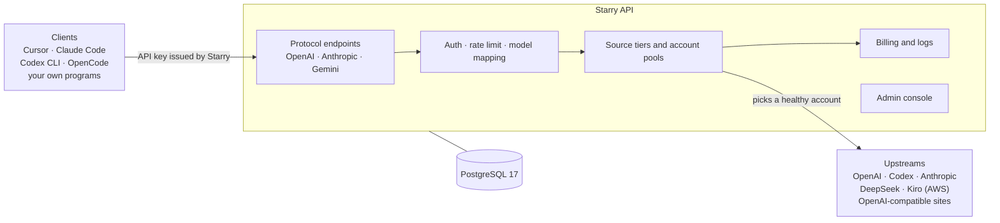
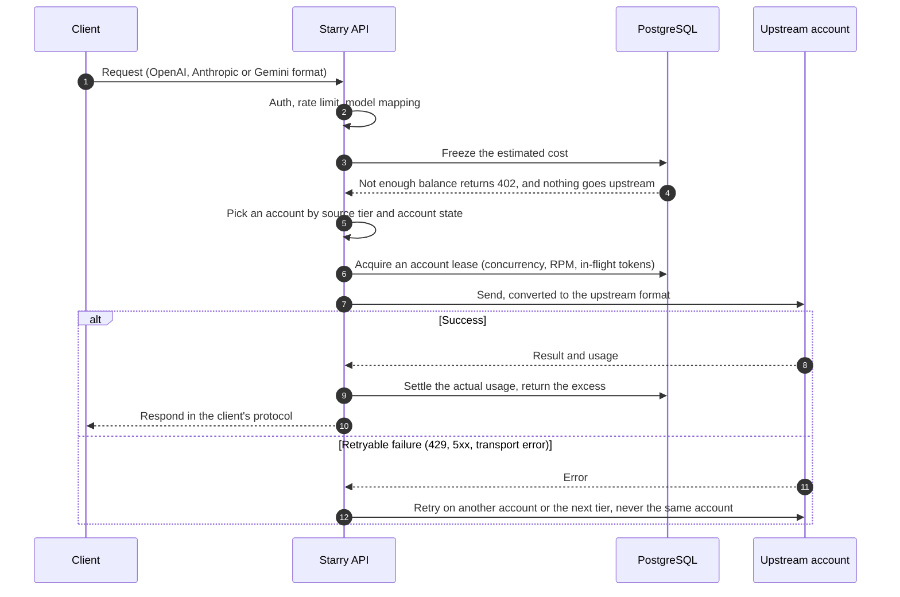
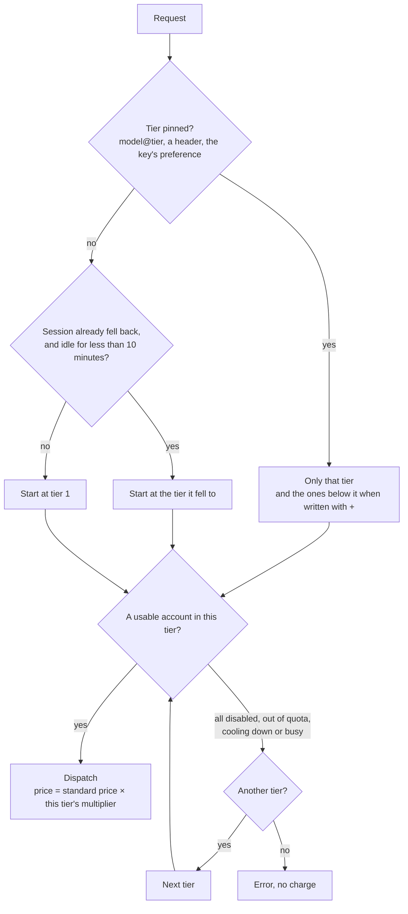
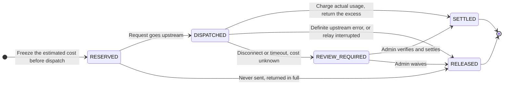

<div align="center">


# Starry API

**A self-hosted LLM API gateway and management console**

<p>
  <strong>English</strong> |
  <a href="./README.zh-CN.md">简体中文</a>
</p>

<p>
  <a href="LICENSE"></a>
  <a href="https://github.com/StaR4y/starry-api/releases/latest"></a>
  <a href="https://github.com/StaR4y/starry-api/pkgs/container/starry-api"></a>
</p>

<p>
  <a href="#quick-start">Quick start</a> •
  <a href="#features">Features</a> •
  <a href="#how-it-works">How it works</a> •
  <a href="#deployment">Deployment</a> •
  <a href="#documentation">Documentation</a> •
  <a href="#license">License</a>
</p>

</div>

---

## Overview

Starry API combines your upstream model accounts (OpenAI, Anthropic, DeepSeek, Kiro and others) behind one endpoint. It speaks the OpenAI, Anthropic and Gemini protocols, and comes with account pool scheduling, API keys, billing, logs and an admin console.

| Your situation | What Starry API does |
| --- | --- |
| You have several upstream accounts or keys to manage | Account pools: rotation, rate protection, failover, health checks |
| A team or friends share them, and the upstream keys must stay private | Each person gets their own API key with a credit limit, and you can disable it at any time |
| Clients differ (Cursor, Claude Code, Codex CLI, OpenCode and others) | OpenAI, Anthropic and Gemini protocols side by side, plus generated configuration for each client |
| You charge by usage or reconcile your own costs | Vendor list price billing, balances and top-ups, redemption codes, Coding Plan subscriptions, full request logs |
| You want to see where the money goes and which account has a problem | Dashboard, request logs, account state and allocation policies |


## Quick start

On a Linux server:

```bash
curl -fsSL https://raw.githubusercontent.com/StaR4y/starry-api/main/scripts/install.sh | sudo bash
```

The script installs Docker if it is missing, generates the database passwords, starts the service and waits for its health check. Then open `http://your-server:18080/#/login` and sign in as `admin`. The initial password is shown by:

```bash
sudo starry-api info
```

The first sign-in asks for a new password. Add an upstream account and create an API key in the console, then send a first request:

```bash
curl -X POST http://your-server:18080/v1/chat/completions \
  -H 'Content-Type: application/json' \
  -H "Authorization: Bearer sk-your-key" \
  -d '{"model": "deepseek-chat", "messages": [{"role": "user", "content": "Hello"}], "max_tokens": 256}'
```

Use a model your account can serve. The [quick start guide](docs/QUICKSTART.md) walks through every step with screenshots (in Chinese).

## Features

### Protocols and endpoints

| Protocol | Endpoint |
| --- | --- |
| OpenAI Chat Completions | `POST /v1/chat/completions` |
| OpenAI Responses | `POST /v1/responses` |
| Anthropic Messages | `POST /v1/messages` |
| Gemini | `POST /v1beta/models/{model}:generateContent` |
| Model list | `GET /v1/models` |

### Gateway and management

- **Upstream accounts**: Kiro, OpenAI API keys, ChatGPT browser authorization (Codex), manual Codex tokens, DeepSeek, Anthropic API keys and any OpenAI-compatible site.
- **Account pools**: per-vendor isolation, warm-up stages, concurrency and RPM protection, retries and cooldowns, and an optional experimental tiered circuit breaker.
- **Source tiers**: per-vendor tiers with a price multiplier each, priced by the tier that actually served the request; clients can pin one with `model@tier` or a header.
- **API keys and billing**: per-user keys bound to a vendor, credit limits, balance or Coding Plan billing, and a built-in vendor list price catalog (from the community-maintained `model-price-repo`, not a vendor API) that verifies and refreshes itself.
- **Admin console**: dashboard, request logs, users, redemption codes, online top-ups, tickets, user documentation, model catalog and price multipliers, appearance settings, in Chinese and English.
- **Data safety**: Root-only data management (backup, export, restore), with a second verification for dangerous actions.
- **Plugins**: a full-trust plugin mechanism, see [plugin development](docs/PLUGINS.md).

Built with Java 25, Spring Boot 4 (WebFlux, Jackson 3), R2DBC, PostgreSQL 17, Flyway and Vue 3; the console is embedded in the same jar.

## How it works



### The path of a request



The [architecture document](docs/ARCHITECTURE.md#账号池行为) covers admission, cooldowns, warm-up and the failure table.

### Source tiers

The accounts of a vendor are grouped into ordered tiers (for example official keys first, Kiro second), and each tier has its own price multiplier.



Users pay only for the tier that served them. An OpenAI-format relay can also be registered as a tier of another vendor. See [source tiers and relays](docs/SOURCE_TIERS.md).

### Billing



Settlement writes an event with an idempotency key, so a request is charged once. While a request of unknown cost is under review its frozen amount stays, and that user's new requests get `409 BILLING_REVIEW_REQUIRED` until an admin resolves it. See the [API reference](docs/API.md).

## Deployment

All three ways use the same image (`ghcr.io/star4y/starry-api`) and the same Compose file. The [deployment guide](docs/DEPLOYMENT.md) has the details.

### One-command install (Linux server)

```bash
curl -fsSL https://raw.githubusercontent.com/StaR4y/starry-api/main/scripts/install.sh | sudo bash
```

It installs to `/opt/starry-api` on port `18080`. Run the same command again to upgrade: `.env` and `data/` stay as they are, and a version that does not start is rolled back automatically. `sudo starry-api info` shows the console address and the initial password, and `sudo starry-api reset-password` sets a new one.

### Docker Compose (Docker already installed)

```bash
git clone --depth 1 https://github.com/StaR4y/starry-api.git
cd starry-api
./scripts/docker-up.sh
```

The first run creates `.env` with random database passwords, then runs `docker compose up -d`. It works on macOS, Windows (WSL) and Linux, without root. `./scripts/starry-api.sh info` shows the initial password.

### Build from source

```bash
./scripts/docker-up.sh --build
```

The image builds inside Docker, so the machine needs neither Java nor Node.js. To run without Docker (Java 25 and PostgreSQL 17 required), see the [operations manual](docs/OPERATIONS.md#启动服务).

### Storage and configuration

- **Data**: everything the service keeps is in `data/` next to the Compose file: the PostgreSQL files, backups, the data-management security files, plugins, documentation attachments and the model price and ranking caches. Keep it together with `.env`.
- **Settings**: `.env` holds the database passwords and the deployment settings; most of the rest is changed in the console. Every variable is listed in the [configuration reference](docs/CONFIGURATION.md).
- **Production**: put the service behind an HTTPS reverse proxy and firewall port `18080`, see [configure a reverse proxy](docs/DEPLOYMENT.md#2-配置反向代理启用-https).

## Development

```text
service-api/   API contracts and shared DTOs
plugin-api/    plugin SDK
service/       Spring Boot service: admin API, account pools, proxying, billing, statistics
  └─ platform/ protocol adapters per vendor (openai / anthropic / gemini / deepseek / kiro)
webui/         Vue 3 admin console (built into the service jar)
docker/        PostgreSQL init script, Mihomo entrypoint, TLS bridge
scripts/       install, start and recovery scripts with their tests
docs/          documentation (screenshots in docs/images)
```

```bash
./gradlew test                     # backend tests (the PostgreSQL ones need Docker)
npm --prefix webui run build       # build the console
./gradlew :service:bootJar         # build the complete jar with the console
```

The repository has no CI, so run the tests before you open a pull request or tag a release. [CONTRIBUTING.md](CONTRIBUTING.md) has the requirements and the checks to run.

## Documentation

The documentation is written in Chinese; the console has both languages.

| I want to | Read |
| --- | --- |
| Deploy, upgrade or roll back | [Deployment guide](docs/DEPLOYMENT.md) |
| Go from nothing to a first request | [Quick start](docs/QUICKSTART.md) |
| Learn each page of the console | [Console guide](docs/CONSOLE_GUIDE.md) |
| Look up a setting or environment variable | [Configuration](docs/CONFIGURATION.md) |
| Import accounts, back up and restore, keep logs | [Operations manual](docs/OPERATIONS.md) |
| Configure source tiers and cross-protocol relays | [Source tiers](docs/SOURCE_TIERS.md) |
| Call the API or write an integration | [API reference](docs/API.md) |
| Track down an error | [Troubleshooting](docs/TROUBLESHOOTING.md) |
| Understand the design | [Architecture](docs/ARCHITECTURE.md) · [Package guide](docs/PACKAGE_GUIDE.md) |
| Write a plugin | [Plugin development](docs/PLUGINS.md) |
| See everything | [Documentation index](docs/README.md) |

## Current limits

- Ordinary OpenAI / GPT requests use official OpenAI API key accounts by default (Base URL `api.openai.com`); Codex accounts are kept apart unless an admin explicitly mixes them.
- DeepSeek requests use DeepSeek accounts only and never fall back to another vendor.
- Anthropic Messages requests prefer native Anthropic API key accounts and fall back to compatible Kiro accounts.
- Gemini is an inbound compatibility protocol for now: built-in Gemini aliases run on Kiro target models, and direct Google API keys and `streamGenerateContent` are not supported yet.
- `stream=true` currently sends SSE after the upstream has finished, not chunk by chunk.
- Image, document and file conversion is only partly supported, and distributed rate limiting is not implemented.

## Disclaimer

Starry API is an independent open-source project. It is not affiliated with, endorsed by or sponsored by Anthropic, OpenAI, Google, Amazon Web Services, DeepSeek or any other provider. Claude, Claude Code, ChatGPT, Codex, OpenAI, Gemini, Kiro, Amazon Q, CodeWhisperer, DeepSeek and related names and logos belong to their owners and are used only to identify services this software can connect to. You are responsible for complying with the terms of every provider and account you connect, including rules on account sharing, resale, automated access and supported regions. Some configurations this software makes possible may be prohibited by those terms. The software is provided as is, and providers may suspend accounts used with it.

## Security

Please do not open a public issue for a vulnerability. Use GitHub's private reporting (**Security → Report a vulnerability** on the repository page). [SECURITY.md](SECURITY.md) lists supported versions, scope and the trust model of plugins.

## Contributing

Issues and pull requests are welcome. Please read [CONTRIBUTING.md](CONTRIBUTING.md) and the [code of conduct](CODE_OF_CONDUCT.md) first. Contributions are licensed under AGPL-3.0-only together with the additional permission for plugins in section 2 of [NOTICE](NOTICE) (Apache-2.0 for changes to `plugin-api/`).

## License

Starry API is released under the **GNU Affero General Public License, version 3 only (SPDX: `AGPL-3.0-only`)**; the full text is in [LICENSE](LICENSE). [NOTICE](NOTICE) covers the license elections for dependencies, where their sources and license texts are, data credits, trademarks and the optional Mihomo component. The console build writes `THIRD-PARTY-NOTICES.txt` for its npm dependencies (ending with logback's copyright notice and its LGPL-2.1-only election), and the jar carries `META-INF/JAVA-THIRD-PARTY-NOTICES.txt` for the Java ones.

- **Source for network users (AGPL section 13)**: the console does not link to the source on its pages. It shows the source address only to the Root of a new deployment, once, in the "License Terms and Disclaimer" dialog (set by `STARRY_SOURCE_URL`, default `https://github.com/StaR4y/starry-api`). **If you modify the code and let others use it over a network, you must offer them your modified source yourself.**
- **Plugin SDK**: [`plugin-api/`](plugin-api/) is under the [Apache License 2.0](plugin-api/LICENSE), and section 2 of [NOTICE](NOTICE) adds this permission under AGPL section 7:

  > Additional permission under section 7 of the GNU Affero General Public License, version 3: a plugin that interacts with Starry API only through the interfaces of the plugin-api module (including the HTTP calls it makes through PluginContext.request), and that contains no other part of Starry API, is an independent work and is not a covered work under the license of Starry API. You may license, convey and use such a plugin under terms of your choice, including proprietary terms, together with an unmodified or modified Starry API. This permission does not extend to a plugin that copies, links against or otherwise builds on any part of Starry API other than plugin-api, and it does not extend to the browser script of a web widget plugin (the script that widget.json declares and the console loads from /plugin-assets), which runs inside the console page and uses the console's own hooks, not the interfaces of plugin-api. If you modify Starry API, you may extend this permission to your version, but you are not obliged to; if you do not wish to, delete this paragraph from your version.

- **Names and logos**: "Starry", "Starry API" and the Starry logo are outside the license grant (AGPL section 7(e)). Third-party names and logos belong to their owners, see the disclaimer.
- **Mihomo**: the optional egress component Mihomo is GPL-3.0, a separate container image pulled from its registry at deployment, and **not distributed by this project**.
