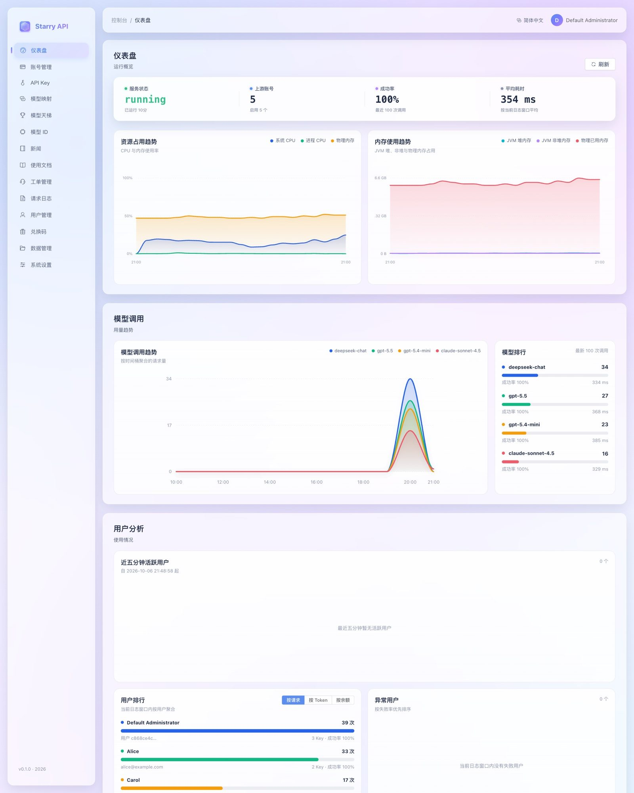

<p align="center">
  
</p>

# Starry API

**一个自托管的大模型 API 网关与管理控制台。** 把你手里的各种上游模型账号（OpenAI、Anthropic、DeepSeek、Kiro 等）汇总成一个统一入口，对外提供 OpenAI、Anthropic、Gemini 三种兼容协议，并配有完整的账号池调度、API Key、计费、日志和后台管理界面。



## 它解决什么问题

| 你的场景 | Starry API 怎么帮你 |
| --- | --- |
| 手里有多个上游账号 / Key，想统一管理 | 账号池：自动轮询、限流保护、失败切换、健康检查 |
| 想让团队或朋友共用，又不想泄露上游 Key | 给每个人发独立的 **API Key**，设置额度上限，随时停用 |
| 客户端各不相同（Cursor、Claude Code、Codex CLI、OpenCode……） | 同时兼容 OpenAI / Anthropic / Gemini 协议，并能一键生成各客户端的配置 |
| 想按用量收费或自己对账 | 官方价目表计费、余额与充值、兑换码、Coding Plan 订阅、完整请求日志 |
| 想知道钱花在哪、哪个账号出了问题 | 仪表盘、请求日志、账号状态与分配策略一目了然 |

## 工作原理

```text
你的客户端 (Cursor / Claude Code / Codex CLI / 自己的程序)
        │   使用 Starry 发的 API Key，调用 /v1/chat/completions 等接口
        ▼
┌───────────────────────── Starry API ─────────────────────────┐
│  鉴权 → 限流 → 模型映射 → 账号池选择 → 转发 → 计费与日志        │
└───────────────────────────────────────────────────────────────┘
        │   自动挑选一个健康的上游账号
        ▼
OpenAI · Anthropic · DeepSeek · Kiro(AWS) · 其他 OpenAI 兼容站点
```

## 主要功能

- **多协议入口**：`/v1/chat/completions`、`/v1/responses`（OpenAI），`/v1/messages`（Anthropic），`/v1beta/models/{model}:generateContent`（Gemini）。
- **多种上游账号**：Kiro、OpenAI API Key、ChatGPT 浏览器授权（Codex）、手动 Codex Token、DeepSeek、Anthropic API Key，以及任意 OpenAI 兼容站点。
- **智能账号池**：按厂商隔离、预热分级、并发与 RPM 保护、失败重试与冷却，可选实验性的分级熔断。
- **API Key 与计费**：按用户发放、绑定模型厂商、额度上限、余额计费或 Coding Plan 订阅计费；内置官方价格目录并自动校验更新。
- **完整的管理控制台**：仪表盘、请求日志、用户、兑换码、在线充值、工单、使用文档、模型目录与价格倍率、外观定制，中英文界面。
- **数据安全**：Root 专属的「数据管理」（备份 / 导出 / 恢复），所有高危操作要二次验证。
- **可扩展**：全信任的插件机制，示例见 [插件开发](docs/PLUGINS.md)。
- **技术栈**：Java 25、Spring WebFlux、R2DBC、PostgreSQL 17、Flyway、Vue 3，控制台内嵌在同一个 jar 里。

## 5 分钟快速开始

选一种方式，把服务跑起来：

| 方式 | 适合谁 | 文档 |
| --- | --- | --- |
| **服务器一键安装** | 有一台 Linux 服务器，想要最省事的生产部署 | [服务器一键安装](docs/INSTALL_SERVER.md) |
| **1Panel / Docker Compose** | 习惯用 1Panel 面板，或想从源码构建镜像 | [1Panel 部署](docs/1PANEL_DEPLOY.md) |
| **本机源码运行** | 想在自己电脑上试用或开发 | 往下看 ↓ |

### 本机源码运行

需要：Java 25、PostgreSQL 17、Node.js（构建控制台）。

**① 准备数据库**（只需一次，`POSTGRES_USER` 填本机 PostgreSQL 的超级用户）：

```bash
export POSTGRES_USER=postgres
export POSTGRES_DB=starry_api
export STARRY_POSTGRES_MIGRATION_PASSWORD='换成一个强密码-迁移用'
export STARRY_POSTGRES_APP_PASSWORD='换成另一个强密码-应用用'

createdb --username "$POSTGRES_USER" --encoding=UTF8 "$POSTGRES_DB"
./docker/postgresql/init/001-starry-api-roles.sh
```

**② 启动服务**：

```bash
export POSTGRES_HOST=localhost
export POSTGRES_PORT=5432
export POSTGRES_DATABASE=starry_api
export POSTGRES_USERNAME=starry_api
export POSTGRES_PASSWORD="$STARRY_POSTGRES_APP_PASSWORD"
export POSTGRES_MIGRATION_USERNAME=starry_api_migration
export POSTGRES_MIGRATION_PASSWORD="$STARRY_POSTGRES_MIGRATION_PASSWORD"

./scripts/start-proxy.sh
```

**③ 确认服务正常**：

```bash
curl http://127.0.0.1:8080/health
```

**④ 登录控制台**：打开 <http://127.0.0.1:8080/#/login>，用户名 `admin`，密码是**首次启动时日志里打印的那一次**随机密码。第一次登录会强制你改密码。


接下来按 [快速开始指南](docs/QUICKSTART.md) 一步步添加上游账号、创建 API Key，并发出第一个请求。

## 文档导航

| 我想…… | 看这里 |
| --- | --- |
| 从零到发出第一个请求 | [快速开始指南](docs/QUICKSTART.md) |
| 了解控制台每个页面怎么用 | [控制台使用手册](docs/CONSOLE_GUIDE.md) |
| 部署到服务器 | [一键安装](docs/INSTALL_SERVER.md) · [1Panel](docs/1PANEL_DEPLOY.md) · [预构建产物](docs/PREBUILT_ARTIFACTS.md) |
| 查某个配置项 / 环境变量 | [配置参考](docs/CONFIGURATION.md) |
| 日常运维：导入账号、备份恢复、日志保留 | [运维手册](docs/OPERATIONS.md) |
| 调用接口 / 写集成 | [API 参考](docs/API.md) |
| 遇到报错 | [故障排查](docs/TROUBLESHOOTING.md) |
| 了解内部设计 | [架构说明](docs/ARCHITECTURE.md) · [包结构与扩展](docs/PACKAGE_GUIDE.md) |
| 开发插件 | [插件开发](docs/PLUGINS.md) |
| 完整目录 | [文档索引](docs/README.md) |

## 项目结构

```text
service-api/   接口契约与共享 DTO
plugin-api/    插件 SDK
service/       Spring Boot 服务：管理接口、账号池、代理转发、计费、统计
  └─ platform/ 各厂商协议适配（openai / anthropic / gemini / deepseek / kiro）
webui/         Vue 3 管理控制台（构建后嵌入 service 的 jar）
docker/        PostgreSQL 初始化脚本
scripts/       启动、部署、发布、恢复脚本
docs/          文档（含 docs/images 截图）
```

## 开发与验证

```bash
./gradlew test                     # 后端测试
npm --prefix webui run build       # 构建控制台
./gradlew :service:bootJar         # 打包完整 jar（含控制台）
```

发布可部署产物的流程见 [预构建产物](docs/PREBUILT_ARTIFACTS.md)。

## 当前能力边界

使用前请了解这些限制，免得踩坑：

- 普通 OpenAI / GPT 请求默认只走**官方 OpenAI API Key** 账号（Base URL 为 `api.openai.com`）；Codex 账号默认与之隔离，需要管理员显式开启才会混用。
- DeepSeek 请求只会走 DeepSeek 账号，不会回退到别的厂商。
- Anthropic Messages 请求优先使用原生 Anthropic API Key 账号，不可用时回退到兼容的 Kiro 账号。
- Gemini 目前是**入站兼容协议**：内置 Gemini 别名通过 Kiro 目标模型执行；还不支持直连 Google API Key 和 `streamGenerateContent`。
- `stream=true` 目前在上游完成后再以 SSE 输出，还不是真正的逐块透传。
- 图片 / 文档 / 文件转换仅部分支持；尚未实现分布式限流。
