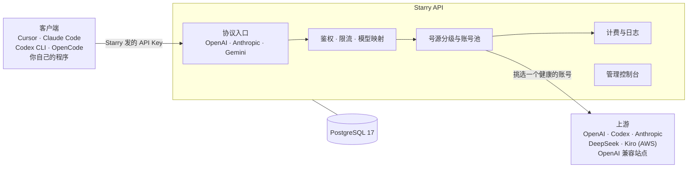
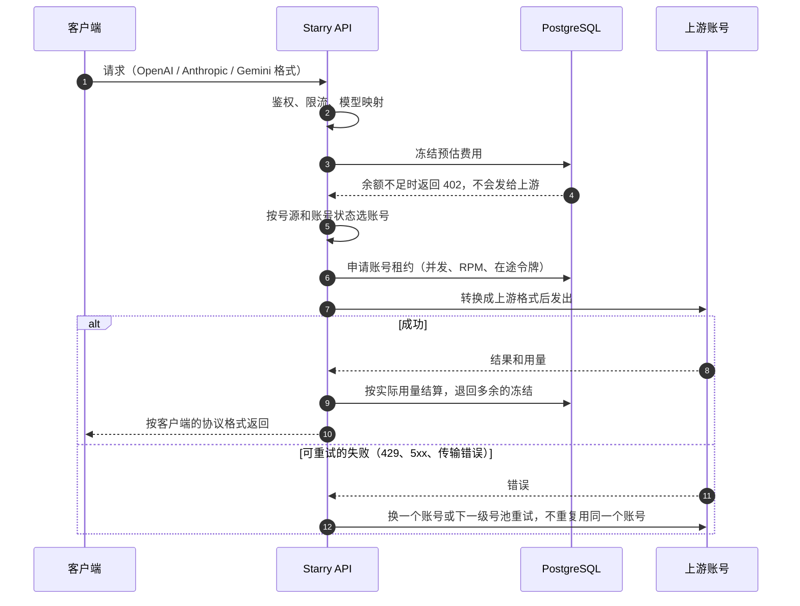
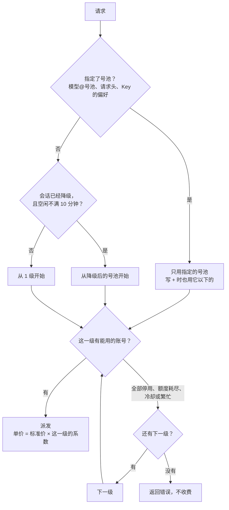
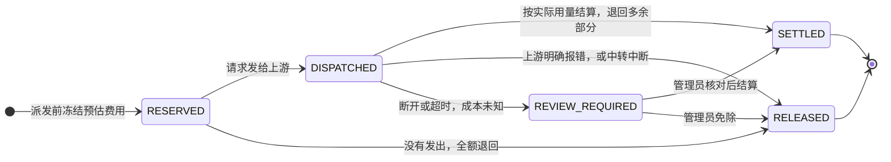
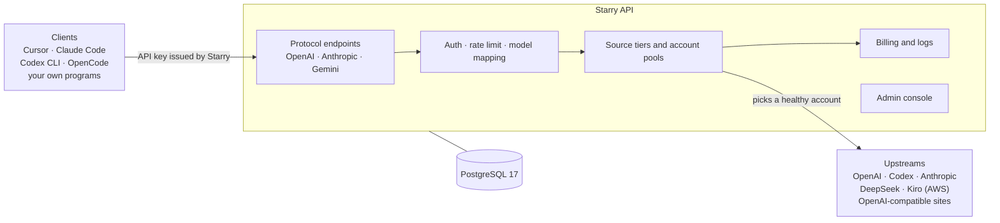
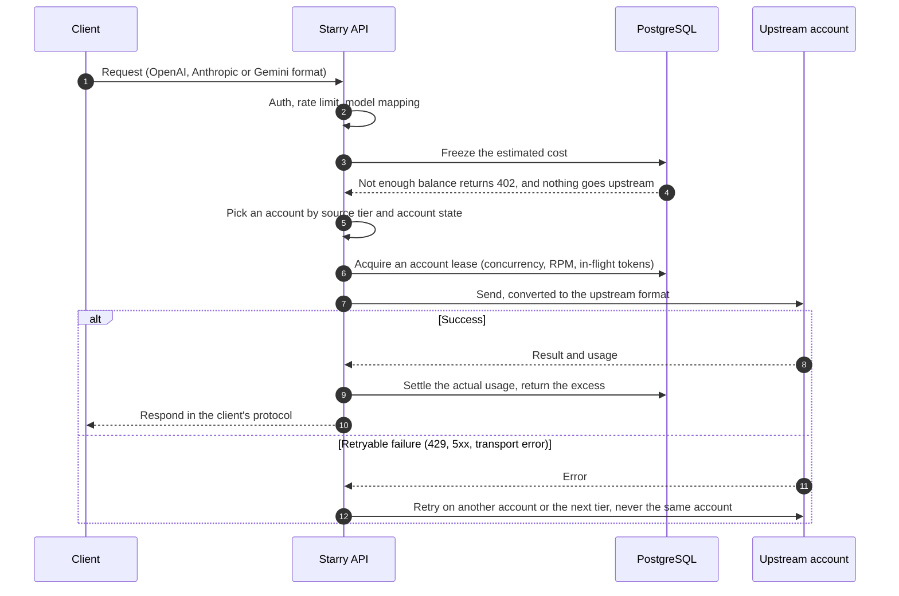
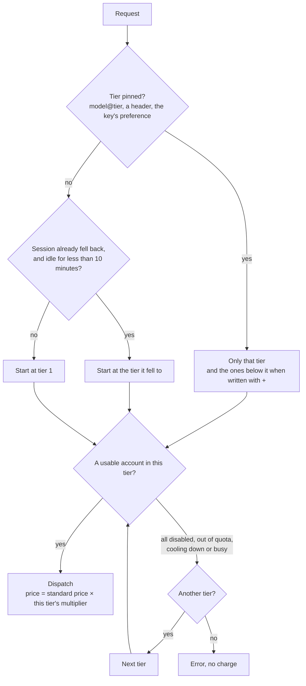
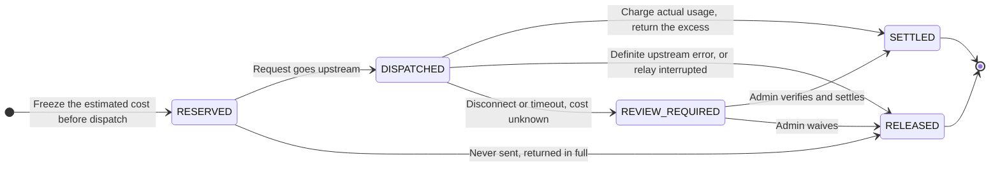

<p align="center">
  
</p>

# Starry API

[](LICENSE)

**简体中文** · [English](#english)

自托管的大模型 API 网关和管理控制台。它把各种上游模型账号（OpenAI、Anthropic、DeepSeek、Kiro 等）汇总成一个入口，对外提供 OpenAI、Anthropic、Gemini 三种兼容协议，并带账号池调度、API Key、计费、日志和后台管理界面。


## 它解决什么问题

| 你的场景 | Starry API 怎么做 |
| --- | --- |
| 手里有多个上游账号或 Key，想统一管理 | 账号池：自动轮询、限流保护、失败切换、健康检查 |
| 想让团队或朋友共用，又不想泄露上游 Key | 给每个人发独立的 API Key，设置额度上限，随时停用 |
| 客户端各不相同（Cursor、Claude Code、Codex CLI、OpenCode 等） | 同时兼容 OpenAI、Anthropic、Gemini 协议，可以一键生成各客户端的配置 |
| 想按用量收费或自己对账 | 厂商标价计费、余额与充值、兑换码、Coding Plan 订阅、完整请求日志 |
| 想知道钱花在哪、哪个账号出了问题 | 仪表盘、请求日志、账号状态与分配策略 |



## 部署

三种方式用同一个镜像和同一个 Compose 文件，完整说明见 [部署指南](docs/DEPLOYMENT.md)。

### 一键安装（Linux 服务器）

```bash
curl -fsSL https://raw.githubusercontent.com/StaR4y/starry-api/main/scripts/install.sh | sudo bash
```

脚本会装好缺少的 Docker，生成数据库密码，启动服务并等它通过健康检查。默认安装到 `/opt/starry-api`，端口 `18080`。重新运行同一条命令就是升级：`.env` 和 `data/` 保持不变，新版本起不来时自动退回上一版。

### Docker Compose（已有 Docker）

```bash
git clone --depth 1 https://github.com/StaR4y/starry-api.git
cd starry-api
./scripts/docker-up.sh
```

第一次运行时生成带随机数据库密码的 `.env`，然后执行 `docker compose up -d`。macOS、Windows（WSL）和 Linux 都可以，不需要 root。

### 从源码构建

```bash
./scripts/docker-up.sh --build
```

镜像在 Docker 里构建，本机不需要 Java 和 Node.js。不用 Docker 的运行方式（需要 Java 25 和 PostgreSQL 17）见 [运维手册](docs/OPERATIONS.md#启动服务)。

### 登录

打开 `http://服务器地址:18080/#/login`，用户名 `admin`。查看初始密码：

```bash
sudo starry-api info              # 一键安装
./scripts/starry-api.sh info      # 克隆仓库部署
```

第一次登录会强制改密码。忘了密码用 `reset-password` 重置。之后按 [快速开始指南](docs/QUICKSTART.md) 添加上游账号、创建 API Key，发出第一个请求。

生产环境请放在 HTTPS 反向代理后面，并用防火墙限制 `18080` 端口，见 [配置反向代理](docs/DEPLOYMENT.md#2-配置反向代理启用-https)。

## 关键机制

### 一个请求怎么走



账号池的细节（准入、冷却、预热、失败处理表）见 [架构说明](docs/ARCHITECTURE.md#账号池行为)。

### 号源分级

把一个厂商的账号分成有序的号池（例如官方 Key 一级、Kiro 二级），每级有自己的价格系数。



用户只为实际服务自己的号池付费。OpenAI 格式的中转站也可以登记成别的厂商的一级。见 [号源分级与跨协议中转](docs/SOURCE_TIERS.md)。

### 计费



结算写入带幂等键的事件，同一个请求只扣一次。成本未知的请求进入复核时冻结不退，该用户的新请求返回 `409 BILLING_REVIEW_REQUIRED`，直到管理员处理。见 [API 参考](docs/API.md)。

## 主要功能

- **多协议入口**：`/v1/chat/completions`、`/v1/responses`（OpenAI），`/v1/messages`（Anthropic），`/v1beta/models/{model}:generateContent`（Gemini）。
- **多种上游账号**：Kiro、OpenAI API Key、ChatGPT 浏览器授权（Codex）、手动 Codex Token、DeepSeek、Anthropic API Key，以及任意 OpenAI 兼容站点。
- **账号池**：按厂商隔离、预热分级、并发与 RPM 保护、失败重试与冷却，可选实验性的分级熔断。
- **号源分级**：按厂商分号池，每级一个价格系数，按实际服务请求的号池计价；客户端可以用 `模型@号池` 或请求头指定。
- **API Key 与计费**：按用户发放、绑定模型厂商、额度上限、余额计费或 Coding Plan 订阅计费；内置厂商标价目录（来自社区维护的 `model-price-repo`，不是厂商的接口）并自动校验更新。
- **管理控制台**：仪表盘、请求日志、用户、兑换码、在线充值、工单、使用文档、模型目录与价格倍率、外观定制，中英文界面。
- **数据安全**：Root 专属的数据管理（备份、导出、恢复），高危操作要二次验证。
- **插件**：全信任的插件机制，见 [插件开发](docs/PLUGINS.md)。
- **技术栈**：Java 25、Spring Boot 4（WebFlux、Jackson 3）、R2DBC、PostgreSQL 17、Flyway、Vue 3，控制台内嵌在同一个 jar 里。

## 文档

| 我想 | 看这里 |
| --- | --- |
| 把服务部署起来，升级或回滚 | [部署指南](docs/DEPLOYMENT.md) |
| 从零到发出第一个请求 | [快速开始指南](docs/QUICKSTART.md) |
| 了解控制台每个页面 | [控制台使用手册](docs/CONSOLE_GUIDE.md) |
| 查配置项和环境变量 | [配置参考](docs/CONFIGURATION.md) |
| 导入账号、备份恢复、日志保留 | [运维手册](docs/OPERATIONS.md) |
| 配置号池和跨协议中转 | [号源分级与跨协议中转](docs/SOURCE_TIERS.md) |
| 调用接口、写集成 | [API 参考](docs/API.md) |
| 排查报错 | [故障排查](docs/TROUBLESHOOTING.md) |
| 了解内部设计 | [架构说明](docs/ARCHITECTURE.md) · [包结构与扩展](docs/PACKAGE_GUIDE.md) |
| 开发插件 | [插件开发](docs/PLUGINS.md) |
| 完整目录 | [文档索引](docs/README.md) |

## 项目结构

```text
service-api/   接口契约与共享 DTO
plugin-api/    插件 SDK
service/       Spring Boot 服务：管理接口、账号池、代理转发、计费、统计
  └─ platform/ 各厂商协议适配（openai / anthropic / gemini / deepseek / kiro）
webui/         Vue 3 管理控制台（构建后嵌入 service 的 jar）
docker/        PostgreSQL 初始化脚本、Mihomo 启动脚本、TLS bridge
scripts/       安装、启动、恢复脚本和它们的测试
docs/          文档（含 docs/images 截图）
```

```bash
./gradlew test                     # 后端测试（PostgreSQL 测试需要 Docker）
npm --prefix webui run build       # 构建控制台
./gradlew :service:bootJar         # 打包完整 jar（含控制台）
```

## 当前能力边界

- 普通 OpenAI / GPT 请求默认只走官方 OpenAI API Key 账号（Base URL 为 `api.openai.com`）；Codex 账号默认与之隔离，需要管理员显式开启才会混用。
- DeepSeek 请求只会走 DeepSeek 账号，不会回退到别的厂商。
- Anthropic Messages 请求优先使用原生 Anthropic API Key 账号，不可用时回退到兼容的 Kiro 账号。
- Gemini 目前是入站兼容协议：内置 Gemini 别名通过 Kiro 目标模型执行；还不支持直连 Google API Key 和 `streamGenerateContent`。
- `stream=true` 目前在上游完成后再以 SSE 输出，还不是真正的逐块透传。
- 图片、文档、文件转换仅部分支持；尚未实现分布式限流。

## 免责声明

Starry API 是独立的开源项目，与 Anthropic、OpenAI、Google、Amazon Web Services、DeepSeek 等任何厂商均无隶属、合作或背书关系。Claude、Claude Code、ChatGPT、Codex、OpenAI、Gemini、Kiro、Amazon Q、CodeWhisperer、DeepSeek 等名称和标识归各自权利人所有，本项目仅用于说明可连接的服务。你需要自行确保接入的每个厂商和账号都符合其条款，包括账号共享、转售、自动化访问和支持地区的规定。本软件能实现的某些配置可能被这些条款禁止。软件按现状提供，厂商可能限制或停用使用它的账号。

## 安全

发现安全漏洞时，请不要开公开的 issue，而是用 GitHub 的私密漏洞报告（仓库页面 **Security → Report a vulnerability**）。支持的版本、受理范围和插件的信任模型见 [SECURITY.md](SECURITY.md)。

## 参与贡献

欢迎提 issue 和 Pull Request。动手之前请先读 [CONTRIBUTING.md](CONTRIBUTING.md)（环境要求、测试方式、提交规范）和 [行为准则](CODE_OF_CONDUCT.md)。你提交的代码按 AGPL-3.0-only 授权，并附带 [NOTICE](NOTICE) 第 2 节的插件附加许可（见下面的「许可证」一节；`plugin-api/` 的改动按 Apache-2.0）。

## 许可证

Starry API 以 **GNU Affero 通用公共许可证第 3 版（仅此版本，SPDX：`AGPL-3.0-only`）** 发布，全文见 [LICENSE](LICENSE)。依赖库的许可证选择、源码和许可证文本在哪里、数据来源、商标声明和可选组件 Mihomo 的说明见 [NOTICE](NOTICE)；控制台构建时还会生成 `THIRD-PARTY-NOTICES.txt`（npm 依赖，末尾附 logback 的版权声明和 LGPL-2.1-only 说明，随控制台一起提供，页脚的「第三方许可」链接指向它），Java 依赖的清单是构建生成的 `JAVA-THIRD-PARTY-NOTICES.txt`（在 jar 的 `META-INF/` 里）。

- **向网络用户提供源码（AGPL 第 13 条）**：控制台不再在页面上放「源代码」链接，只在新部署首次初始化后，在 Root 需要确认的「许可条款与免责声明」里显示一次源码地址（由环境变量 `STARRY_SOURCE_URL` 设置，默认 `https://github.com/StaR4y/starry-api`）。**如果你修改了代码并让别人通过网络使用它，要自己向这些用户提供修改后的源码。**见 [配置参考](docs/CONFIGURATION.md#源代码与许可证)。
- **插件 SDK**：[`plugin-api/`](plugin-api/) 使用 [Apache License 2.0](plugin-api/LICENSE)。同时，在 AGPL-3.0 第 7 条下附加如下许可（原文为英文，以 [NOTICE](NOTICE) 第 2 节为准）：只通过 `plugin-api` 与 Starry API 交互、且不含 Starry API 其他部分的插件，是独立作品，可以按你选择的条款（包括闭源）授权和使用。这项许可不覆盖前端挂件插件的浏览器脚本（`widget.json` 声明、由控制台从 `/plugin-assets` 加载的脚本）：它运行在控制台页面里，用的是控制台自己的钩子，不是 `plugin-api` 的接口。

  > Additional permission under section 7 of the GNU Affero General Public License, version 3: a plugin that interacts with Starry API only through the interfaces of the plugin-api module (including the HTTP calls it makes through PluginContext.request), and that contains no other part of Starry API, is an independent work and is not a covered work under the license of Starry API. You may license, convey and use such a plugin under terms of your choice, including proprietary terms, together with an unmodified or modified Starry API. This permission does not extend to a plugin that copies, links against or otherwise builds on any part of Starry API other than plugin-api, and it does not extend to the browser script of a web widget plugin (the script that widget.json declares and the console loads from /plugin-assets), which runs inside the console page and uses the console's own hooks, not the interfaces of plugin-api. If you modify Starry API, you may extend this permission to your version, but you are not obliged to; if you do not wish to, delete this paragraph from your version.

- **名称与标识**：「Starry」「Starry API」和 Starry 标识不在软件许可的授权范围内（AGPL-3.0 第 7(e) 条）；第三方的名称和标识归各自权利人所有，见上面的免责声明。
- **Mihomo**：可选的出站代理组件 Mihomo 使用 GPL-3.0，是单独的容器镜像，部署时从镜像仓库拉取，**不随本项目分发**。

---

# English

[简体中文](#starry-api) · **English**

A self-hosted LLM API gateway and management console. It combines your upstream model accounts (OpenAI, Anthropic, DeepSeek, Kiro and others) behind one endpoint, speaks the OpenAI, Anthropic and Gemini protocols, and comes with account pool scheduling, API keys, billing, logs and an admin console.


## What it is for

| Your situation | What Starry API does |
| --- | --- |
| You have several upstream accounts or keys to manage | Account pools: rotation, rate protection, failover, health checks |
| A team or friends share them, and the upstream keys must stay private | Each person gets their own API key with a credit limit, and you can disable it at any time |
| Clients differ (Cursor, Claude Code, Codex CLI, OpenCode and others) | OpenAI, Anthropic and Gemini protocols side by side, plus generated configuration for each client |
| You charge by usage or reconcile your own costs | Vendor list price billing, balances and top-ups, redemption codes, Coding Plan subscriptions, full request logs |
| You want to see where the money goes and which account has a problem | Dashboard, request logs, account state and allocation policies |



## Deployment

All three ways use the same image and the same Compose file. The [deployment guide](docs/DEPLOYMENT.md) has the details (in Chinese).

### One-click install (Linux server)

```bash
curl -fsSL https://raw.githubusercontent.com/StaR4y/starry-api/main/scripts/install.sh | sudo bash
```

The script installs Docker if it is missing, generates the database passwords, starts the service and waits for its health check. It installs to `/opt/starry-api` on port `18080`. Run the same command again to upgrade: `.env` and `data/` stay as they are, and a version that does not start is rolled back automatically.

### Docker Compose (Docker already installed)

```bash
git clone --depth 1 https://github.com/StaR4y/starry-api.git
cd starry-api
./scripts/docker-up.sh
```

The first run creates `.env` with random database passwords, then runs `docker compose up -d`. It works on macOS, Windows (WSL) and Linux, without root.

### Build from source

```bash
./scripts/docker-up.sh --build
```

The image builds inside Docker, so the machine needs neither Java nor Node.js. To run without Docker (Java 25 and PostgreSQL 17 required), see the [operations manual](docs/OPERATIONS.md#启动服务).

### Sign in

Open `http://your-server:18080/#/login`, user name `admin`. To see the initial password:

```bash
sudo starry-api info              # one-click install
./scripts/starry-api.sh info      # deployed from a clone
```

The first sign-in forces a password change. `reset-password` resets a forgotten one. Then follow the [quick start](docs/QUICKSTART.md) to add an upstream account, create an API key and send your first request.

In production, put it behind an HTTPS reverse proxy and firewall port `18080`.

## Key mechanisms

### The path of a request



The [architecture document](docs/ARCHITECTURE.md#账号池行为) covers admission, cooldowns, warm-up and the failure table.

### Source tiers

The accounts of a vendor are grouped into ordered tiers (for example official keys first, Kiro second), and each tier has its own price multiplier.



Users pay only for the tier that served them. An OpenAI-format relay can also be registered as a tier of another vendor. See [source tiers and relays](docs/SOURCE_TIERS.md).

### Billing



Settlement writes an event with an idempotency key, so a request is charged once. While a request of unknown cost is under review its frozen amount stays, and that user's new requests get `409 BILLING_REVIEW_REQUIRED` until an admin resolves it. See the [API reference](docs/API.md).

## Features

- **Protocol endpoints**: `/v1/chat/completions` and `/v1/responses` (OpenAI), `/v1/messages` (Anthropic), `/v1beta/models/{model}:generateContent` (Gemini).
- **Upstream accounts**: Kiro, OpenAI API keys, ChatGPT browser authorization (Codex), manual Codex tokens, DeepSeek, Anthropic API keys and any OpenAI-compatible site.
- **Account pools**: per-vendor isolation, warm-up stages, concurrency and RPM protection, retries and cooldowns, and an optional experimental tiered circuit breaker.
- **Source tiers**: per-vendor tiers with a price multiplier each, priced by the tier that actually served the request; clients can pin one with `model@tier` or a header.
- **API keys and billing**: per-user keys bound to a vendor, credit limits, balance or Coding Plan billing, and a built-in vendor list price catalog (from the community-maintained `model-price-repo`, not a vendor API) that verifies and refreshes itself.
- **Admin console**: dashboard, request logs, users, redemption codes, online top-ups, tickets, user documentation, model catalog and price multipliers, appearance settings, in Chinese and English.
- **Data safety**: Root-only data management (backup, export, restore), with a second verification for dangerous actions.
- **Plugins**: a full-trust plugin mechanism, see [plugin development](docs/PLUGINS.md).
- **Stack**: Java 25, Spring Boot 4 (WebFlux, Jackson 3), R2DBC, PostgreSQL 17, Flyway, Vue 3, with the console embedded in one jar.

## Documentation

The documentation is written in Chinese, and the console has both languages.

| I want to | Read |
| --- | --- |
| Deploy, upgrade or roll back | [Deployment guide](docs/DEPLOYMENT.md) |
| Go from nothing to a first request | [Quick start](docs/QUICKSTART.md) |
| Learn each page of the console | [Console guide](docs/CONSOLE_GUIDE.md) |
| Look up a setting or environment variable | [Configuration](docs/CONFIGURATION.md) |
| Import accounts, back up and restore, keep logs | [Operations manual](docs/OPERATIONS.md) |
| Configure source tiers and cross-protocol relays | [Source tiers](docs/SOURCE_TIERS.md) |
| Call the API or write an integration | [API reference](docs/API.md) |
| Track down an error | [Troubleshooting](docs/TROUBLESHOOTING.md) |
| Understand the design | [Architecture](docs/ARCHITECTURE.md) · [Package guide](docs/PACKAGE_GUIDE.md) |
| Write a plugin | [Plugin development](docs/PLUGINS.md) |
| See everything | [Documentation index](docs/README.md) |

## Project layout

```text
service-api/   API contracts and shared DTOs
plugin-api/    plugin SDK
service/       Spring Boot service: admin API, account pools, proxying, billing, statistics
  └─ platform/ protocol adapters per vendor (openai / anthropic / gemini / deepseek / kiro)
webui/         Vue 3 admin console (built into the service jar)
docker/        PostgreSQL init script, Mihomo entrypoint, TLS bridge
scripts/       install, start and recovery scripts with their tests
docs/          documentation (screenshots in docs/images)
```

```bash
./gradlew test                     # backend tests (the PostgreSQL ones need Docker)
npm --prefix webui run build       # build the console
./gradlew :service:bootJar         # build the complete jar with the console
```

## Current limits

- Ordinary OpenAI / GPT requests use official OpenAI API key accounts by default (Base URL `api.openai.com`); Codex accounts are kept apart unless an admin explicitly mixes them.
- DeepSeek requests use DeepSeek accounts only and never fall back to another vendor.
- Anthropic Messages requests prefer native Anthropic API key accounts and fall back to compatible Kiro accounts.
- Gemini is an inbound compatibility protocol for now: built-in Gemini aliases run on Kiro target models, and direct Google API keys and `streamGenerateContent` are not supported yet.
- `stream=true` currently sends SSE after the upstream has finished, not chunk by chunk.
- Image, document and file conversion is only partly supported, and distributed rate limiting is not implemented.

## Disclaimer

Starry API is an independent open-source project. It is not affiliated with, endorsed by or sponsored by Anthropic, OpenAI, Google, Amazon Web Services, DeepSeek or any other provider. Claude, Claude Code, ChatGPT, Codex, OpenAI, Gemini, Kiro, Amazon Q, CodeWhisperer, DeepSeek and related names and logos belong to their owners and are used only to identify services this software can connect to. You are responsible for complying with the terms of every provider and account you connect, including rules on account sharing, resale, automated access and supported regions. Some configurations this software makes possible may be prohibited by those terms. The software is provided as is, and providers may suspend accounts used with it.

## Security

Please do not open a public issue for a vulnerability. Use GitHub's private reporting (**Security → Report a vulnerability** on the repository page). [SECURITY.md](SECURITY.md) lists supported versions, scope and the trust model of plugins.

## Contributing

Issues and pull requests are welcome. Please read [CONTRIBUTING.md](CONTRIBUTING.md) (requirements, tests, commit conventions) and the [code of conduct](CODE_OF_CONDUCT.md) first. Contributions are licensed under AGPL-3.0-only together with the additional permission for plugins in section 2 of [NOTICE](NOTICE) (Apache-2.0 for changes to `plugin-api/`).

## License

Starry API is released under the **GNU Affero General Public License, version 3 only (SPDX: `AGPL-3.0-only`)**; the full text is in [LICENSE](LICENSE). [NOTICE](NOTICE) covers the license elections for dependencies, where their sources and license texts are, data credits, trademarks and the optional Mihomo component.

- **Source for network users (AGPL section 13)**: the console no longer links to the source on its pages. It shows the source address only to the Root of a new deployment, once, in the "License Terms and Disclaimer" dialog (set by `STARRY_SOURCE_URL`, default `https://github.com/StaR4y/starry-api`). **If you modify the code and let others use it over a network, you must offer them your modified source yourself.**
- **Plugin SDK**: [`plugin-api/`](plugin-api/) is under the [Apache License 2.0](plugin-api/LICENSE), and section 2 of [NOTICE](NOTICE) adds a permission under AGPL section 7 (quoted in full above): plugins that use only `plugin-api` are independent works and may use any license, including proprietary ones. It does not cover the browser script of a web widget plugin.
- **Names and logos**: "Starry", "Starry API" and the Starry logo are outside the license grant (AGPL section 7(e)). Third-party names and logos belong to their owners, see the disclaimer.
- **Mihomo**: the optional egress component Mihomo is GPL-3.0, a separate container image pulled from its registry at deployment, and **not distributed by this project**.
