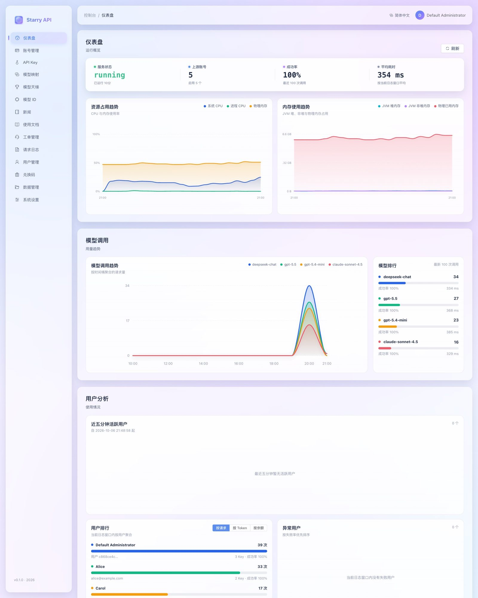
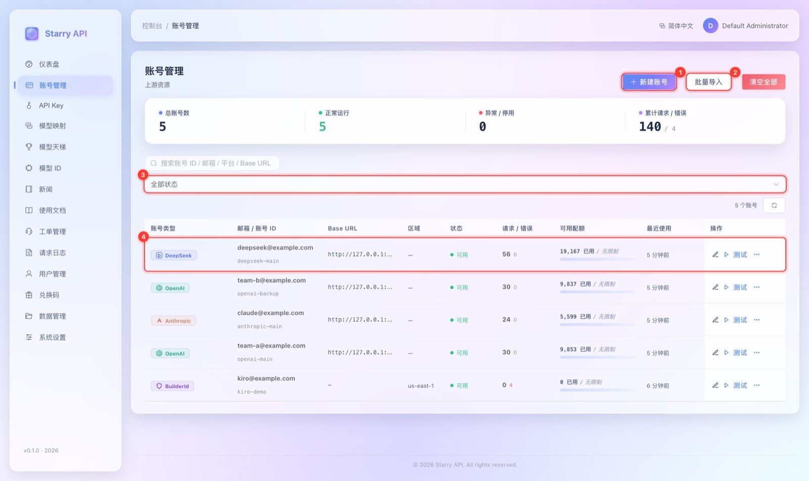
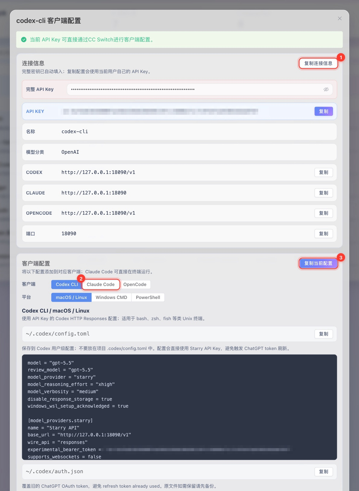
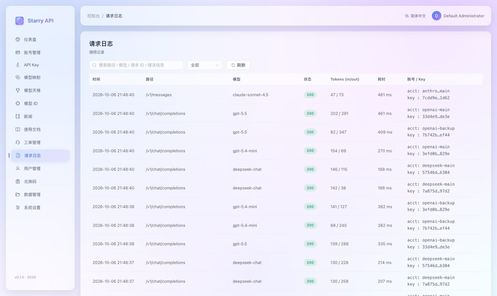
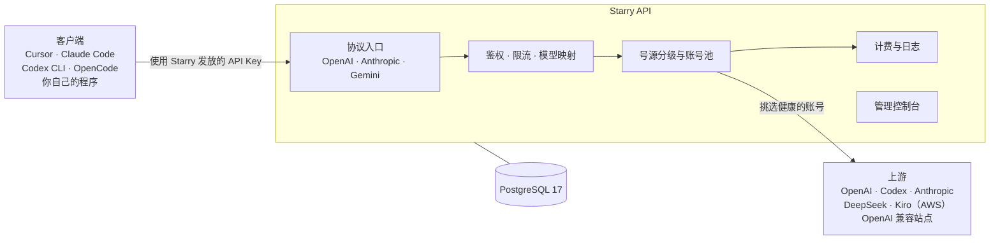
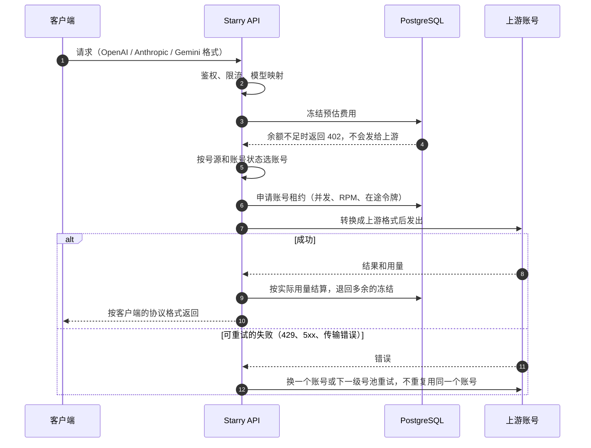
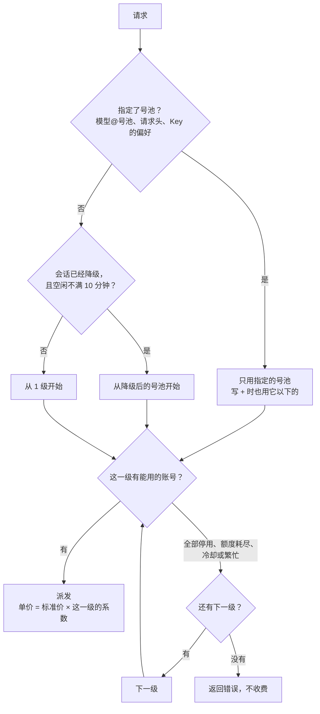
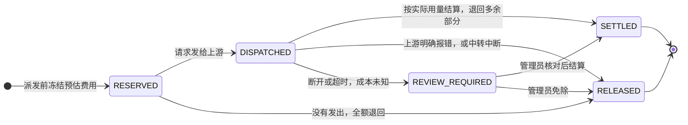

<div align="center">


# Starry API

**自托管的大模型 API 网关和管理控制台**

<p>
  <a href="./README.md">English</a> |
  <strong>简体中文</strong>
</p>

<p>
  <a href="LICENSE"></a>
  <a href="https://github.com/StaR4y/starry-api/releases/latest"></a>
  <a href="https://github.com/StaR4y/starry-api/pkgs/container/starry-api"></a>
</p>

<p>
  <a href="#快速开始">快速开始</a> •
  <a href="#主要功能">主要功能</a> •
  <a href="#工作原理">工作原理</a> •
  <a href="#部署">部署</a> •
  <a href="#文档">文档</a> •
  <a href="#许可证">许可证</a>
</p>

</div>

---

## 项目介绍

Starry API 把各种上游模型账号（OpenAI、Anthropic、DeepSeek、Kiro 等）汇总成一个入口，对外提供 OpenAI、Anthropic、Gemini 三种兼容协议，并带账号池调度、API Key、计费、日志和后台管理界面。

| 你的场景 | Starry API 怎么做 |
| --- | --- |
| 手里有多个上游账号或 Key，想统一管理 | 账号池：自动轮询、限流保护、失败切换、健康检查 |
| 想让团队或朋友共用，又不想泄露上游 Key | 给每个人发独立的 API Key，设置额度上限，随时停用 |
| 客户端各不相同（Cursor、Claude Code、Codex CLI、OpenCode 等） | 同时兼容 OpenAI、Anthropic、Gemini 协议，可以一键生成各客户端的配置 |
| 想按用量收费或自己对账 | 厂商标价计费、余额与充值、兑换码、Coding Plan 订阅、完整请求日志 |
| 想知道钱花在哪、哪个账号出了问题 | 仪表盘、请求日志、账号状态与分配策略 |

| 仪表盘 | 账号管理 |
| --- | --- |
|  |  |
| **API Key 客户端配置** | **请求日志** |
|  |  |

## 快速开始

在 Linux 服务器上执行：

```bash
curl -fsSL https://raw.githubusercontent.com/StaR4y/starry-api/main/scripts/install.sh | sudo bash
```

脚本会装好缺少的 Docker，生成数据库密码，启动服务并等它通过健康检查。然后打开 `http://服务器地址:18080/#/login`，用户名 `admin`，初始密码用这条命令查看：

```bash
sudo starry-api info
```

第一次登录会要求改密码。在控制台里添加上游账号、创建 API Key，然后发出第一个请求：

```bash
curl -X POST http://服务器地址:18080/v1/chat/completions \
  -H 'Content-Type: application/json' \
  -H "Authorization: Bearer sk-你的Key" \
  -d '{"model": "deepseek-chat", "messages": [{"role": "user", "content": "你好"}], "max_tokens": 256}'
```

模型名换成你的账号能用的。每一步的截图和说明见 [快速开始指南](docs/QUICKSTART.md)。

## 主要功能

### 协议与接口

| 协议 | 接口 |
| --- | --- |
| OpenAI Chat Completions | `POST /v1/chat/completions` |
| OpenAI Responses | `POST /v1/responses` |
| Anthropic Messages | `POST /v1/messages` |
| Gemini | `POST /v1beta/models/{model}:generateContent` |
| 模型列表 | `GET /v1/models` |

### 网关与管理

- **多种上游账号**：Kiro、OpenAI API Key、ChatGPT 浏览器授权（Codex）、手动 Codex Token、DeepSeek、Anthropic API Key，以及任意 OpenAI 兼容站点。
- **账号池**：按厂商隔离、预热分级、并发与 RPM 保护、失败重试与冷却，可选实验性的分级熔断。
- **号源分级**：按厂商分号池，每级一个价格系数，按实际服务请求的号池计价；客户端可以用 `模型@号池` 或请求头指定。
- **API Key 与计费**：按用户发放、绑定模型厂商、额度上限、余额计费或 Coding Plan 订阅计费；内置厂商标价目录（来自社区维护的 `model-price-repo`，不是厂商的接口）并自动校验更新。
- **管理控制台**：仪表盘、请求日志、用户、兑换码、在线充值、工单、使用文档、模型目录与价格倍率、外观定制，中英文界面。
- **数据安全**：Root 专属的数据管理（备份、导出、恢复），高危操作要二次验证。
- **插件**：全信任的插件机制，见 [插件开发](docs/PLUGINS.md)。

技术栈：Java 25、Spring Boot 4（WebFlux、Jackson 3）、R2DBC、PostgreSQL 17、Flyway、Vue 3，控制台内嵌在同一个 jar 里。

## 工作原理



### 一个请求怎么走



账号池的细节（准入、冷却、预热、失败处理表）见 [架构说明](docs/ARCHITECTURE.md#账号池行为)。

### 号源分级

把一个厂商的账号分成有序的号池（例如官方 Key 一级、Kiro 二级），每级有自己的价格系数。



用户只为实际服务自己的号池付费。OpenAI 格式的中转站也可以登记成别的厂商的一级。见 [号源分级与跨协议中转](docs/SOURCE_TIERS.md)。

### 计费



结算写入带幂等键的事件，同一个请求只扣一次。成本未知的请求进入复核时冻结不退，该用户的新请求返回 `409 BILLING_REVIEW_REQUIRED`，直到管理员处理。见 [API 参考](docs/API.md)。

## 部署

三种方式用同一个镜像（`ghcr.io/star4y/starry-api`）和同一个 Compose 文件，完整说明见 [部署指南](docs/DEPLOYMENT.md)。

### 一键安装（Linux 服务器）

```bash
curl -fsSL https://raw.githubusercontent.com/StaR4y/starry-api/main/scripts/install.sh | sudo bash
```

默认安装到 `/opt/starry-api`，端口 `18080`。重新运行同一条命令就是升级：`.env` 和 `data/` 保持不变，新版本起不来时自动退回上一版。`sudo starry-api info` 显示控制台地址和初始密码，`sudo starry-api reset-password` 重置 Root 密码。

### Docker Compose（已有 Docker）

```bash
git clone --depth 1 https://github.com/StaR4y/starry-api.git
cd starry-api
./scripts/docker-up.sh
```

第一次运行时生成带随机数据库密码的 `.env`，然后执行 `docker compose up -d`。macOS、Windows（WSL）和 Linux 都可以，不需要 root。初始密码用 `./scripts/starry-api.sh info` 查看。

### 从源码构建

```bash
./scripts/docker-up.sh --build
```

镜像在 Docker 里构建，本机不需要 Java 和 Node.js。不用 Docker 的运行方式（需要 Java 25 和 PostgreSQL 17）见 [运维手册](docs/OPERATIONS.md#启动服务)。

### 存储与配置

- **数据**：服务保存的东西都在 Compose 文件旁边的 `data/` 里，包括 PostgreSQL 数据文件、备份、数据管理的安全文件、插件、文档附件，以及模型价格和天梯的缓存。它要和 `.env` 放在一起。
- **配置**：`.env` 里是数据库密码和部署相关的设置，其余大多在控制台里改。所有变量见 [配置参考](docs/CONFIGURATION.md)。
- **生产环境**：放在 HTTPS 反向代理后面，并用防火墙限制 `18080` 端口，见 [配置反向代理](docs/DEPLOYMENT.md#2-配置反向代理启用-https)。

## 开发

```text
service-api/   接口契约与共享 DTO
plugin-api/    插件 SDK
service/       Spring Boot 服务：管理接口、账号池、代理转发、计费、统计
  └─ platform/ 各厂商协议适配（openai / anthropic / gemini / deepseek / kiro）
webui/         Vue 3 管理控制台（构建后嵌入 service 的 jar）
docker/        PostgreSQL 初始化脚本、Mihomo 启动脚本、TLS bridge
scripts/       安装、启动、恢复脚本和它们的测试
docs/          文档（含 docs/images 截图）
```

```bash
./gradlew test                     # 后端测试（PostgreSQL 测试需要 Docker）
npm --prefix webui run build       # 构建控制台
./gradlew :service:bootJar         # 打包完整 jar（含控制台）
```

仓库没有 CI，提交 Pull Request 或打标签发布之前，请先在本地跑完测试。环境要求和要跑的检查见 [CONTRIBUTING.md](CONTRIBUTING.md)。

## 文档

| 我想 | 看这里 |
| --- | --- |
| 把服务部署起来，升级或回滚 | [部署指南](docs/DEPLOYMENT.md) |
| 从零到发出第一个请求 | [快速开始指南](docs/QUICKSTART.md) |
| 了解控制台每个页面 | [控制台使用手册](docs/CONSOLE_GUIDE.md) |
| 查配置项和环境变量 | [配置参考](docs/CONFIGURATION.md) |
| 导入账号、备份恢复、日志保留 | [运维手册](docs/OPERATIONS.md) |
| 配置号池和跨协议中转 | [号源分级与跨协议中转](docs/SOURCE_TIERS.md) |
| 调用接口、写集成 | [API 参考](docs/API.md) |
| 排查报错 | [故障排查](docs/TROUBLESHOOTING.md) |
| 了解内部设计 | [架构说明](docs/ARCHITECTURE.md) · [包结构与扩展](docs/PACKAGE_GUIDE.md) |
| 开发插件 | [插件开发](docs/PLUGINS.md) |
| 完整目录 | [文档索引](docs/README.md) |

## 当前能力边界

- 普通 OpenAI / GPT 请求默认只走官方 OpenAI API Key 账号（Base URL 为 `api.openai.com`）；Codex 账号默认与之隔离，需要管理员显式开启才会混用。
- DeepSeek 请求只会走 DeepSeek 账号，不会回退到别的厂商。
- Anthropic Messages 请求优先使用原生 Anthropic API Key 账号，不可用时回退到兼容的 Kiro 账号。
- Gemini 目前是入站兼容协议：内置 Gemini 别名通过 Kiro 目标模型执行；还不支持直连 Google API Key 和 `streamGenerateContent`。
- `stream=true` 目前在上游完成后再以 SSE 输出，还不是真正的逐块透传。
- 图片、文档、文件转换仅部分支持；尚未实现分布式限流。

## 免责声明

Starry API 是独立的开源项目，与 Anthropic、OpenAI、Google、Amazon Web Services、DeepSeek 等任何厂商均无隶属、合作或背书关系。Claude、Claude Code、ChatGPT、Codex、OpenAI、Gemini、Kiro、Amazon Q、CodeWhisperer、DeepSeek 等名称和标识归各自权利人所有，本项目仅用于说明可连接的服务。你需要自行确保接入的每个厂商和账号都符合其条款，包括账号共享、转售、自动化访问和支持地区的规定。本软件能实现的某些配置可能被这些条款禁止。软件按现状提供，厂商可能限制或停用使用它的账号。

## 安全

发现安全漏洞时，请不要开公开的 issue，而是用 GitHub 的私密漏洞报告（仓库页面 **Security → Report a vulnerability**）。支持的版本、受理范围和插件的信任模型见 [SECURITY.md](SECURITY.md)。

## 参与贡献

欢迎提 issue 和 Pull Request。动手之前请先读 [CONTRIBUTING.md](CONTRIBUTING.md) 和 [行为准则](CODE_OF_CONDUCT.md)。你提交的代码按 AGPL-3.0-only 授权，并附带 [NOTICE](NOTICE) 第 2 节的插件附加许可（见下面的「许可证」一节；`plugin-api/` 的改动按 Apache-2.0）。

## 许可证

Starry API 以 **GNU Affero 通用公共许可证第 3 版（仅此版本，SPDX：`AGPL-3.0-only`）** 发布，全文见 [LICENSE](LICENSE)。依赖库的许可证选择、源码和许可证文本在哪里、数据来源、商标声明和可选组件 Mihomo 的说明见 [NOTICE](NOTICE)。控制台构建时会生成 `THIRD-PARTY-NOTICES.txt`（npm 依赖，末尾附 logback 的版权声明和 LGPL-2.1-only 说明，随控制台一起提供），Java 依赖的清单是 jar 里的 `META-INF/JAVA-THIRD-PARTY-NOTICES.txt`。

- **向网络用户提供源码（AGPL 第 13 条）**：控制台不在页面上放「源代码」链接，只在新部署首次初始化后，在 Root 需要确认的「许可条款与免责声明」里显示一次源码地址（由环境变量 `STARRY_SOURCE_URL` 设置，默认 `https://github.com/StaR4y/starry-api`）。**如果你修改了代码并让别人通过网络使用它，要自己向这些用户提供修改后的源码。**见 [配置参考](docs/CONFIGURATION.md#源代码与许可证)。
- **插件 SDK**：[`plugin-api/`](plugin-api/) 使用 [Apache License 2.0](plugin-api/LICENSE)。同时，在 AGPL-3.0 第 7 条下附加如下许可（原文为英文，以 [NOTICE](NOTICE) 第 2 节为准）：只通过 `plugin-api` 与 Starry API 交互、且不含 Starry API 其他部分的插件，是独立作品，可以按你选择的条款（包括闭源）授权和使用。这项许可不覆盖前端挂件插件的浏览器脚本（`widget.json` 声明、由控制台从 `/plugin-assets` 加载的脚本）：它运行在控制台页面里，用的是控制台自己的钩子，不是 `plugin-api` 的接口。

  > Additional permission under section 7 of the GNU Affero General Public License, version 3: a plugin that interacts with Starry API only through the interfaces of the plugin-api module (including the HTTP calls it makes through PluginContext.request), and that contains no other part of Starry API, is an independent work and is not a covered work under the license of Starry API. You may license, convey and use such a plugin under terms of your choice, including proprietary terms, together with an unmodified or modified Starry API. This permission does not extend to a plugin that copies, links against or otherwise builds on any part of Starry API other than plugin-api, and it does not extend to the browser script of a web widget plugin (the script that widget.json declares and the console loads from /plugin-assets), which runs inside the console page and uses the console's own hooks, not the interfaces of plugin-api. If you modify Starry API, you may extend this permission to your version, but you are not obliged to; if you do not wish to, delete this paragraph from your version.

- **名称与标识**：「Starry」「Starry API」和 Starry 标识不在软件许可的授权范围内（AGPL-3.0 第 7(e) 条）；第三方的名称和标识归各自权利人所有，见上面的免责声明。
- **Mihomo**：可选的出站代理组件 Mihomo 使用 GPL-3.0，是单独的容器镜像，部署时从镜像仓库拉取，**不随本项目分发**。
