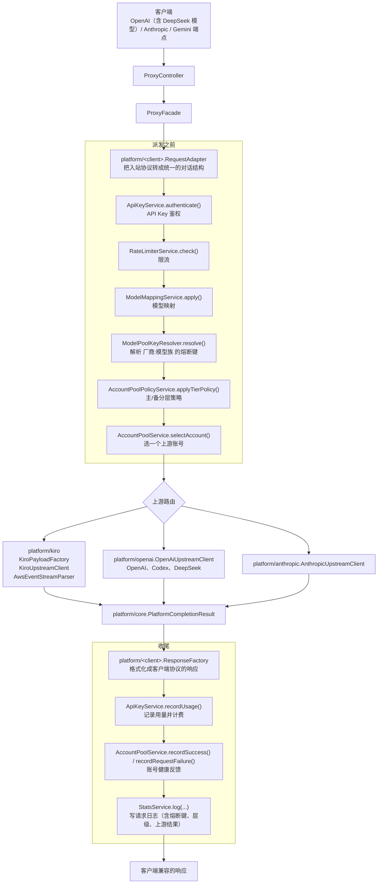
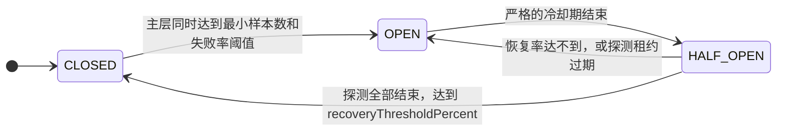
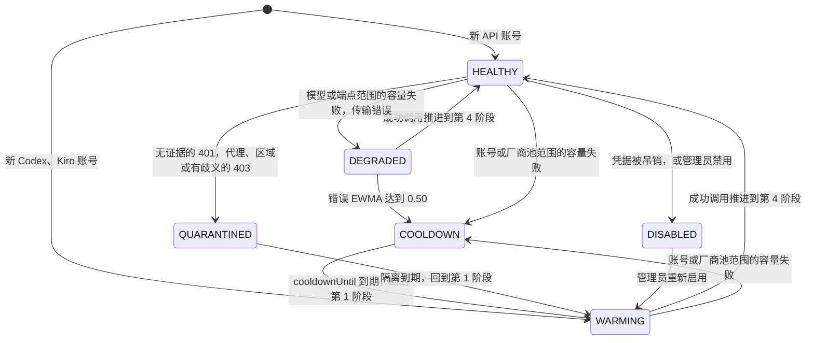

# 架构说明

这份文档讲 Starry API 内部是怎么运转的：请求怎么流转、模块怎么划分、账号池怎么调度、数据存在哪里。适合想二次开发、排查疑难问题或评估部署方案的人阅读。只是想使用的话，请看 [快速开始](QUICKSTART.md)。

**目录**：[整体设计](#整体设计) · [请求流程](#请求流程) · [模块与包布局](#模块与包布局) · [模型目录](#模型目录) · [持久化状态](#持久化状态) · [账号池行为](#账号池行为) · [会话亲和](#会话亲和) · [上游适配器](#上游适配器) · [信任边界与维护模式](#信任边界与维护模式)

---

## 整体设计

Starry API 围绕三个互相独立的关注点组织：

| 关注点 | 内容 |
| --- | --- |
| **入站平台协议** | OpenAI、Anthropic、Gemini——客户端用什么协议跟我们说话 |
| **与厂商无关的核心记录 + 模型目录元数据** | 统一的补全结果、用量、工具调用结构，以及模型目录 |
| **上游执行适配器** | Kiro / AWS CodeWhisperer、官方 OpenAI / Codex、Anthropic API Key、官方 DeepSeek（复用共享的 OpenAI HTTP 传输） |

> 核心代理层**不应包含**任何平台专属的请求转换、响应格式化或模型目录数据。详细的包归属规则见 [包结构与扩展](PACKAGE_GUIDE.md)。

---

## 请求流程



---

## 模块与包布局

### Gradle 模块

| 模块 | 说明 |
| --- | --- |
| `:service-api` | Java API 契约和共享 DTO |
| `:service` | Spring Boot 服务：持久化、代理编排、平台适配器 |
| `:webui` | Vue / Vite 管理控制台（构建后嵌入 `service` 的 jar） |
| `:plugin-api` | 全信任的 Java 插件 SDK 与生命周期契约 |

`service-api` 和 `plugin-api` 是两个独立的库模块：前者保留原有的业务契约和 Java 包名；后者只暴露通用的宿主访问、JSON / 配置、托管资源 / 任务和流式 HTTP。`service` 模块实现这套 SDK。插件的类型缓存、有界的资源注册和懒创建的任务线程都随上下文释放；**不需要**新的数据库、消息中间件或外部调度服务。

### 后端包布局

```text
service/src/main/java/tech/starryapi
├── admin              本地管理员、密码哈希、会话、启动引导
├── account            上游账号的持久化、导入、测试、账号池选择
├── apikey             API Key 生成、哈希、鉴权、用量计费
├── assistant          鲸鱼助手：对话、使用文档的检索
├── cli                服务器上 starry-api 命令调用的管理入口
├── codingplan         Coding Plan 套餐与订阅
├── common             错误处理、管理鉴权辅助、共享工具
├── config             Spring Boot / WebFlux / WebClient / OpenAPI / 调度配置
├── documentation      使用文档：页面、附件、发布
├── egress             账号出站代理：节点、通道、路由传输
├── model              托管目录、定价、模型映射、图标存储
├── news               资讯页的数据
├── payment            充值订单、回调、余额账本、兑换码
├── plugin             插件的安装、生命周期、配置与审计
├── proxy              对外代理控制器、核心 facade、限流、模型列表
├── sourcetier         号源分级的配置与管理接口
├── stats              请求日志持久化与管理端统计
├── ticket             工单与通知
└── platform
    ├── core           与厂商无关的补全结果、用量、工具调用记录
    ├── catalog        统一模型目录与模型元数据
    ├── openai         OpenAI Chat / Responses 的请求与响应
    ├── deepseek       DeepSeek 模型规范化与端点能力策略
    ├── anthropic      Anthropic Messages 的请求、响应与原生上游
    ├── gemini         Gemini GenerateContent 的请求与响应
    ├── kiro           Kiro / AWS payload、上游客户端、事件流解析
    ├── upstream       共享的上游异常抽象
    └── xproto         跨协议转换：把入口的请求转成中转的 Chat Completions，再转回来
```

**关键规则**（完整版见 [包结构与扩展](PACKAGE_GUIDE.md)）：

- `proxy` 可以依赖 `platform/*`。
- `platform/openai`、`anthropic`、`gemini` 拥有各自的入站 / 出站协议形状，可以依赖 `platform/core` 和 `platform/catalog`，但**互相不能 import**，也不能 import `platform/kiro`。
- `platform/openai` 同时提供共享的 OpenAI 兼容 HTTP 传输；`platform/deepseek` 拥有官方模型 ID、规范化和 Chat / Responses 能力策略，**复用** `OpenAiUpstreamClient` 做 HTTP 传输，而不是重复造一个客户端。
- `model/OfficialModelPricingService` 拥有经验证的厂商标价（美元）目录：从内置的、社区维护的 `Wei-Shaw/model-price-repo` 快照起步，仅当远程 JSON 与发布的 SHA-256 校验和匹配后才定期替换。
- `platform/catalog/ModelPriceRepoModelIds` 从该快照派生内置的 OpenAI、Anthropic、Gemini、DeepSeek 聊天模型 ID。一个条目要被默认公布，必须有输入 / 输出 token 价格和与当前代理兼容的请求端点；仅 Realtime 的条目被排除。
- `service-api/model` 包含公开的模型目录 REST 契约、模型 DTO 和 `ModelCatalogProvider`；`platform/catalog` 只是服务端聚合用的实现细节。
- admin / account / apikey / stat 模块**不能**依赖 OpenAI / Anthropic / Gemini 的响应工厂。

### 前端布局

```text
webui/src
├── api          与后端端点对齐的 TypeScript API 客户端
├── components   共享的可视化组件
├── layouts      登录后的外壳
├── platforms    前端平台注册表与各平台的安装片段
│   ├── openai / deepseek / anthropic / gemini / opencode
│   ├── registry.ts
│   ├── clientSetup.ts
│   └── types.ts
├── router       路由表与鉴权守卫
├── stores       Pinia 鉴权状态
├── types        API DTO 类型
├── utils        HTTP 与格式化工具
└── views        仪表盘 / 管理页面
```

- `views` 渲染页面并持有页面状态。
- `platforms/<provider>/index.ts` 拥有厂商展示元数据和模型 ID 推断；`setup.ts` 拥有厂商专属的环境变量块；`registry.ts` 拥有厂商 / 系列顺序和统一推断；`clientSetup.ts` 汇总 OpenAI、Anthropic、Gemini、OpenCode 的片段。
- DeepSeek 模型与 OpenAI 共用 Starry API 的 OpenAI 兼容连接，所以不需要单独的客户端配置片段。
- 视图组件**不应**硬编码厂商顺序或客户端环境变量块。

---

## 模型目录

`ProxyModelCatalog` 按这个顺序聚合各厂商目录：**Anthropic → OpenAI → Gemini → DeepSeek**。

每个模型记录暴露：

| 字段 | 含义 |
| --- | --- |
| `id` | 面向客户端的模型 ID |
| `provider` | 平台分组 |
| `family` | 平台内的系列 |
| `owned_by` | 展示给 OpenAI 兼容客户端的目录所有者 |
| `targetModelId` | 别名映射之后的上游模型 ID |
| token 与输入能力元数据 | 上下文长度、支持的输入类型等 |
| 可选的管理员图标、请求格式、客户端端点元数据 | |

**价格**：OpenAI、Google / Gemini、Anthropic、DeepSeek 的内置模型来自随仓库提交的 `model-price-repo` 快照，外加少量兼容路由别名。厂商标价（美元）在启动时和每 10 分钟刷新（经校验和验证，保留最近一次可用的磁盘缓存）。目录别名按这个顺序解析到厂商标价：**精确 ID → 去前缀 → 连字符 / 点规范化**，再沿着配置的目录目标走（带环检测），**绝不会**通过路由用的 `targetModelId` 去取价，也不再按系列、厂商或全局中位数猜价。没有价格的模型显示为「待定价」，计费请求在预留之前以 `MODEL_PRICE_UNAVAILABLE` 失败，见 [配置参考](CONFIGURATION.md#模型目录与价格)。管理员可以在「系统设置 → 模型管理 → 价格倍率」里开启 `syncCatalogIds`，让新发布的一线聊天模型被追加进目录；已停用的 ID 不会被复活。

**管理员能做什么**：增加厂商和模型、覆盖内置项、停用条目、上传 PNG / JPEG / WebP 图标，并通过 `/admin/models` 持久化全局的模型 ID 显示顺序和画廊样式。目录自定义、顺序和显示设置保存在 `system_settings` 里；图标文件在 `STARRY_MODEL_ICON_DIR` 里，**需要和 PostgreSQL 导出分开备份**。

**路由规则**：

- GPT / OpenAI 的 ID 路由到 OpenAI API Key 或 Codex Token 账号。
- `openai-compatible/<model>` 选中第三方 OpenAI 兼容 API Key 账号，并在派发前去掉前缀；但厂商级的 API Key 只有在「请求的源 ID」和「映射后带前缀的目标 ID」**都**是该 Key 厂商下已启用的目录条目时，才能使用它。
- DeepSeek 提供 `deepseek-chat`、`deepseek-reasoner`、`deepseek-v4-flash`、`deepseek-v4-pro`；内置目录可靠地支持裸名和 `starry/` 两种形式。底层路由解析器仍认识 `deepseek/`，但厂商级 Key 会拒绝这个别名，除非管理员把它登记到同一厂商下。价格规范化独立于路由授权，认识三种前缀。
- Claude / Kiro 别名继续用 `ModelCatalogProvider.resolveTargetModel`；`anthropic/` 目标优先走原生 Anthropic API Key 账号。
- 共享的默认能力和路由目标由 `service-api/model` 契约定义，而不是某个厂商专属的目录。

**每把 API Key 都绑定一个厂商**：新建的 API Key 通过 `api_keys.model_provider` 绑定一个已启用的目录厂商。在选择上游账号之前，授权会同时校验**客户端请求的模型**和**解析后的映射目标**。通配厂商 `*` 只保留给迁移过来的旧 Key。

---

## 持久化状态

PostgreSQL 17 是持久化基线。数据库和应用 schema 都叫 `starry_api`；Flyway 在这个 schema 里安装全新的基线。用户视为不区分大小写的标识符使用函数索引 `lower(...)`，而 Token、哈希和 ID 保持区分大小写。

Flyway 创建这些主要的表：

| 表 | 用途 |
| --- | --- |
| `proxy_accounts` | 上游账号凭据、总额度 / 5 小时 / 7 天额度窗口、挂起状态和元数据 |
| `api_keys` | 每用户的 API Key 所有者、厂商范围、新 Key 的完整副本、哈希、状态、限额、聚合用量 |
| `api_key_usage_daily` | API Key 的日用量汇总 |
| `api_usage_events` | 哈希分区的幂等 / 结算事件，用于**恰好一次**地更新 Key 用量和用户余额 |
| `model_mappings` | 模型别名 / 替换 / 负载均衡规则 |
| `request_logs` | 按月范围分区的请求历史：时间、API Key、账号、熔断键 / 层级、解析后的上游模型、上游结果，以及 BRIN / 部分覆盖索引 |
| `request_usage_hourly` / `request_usage_daily` | 供分析使用的长区间请求 / token / 成本聚合 |
| `aggregation_watermarks` | 增量聚合的进度 |
| `performance_metrics` | 运行时 CPU、内存、网络样本 |
| `admin_users` | 本地管理员用户、密码哈希、角色、首次登录状态 |
| `registration_email_tokens` | 经哈希、会过期的注册邮箱验证令牌 |
| `system_settings` | 运行时设置、托管目录 / 定价快照、支付设置，以及不可变的应用 Root 标记 |
| `payment_orders` | 充值订单状态和入账状态 |
| `invite_codes` / `redemption_codes` | 注册邀请码和余额兑换码 |
| `invite_rebate_records` | 幂等的邀请返利记录 |
| `balance_ledger` | 可审计、幂等的余额变更 |
| `flyway_schema_history` | Flyway 迁移历史 |

另一个独立的 `starry_security` schema 包含只追加的 `data_management_security_audit_events` 和带租约的 `data_management_security_alert_outbox`。它被**故意排除**在普通 `starry_api` 应用的导出和恢复之外。

---

## 账号池行为

这是 Starry API 最核心、也最容易产生疑问的部分。

> **三句话版**：① 不同厂商的账号**互相隔离**，绝不串用；② 每个账号有自己的并发 / RPM 保护，新账号要经历**预热**；③ 出错会按错误类型决定「换账号重试 / 冷却 / 隔离 / 禁用」，而不是一出错就禁用。

### 一个账号什么时候会被跳过

- `enabled=false`；
- 设置了 `suspendedAt`（被挂起）；
- 总额度、5 小时额度或 7 天额度耗尽，且它的重置窗口还没过；
- 可恢复的失败仍在冷却，并且概率性重试没有触发。

### 分级熔断（实验性，默认关闭）

> 它和**号源分级**（把一个厂商的账号分成有序的号池、按服务的号池计价，可含跨协议中转）是两套互相独立的机制：已配置号源分级的厂商不进入这里的熔断，它的请求不带熔断纪元，也不会返回 `ACCOUNT_POOL_CIRCUIT_OPEN`。号源分级见 [运维手册：号源分级](OPERATIONS.md#号源分级) 和 [跨协议中转](OPERATIONS.md#跨协议中转)。

关闭时，`AccountPoolPolicyService` 原样返回该厂商所有符合条件的账号、保持原有的会话亲和键，并在请求日志里省略熔断维度；账号选择忽略熔断层级，控制台显示普通的账号管理而不是熔断内容。持久的 `poolTier` 和 `poolWeight` 字段仍然可以通过账号 API 使用，所以运维可以**在启用这个功能之前**就把主 / 备容量准备好。

启用时，`ModelPoolKeyResolver` 会把每个请求在模型映射之后，解析成一个稳定、有界的 `厂商:模型族` 键。目录里的模型使用它们的目录厂商和系列，所以**同一厂商下的不同模型系列有各自独立的熔断器**；未知 ID 归入对应的 `厂商:other`，所以任意的用户模型 ID **不会**造成无限的内存熔断基数。同一个请求级的键和令牌，在账号重试之间保持不变。

每个模型池拥有一个独立的、并发安全的滑动窗口状态机：



| 状态 | 路由行为 |
| --- | --- |
| `CLOSED` | 优先主账号；只有主层同时达到最小样本数和失败率阈值才打开。没有配置主账号时，仍可使用原有的「厂商列表」回退 |
| `OPEN` | 严格的冷却期内，**只**走备用账号 |
| `HALF_OPEN` | 放行有限数量的**真实客户端请求**去探测主层；所有非探测流量继续走备用 |

- 冷却和探测额度复用兼容的设置字段 `retestIntervalMinutes` 和 `retestMaxConcurrency`。
- 探测租约限制在 2–10 分钟，防止被放弃的请求永远占着名额：过期的探测会让熔断器重新打开。
- 没有稳定请求令牌的请求不能成为探测。同一个请求令牌在账号重试之间最多消耗一个探测名额。
- 所有允许的探测都结束后，达到 `recoveryThresholdPercent` 就关闭熔断器并清空主窗口；恢复率不足或已不可能达到，则重新打开。恢复后的宽限窗口防止同样的陈旧样本立刻把它重新打开。
- 这个状态机**不会**生成合成的探测请求，也不会对所有账号复测。
- 真实请求的结果会立刻更新本地窗口。每 **30 秒**，`AccountPoolRetestService` 从共享的 `request_logs` PostgreSQL 窗口，对每个实例的熔断指标做**对账**。
- 每次 `false -> true` 的启用都会创建一个新的 UUID 熔断纪元和启用时间戳。请求在路由前捕获该纪元，对账只接受**当前纪元**且在启用边界之后的行。所以跨越禁用 / 重新启用边界的请求，以及更早启用留下的历史行，都不会改变新熔断器的状态。时间谓词还带有排他的上界，所以 PostgreSQL 会裁剪过去和未来的分区。
- 只有 `upstream_success` 明确标记了「成功调用」或「会计入熔断的失败」的行才进入这个窗口：可重试的传输失败和上游声明可重试的 `408`、`409`、`5xx` 会计入；账号级的和不可重试的失败**不会**。
- 部分覆盖索引 `idx_request_logs_circuit_window` 先按 `circuit_epoch`，再按 `created_at DESC` 和 `circuit_key`，包含层级和上游结果，并使用匹配的非空谓词做纯索引扫描。
- 一次评估会在查询 PostgreSQL 之前，捕获一个「持久化确认代数」。它只替换在该代数之前**已确认提交**的本地结果。查询期间完成的提交留在本地增量里，直到下一个基线；写日志失败的留在仅本地的分钟桶里，直到窗口过期。
- 已确认的结果按分钟和确认代数聚合，只有真正在途的写入才保留单请求 ID。这样既不会出现空洞，保留的状态也受「在途写入 + 窗口桶数」限制，不随请求量增长。
- 不在最新结果里的池会被显式对账为空的外部基线，而不是保留陈旧的指标。
- 熔断状态在每个服务实例本地，通过共享窗口收敛；它**不是**经由 PostgreSQL 通知分发的。
- `request_logs.success` 是最终的代理 / 结算结果。单独的、可空的 `upstream_success` 记录一次会计入熔断的上游调用是否成功，所以「上游成功、但本地计费失败」不会被误判成上游失败。`circuit_epoch`、`circuit_key`、`circuit_tier`、`upstream_model` 保留了对账维度，行移出默认分区时也会保留。
- 账号全局的生命周期和模型池的失败域是**刻意分开**的：
  - 启用该策略时，会计入熔断的主层失败只更新受影响的模型族熔断器，**不会**增加兼容的 `errorCount`；同样的失败发生在备用账号上，则**也会**增加 `errorCount`。
  - 每一次派发的尝试，还会被对账进下面的 PostgreSQL 账号生命周期。
  - `401` / `403` 只有在响应里有结构化的「永久吊销」证据时才会禁用账号；有歧义的 Anthropic `403` 会被隔离。
  - 普通的上游 `429` **不会**设置 `quotaExhaustedAt` 或禁用账号。
  - 模型和端点范围的 `429` 只会为那个账号和匹配的上游模型或端点创建或延长冷却。它们被审计，但不改变账号全局的生命周期或兼容的 `errorCount`，所以不相关的流量可以继续使用这个凭据。
- 策略设置、启用纪元及其开始时间戳保存在 `system_settings` 里，这张表的 PostgreSQL 触发器在 `starry_api_system_settings` 通道上发布变更的键。
- 每个实例在就绪前同步预加载策略和带索引的窗口。随后它保持一个专用的 `LISTEN` 连接，使受影响的缓存失效，并以单飞方式重新加载策略、立即对账。
- 监听器重连会使过期的刷新代数失效，但在完整的替代快照成功之前，保留最近一次可用的设置和熔断状态。
- 禁用会重置本地熔断状态；重新启用开启新的纪元，**绝不会**恢复更早启用留下的指标。

### 提供者隔离

账号选择在**两个方向上都是厂商隔离**的。DeepSeek 模型请求只选择 provider 为 `DeepSeek`、或官方主机为 `api.deepseek.com` 的账号；普通的 OpenAI / Codex 池则**明确排除**这些账号。所以 DeepSeek 池耗尽时返回「没有可用账号」，而不是回退到别的厂商；由可恢复的 DeepSeek 错误引起的重试，也留在 DeepSeek 池里。

### 失败处理表

只有可重试的传输失败，和上游声明可重试的 `408`、`409`、`5xx`，才会进入模型族熔断窗口。账号重试始终留在选定的厂商池内，**绝不重复使用同一个账号**；原始账号也计入上限：

| 失败 | 跨账号行为 | 生命周期结果 |
| --- | --- | --- |
| `400`、`404`、`422` | 不重试 | 请求级；账号健康不变 |
| 无结构化证据的 `401` | 不重试 | 凭据被隔离；没有吊销证据就不会被永久禁用 |
| 吊销了凭据的 `401` / `403` | 最多 2 个不同账号 | 永久禁用并挂起被拒绝的凭据 |
| `402` | 最多 3 个不同账号 | 账号容量冷却，默认 10 分钟 |
| 代理 / 区域 / 有歧义的 `403` | 最多 2 个不同账号 | 隔离，默认 10–15 分钟 |
| 传输、`408`、`409`、可恢复的 `502` | 最多 2 个不同账号 | 先降级；错误 EWMA 达到 0.50 时进入冷却 |
| `429` | 最多 3 个不同账号 | 账号范围冷却；模型 / 端点范围降级。**不会**标记额度耗尽 |
| `500`、`501`、`503`、`504` | 最多 3 个不同账号 | 厂商池冷却，默认 1 分钟 |
| `529` | 最多 2 个不同账号 | 账号容量冷却，默认 10 分钟 |

### PostgreSQL 账号分配

**PostgreSQL 17 就是账号准入的协调者，不需要 Redis。**

- `account_allocation_policies` 保存运维设置的限额；`account_allocation_states` 保存生命周期和 EWMA；`account_admission_states` 保存热点计数器和令牌桶；`account_scoped_cooldowns` 保存模型 / 端点范围的局部封锁。
- `try_acquire_scoped_account_lease` 对单个账号串行化准入：原子地检查匹配的作用域冷却、当前生命周期、有效并发、RPM、突发、在途令牌预留，以及可选的 Anthropic 会话容量，然后创建一个**十分钟**的租约。
- 代理**故意传入空的期望生命周期版本**：数据库事务才是权威，而两秒的排名快照不应造成误报的「版本过期」拒绝。
- 派发标记发生在**调用上游之前的一刻**。成功和上游失败的对账会释放预留；取消和本地管线失败会放弃已打开的租约；派发之前的失败释放租约，对健康没有影响。过期的租约会被回收，它们的计数器在该账号的任何后续准入决定之前持久化。

**默认策略是保守的，且按厂商区分**：

| 账号类型 | 安全并发 | 安全 RPM | 突发 | 最大会话数 | 会话空闲 | 在途令牌 |
| --- | ---: | ---: | ---: | ---: | ---: | ---: |
| 官方 OpenAI / Anthropic API | 14 | 0（不限） | 0 | 0 | 600 秒 | 1,000,000 |
| 非官方 API / DeepSeek / 其他 API | 0（不限） | 0 | 0 | 0 | 600 秒 | 1,000,000 |
| Codex | 4 | 60 | 4 | 0 | 600 秒 | 1,000,000 |
| Claude OAuth / Setup Token | 2 | 30 | 2 | 4 | 600 秒 | 1,000,000 |
| Kiro | 2 | 30 | 2 | 0 | 600 秒 | 1,000,000 |

每个策略的分配优先级默认都是 `100`，**数值越小越优先**。

**生命周期与预热**：新 API 账号从 `HEALTHY`、第 4 阶段开始并使用完整配置容量。Codex / Kiro 从 `WARMING` 第 1 阶段开始，各阶段分别放行配置容量的 10%、25%、50%、100%，随成功调用推进。V26 保留已有账号手动策略；V28 起新账号的默认限额来自管理员可配置的系统设置。详见 [出站代理与路由限制](ACCOUNT_EGRESS.md)。



| 状态 | 含义 |
| --- | --- |
| `WARMING` | 在创建、恢复或冷却到期之后的分阶段容量 |
| `HEALTHY` | 完整的配置容量 |
| `DEGRADED` | 仍可选，但排在更健康 / 压力更低的容量之后 |
| `COOLDOWN` | 到 `cooldownUntil` 前暂时不可用，之后回到第 1 阶段预热 |
| `QUARANTINED` | 因凭据、代理、区域或未知的不确定失败而被暂时隔离 |
| `DISABLED` | 管理员禁用，或凭据被永久吊销 |

### 账号是怎么被选中的

官方 OpenAI API Key、Codex OAuth 账号、DeepSeek 账号、通用的 OpenAI 兼容账号，各有**独立的选择路径**。安全的默认值让 Codex 保持隔离，并让普通 GPT 请求只走官方 OpenAI API Key；管理员可以显式选择启用 Codex 路由或混合回退。

- **Anthropic**：先把候选限制在**分配优先级最低**的值，再偏好更低的错误、延迟、并发和令牌压力。
- **OpenAI 家族的池**：给所有符合条件的账号打分，取最好的三个，再在它们之间做**带权随机**，避免流量集中在一个凭据上。
- **会话容量**只对 Anthropic 强制；有可靠标识时按会话计数，缺少标识时按独立请求计数，避免绕过窗口限制。普通用户 ID 不等同于会话 ID。
- 成功的会话亲和用 `putIfAbsent` 写入，使用与读取相同的模型池键，防止并发请求让绑定来回摆动。准入时的亲和和按 API Key 的亲和，仍然只是可选的兼容设置。

**OpenAI Responses 的归属**：保存在 `openai_response_owners` 里，保留 6 小时。已知的链优先选它的产生账号。能从本地响应状态缓存重建的链，必要时可以迁移；未知或不可重建的链，只在**一个**账号上尝试，绝不跨重试扇出。

**保留与反馈**：终态租约默认保留 7 天、分配事件 90 天；有界维护任务清理过期会话、作用域冷却和响应归属。反馈衡量整次上游尝试，不是真正的首字时间（TTFT）。账号出站已接入节点 / HTTP / SOCKS5，Anthropic 可选 TLS 指纹；路由连接按请求建立以隔离出口变化。Anthropic OAuth / Setup Token 账号尚未提供。

---

## 会话亲和

「会话亲和」让同一个会话尽量落在同一个上游账号上（利用上游缓存、保持上下文）。服务识别这些**请求头**：

- `x-claude-code-session-id`
- `x-opencode-session`
- `x-session-affinity`
- `x-conversation-id`

以及这些**请求字段**：`conversation_id`、`conversationId`、`thread_id`、`session_id`。

亲和键以 API Key ID 为前缀，当经过账号池服务路由时，还带上解析出的模型池键。所以**不同的 API Key、不同的模型族，不会共享路由亲和**。

---

## 上游适配器

**`platform/kiro`** 向配置的上游端点发送 Kiro / AWS 兼容的 payload，带有：

- `Authorization: Bearer <account.accessToken>`；
- Kiro / AWS 的 User-Agent 头、AWS SDK 的调用头；
- 端点专属的 origin 和 target 设置。

`AwsEventStreamParser` 提取：助手文本、工具调用事件、输入 token、输出 token、缓存读 / 写 token、计量积分。

**`platform/openai.OpenAiUpstreamClient`** 为官方 OpenAI 和通用的 OpenAI 兼容 API Key 账号发送 Bearer 认证的 JSON 请求。Codex Token 账号使用 ChatGPT 后端的 Responses 端点，通过按账号的单飞刷新路径刷新即将过期的 OAuth 凭据，并在派发前规范化受支持的 GPT-5 模型 ID。

**DeepSeek** 复用 OpenAI 传输和账号的官方 Base URL，而路由和策略由 `platform/deepseek` 拥有：

- Chat Completions 接受目录里全部四个 DeepSeek ID；
- Responses **只接受** `deepseek-v4-flash`，Pro 会在调用不受支持的上游**之前**就被 `400` 拒绝；
- DeepSeek 请求不会启用 GPT 的快速 / 优先模式；
- 两种响应形状都会被解析成 `PlatformCompletionResult`，交给入站响应工厂。

**`platform/anthropic.AnthropicUpstreamClient`** 用 `x-api-key` 和 `anthropic-version` 头发送原生的 `/messages` 请求，转换工具和内容块，并把 JSON 或 Anthropic SSE 响应解析成 `PlatformCompletionResult`。Anthropic Messages 和 `anthropic/` 路由优先使用这些原生账号，再回退到兼容的 Kiro / AWS 容量。

**Gemini** 目前**没有**直连 Google 的上游适配器。GenerateContent 是入站兼容协议，其内置别名解析到 Kiro 兼容的目标模型；直连 Google API Key 的账号测试和派发尚未实现。

---

## 信任边界与维护模式

**Root 是整个服务的信任根。**默认 / 初始的数据库管理员是应用层面的信任根。

- Flyway V6 把它不可变的 `user_id` 存进 `system_settings.application_root_user_id`；数据库触发器阻止该账号或标记被改名、替换、禁用、降级或删除。
- 只有当数据库里没有用户时，启动引导才会分配这个身份；**库里已有用户却缺失 Root，会让启动中止**。
- Root 密码被盗或 Root 会话被劫持，等同于整个服务被攻破。
- 数据管理的安全机制增加了按动作绑定的、短期的二次验证（用于导出、备份、删除和恢复）。它防的是「已认证会话被误用 / 被机会性利用」，**不是**一道能在 Root 被攻破后依然成立的边界。

**数据管理的安全密钥**对照一个加盐的 PBKDF2 值校验，该值存放在仅属主可读的外部状态文件里；它**从不**保存在 PostgreSQL，也不会被复制进事件。

- 每一次已脱敏的失败事件，都会和「连续失败计数 + 锁定标志」一起追加到同一次原子状态更新里；持久的分发器只有在数据库审计 / 发件箱入队成功后才移除它。所以连续 5 次验证失败会设置**永久锁定**，并使数据管理授权失效，**而不必等待 PostgreSQL 或 SMTP**。
- 之后，一个最高优先级的 WebFlux 过滤器用一个内存中的、故障关闭的快照，对每个服务命名空间返回 `503 SYSTEM_MAINTENANCE`，同时仍提供静态界面资源、公开系统状态和健康探针。就绪探针变为 `OUT_OF_SERVICE`，存活探针保持 `UP`。
- 从锁定中恢复，需要在启动时显式配置的、可写的仅属主密钥文件。恢复会原子地暂存该文件，提交解锁后的状态，再擦除暂存的密钥，并在启动时对「这两步之间崩溃」做对账。

**安全事件和它的 SMTP 发件箱**存放在专用的 `starry_security` PostgreSQL schema 里，在 `starry_api` 的备份 / 恢复范围之外。

- 审计行拒绝更新 / 删除操作，运行时角色只有追加 / 读取权限。
- 告警复用共享的系统 SMTP 传输，优先使用事件里记录的应用 Root 邮箱；如果当时为空，则每次重试通过不可变的 Root 标记解析当前邮箱，所以之后补上邮箱就能放出待发的告警。
- 投递带租约和指数退避重试。SMTP 必然是「至少一次」而不是「恰好一次」；稳定的安全事件头让接收方可以对「投递 / 确认崩溃后偶尔重复」的邮件去重。
- 密码、密码哈希 / 盐、提交的安全密钥值、会话 / 访问令牌，都被排除在状态事件、审计行、发件箱行、邮件和结构化日志之外。

**校验值 / 锁定文件和短期授权有意只放在实例本地**。因此，启用数据管理安全机制**只支持恰好一个活动服务实例**；不要部署服务副本或滚动重叠。

- 整个配置的安全目录（含相邻的初始化标记）必须在持久、仅属主的存储上。
- 初始化之后缺失 / 损坏的状态文件会**故障关闭**，而不是允许重新初始化；初始化之后的 `require-initialized` 部署保护还能检测整卷丢失。
- 高可用需要把状态机和授权移到外部的、强一致的安全存储里，这个边界**没有实现**。

**插件的信任边界**：第三方 PF4J 插件**默认禁用**。

- 不可变的应用 Root 必须通过当前密码和一个绑定会话的 6 位邮箱挑战的校验，才能开启开发者模式。
- 插件代码获得对宿主服务的完全访问；这是**安装同意边界**，不是安全沙箱。没有实现插件市场或签名要求。
- `plugin` 包拥有安装、生命周期、配置 / 调试工具和审计；`plugin-api` 是 SDK。

兼容性、日志覆盖、恢复和资源清理的限制见 [插件开发](PLUGINS.md)。
