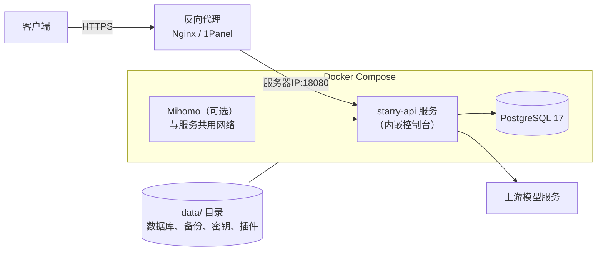
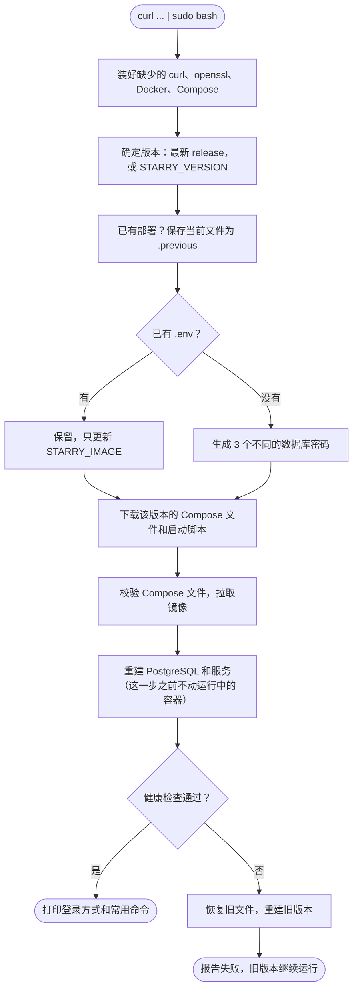
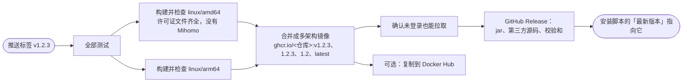

# 部署指南

Starry API 以 Docker 镜像发布。服务器上不需要 Java、Gradle 或 Node.js，也不在服务器上编译。

| 方式 | 适合谁 | 命令 |
| --- | --- | --- |
| [一键安装](#一键安装) | 有一台 Linux 服务器，想要最省事的生产部署 | `curl -fsSL https://raw.githubusercontent.com/StaR4y/starry-api/main/scripts/install.sh \| sudo bash` |
| [Docker Compose](#docker-compose) | 已经有 Docker，或者在 macOS / Windows 上试用 | `./scripts/docker-up.sh` |
| [从源码构建](#从源码构建) | 改过代码，或者不想用发布的镜像 | `./scripts/docker-up.sh --build` |
| [不用 Docker](OPERATIONS.md#启动服务) | 本机开发 | 见运维手册 |



## 一键安装

需要一台 Linux 服务器，建议至少 **2 GiB 可用内存**和 SSD，并有 root / sudo 权限。服务器要能访问 GitHub（下载 Compose 文件）和 `ghcr.io`（拉镜像）；访问不了时见[镜像源与离线安装](#镜像源与离线安装)。

```bash
curl -fsSL https://raw.githubusercontent.com/StaR4y/starry-api/main/scripts/install.sh | sudo bash
```

已有域名时，可以同时告诉它，登录地址就会显示成这个域名：

```bash
curl -fsSL https://raw.githubusercontent.com/StaR4y/starry-api/main/scripts/install.sh \
  | sudo env PUBLIC_BASE_URL=https://api.example.com bash
```

> **安全提示**：`curl ... | sudo bash` 会以 root 直接执行下载到的脚本。想先检查的话，下载下来看过再运行：
>
> ```bash
> curl -fsSL https://raw.githubusercontent.com/StaR4y/starry-api/main/scripts/install.sh -o install.sh
> less install.sh
> sudo bash install.sh
> ```

### 脚本做了什么



下载或拉取镜像失败时，运行中的服务不受影响：这些步骤都排在改动容器之前。

安装目录默认是 `/opt/starry-api`：

```text
/opt/starry-api/
├── .env                  密码和设置（权限 0600）
├── docker-compose.yml    这个版本的 Compose 文件
├── docker/               PostgreSQL 初始化脚本、Mihomo 启动脚本
├── starry-api            管理命令（链接到 /usr/local/bin/starry-api）
└── data/
    ├── postgresql/       数据库文件
    ├── backups/          数据管理的备份
    ├── security/         数据管理的校验值（权限 0700）
    ├── plugins/          插件
    ├── documentation/    使用文档的附件
    ├── model-pricing/    价格目录缓存
    └── model-ranking/    模型排行缓存
```

> ⚠️ **不要删除 `data/postgresql`**，除非你打算永久清空数据库。

## 安装之后

### 1. 查看 admin 登录信息

```bash
sudo starry-api info
```

它显示控制台地址、反向代理该指向哪里、服务状态，以及 Root 用户（`admin`）的**初始密码**。密码以加盐哈希保存、读不回来，所以初始密码只在「Root 还没改过密码，并且服务日志里还留着首次启动打印的那一行」时才显示；否则会告诉你原因。**初始密码只能用一次：登录后控制台会强制你改密码。**

初始密码找不到了，或者忘了新密码：

```bash
sudo starry-api reset-password
```

（RHEL 系的 `sudo` 可能不搜索 `/usr/local/bin`，提示找不到命令时用 `sudo /opt/starry-api/starry-api`。）

输入 `RESET` 确认后，它为 Root 设置新的临时密码、重启服务（所有控制台会话随之登出），并**只显示一次**新密码。更多用法见 [运维手册](OPERATIONS.md#服务器上的-starry-api-命令)。

> 数据管理的安全密钥（`dmsk-…`）**不能**在服务器上显示、找回或重置，`starry-api` 只显示它的状态。被锁定时见 [恢复被锁定的数据管理](OPERATIONS.md#恢复被锁定的数据管理)。

### 2. 配置反向代理，启用 HTTPS

安装脚本默认把端口绑定在 `0.0.0.0:18080`，方便容器化的 1Panel / OpenResty 通过宿主机端口访问。**请用防火墙或安全组限制这个端口**，只通过 HTTPS 反向代理对外开放。

以 1Panel 为例，在「网站 → 创建网站 → 反向代理」里填：

| 设置 | 值 |
| --- | --- |
| 代理地址 | `http://<服务器IP>:18080` |
| 域名 | 你的域名 |
| HTTPS | 在 1Panel 里启用 |

> ⚠️ **1Panel 的 OpenResty 跑在 Docker 里时，不要用 `127.0.0.1`**：对它来说 `127.0.0.1` 是它自己的容器，会得到 `502 Bad Gateway`。请用安装脚本打印的服务器 IP。只有 Nginx 直接运行在宿主机上时才可以用 `http://127.0.0.1:18080`，这时还可以把 `HOST_BIND_ADDR` 设成 `127.0.0.1`。

使用文档要上传大文件时，反向代理的请求体上限至少要 **65 MiB**（Nginx：`client_max_body_size 65m;`），见 [用户文档系统](USER_DOCUMENTATION.md#图片视频与附件)。

### 3. 登录控制台

打开 `https://你的域名/#/login`，用 `admin` 和初始密码登录，**立即改密码**。接着按 [快速开始指南](QUICKSTART.md) 添加账号和 API Key。

## 升级与回滚

升级就是重新执行安装命令。默认装最新的 release，也可以指定版本（回到旧版本也用这个办法）：

```bash
curl -fsSL https://raw.githubusercontent.com/StaR4y/starry-api/main/scripts/install.sh \
  | sudo env STARRY_VERSION=v1.2.3 bash
```

`.env` 和 `data/` 保持不变。Compose 文件、启动脚本和 `.env` 的上一版留在相邻的 `.previous` 文件里。之后任何一步失败，都会恢复整套旧文件；如果容器已经开始改动，还会重建旧版本并确认健康。自动回滚每次运行最多尝试一次。

要知道的几点：

- 安装目录里的 `.env` 只有 root 能读，所以 `docker compose` 命令要加 `sudo`。
- 安装脚本运行中断时（Ctrl-C、`kill`）也会回滚；SSH 断开不会打断它。真的半途退出了，重新运行时它会沿用上次保存的 `.previous` 文件，不会用半成品覆盖。
- 服务已经部署在别的目录时（`docker ps` 里有 `starryapi-postgres`），脚本拒绝继续，并告诉你用 `INSTALL_DIR` 指向那个目录。容器名是固定的，一台机器上只能有一套部署。
- 用了 [TLS bridge](ACCOUNT_EGRESS.md#tls-bridge实验性) 时，脚本只启动基础的 Compose 文件。结束时它会打印把 bridge 加回来的两条命令。
- 数据库迁移只向前。新版本已经迁移过数据库之后再回到旧版本，旧版本可能启动失败。重要升级前先在控制台做一次备份，见 [数据库备份与数据传输](OPERATIONS.md#数据库备份与数据传输)。
- **首次安装**没有上一版可恢复。失败时生成的 `.env`、Compose 文件和 PostgreSQL 数据原样保留，修好问题后重新运行即可，脚本会复用同一份密码。

### 从旧的 jar 部署升级

用旧版安装脚本（`docker-compose.artifact.yml` 加 `app/starry-api.jar`）装过的服务器，直接运行新的安装命令：

1. 保留原来的 `.env` 和 `data/`，用同样的容器名切换到镜像。
2. 新版本健康之后，旧文件移到 `legacy-jar-deployment.<时间>/`，确认没问题后可以自己删除。
3. 新版本起不来时，回到原来的 jar 部署，文件和启动方式都和之前一样。

## Docker Compose

已经有 Docker 时，克隆仓库后一条命令启动。Linux、macOS、Windows（WSL）都可以，不需要 root：

```bash
git clone --depth 1 https://github.com/StaR4y/starry-api.git
cd starry-api
./scripts/docker-up.sh
```

第一次运行时，脚本从 `.env.example` 生成 `.env`，三个数据库密码随机生成；已有 `.env` 时会检查密码，拒绝默认值和重复值。然后执行 `docker compose up -d`。

脚本还会拒绝两种会弄丢数据的情况：`.env` 不在但 `data/postgresql` 还在（新密码打不开旧数据库），以及同一台机器上已有另一个目录里的部署。

```bash
./scripts/starry-api.sh info                # 登录信息
docker compose logs -f service              # 看日志
docker compose pull service && docker compose up -d   # 升级到 STARRY_IMAGE 指向的镜像
docker compose down                         # 停止（数据还在 data/ 里）
```

要固定版本，把 `.env` 里的 `STARRY_IMAGE` 改成某个发布的标签，例如 `ghcr.io/star4y/starry-api:v1.2.3`。想部署可选的 Mihomo，在 `.env` 里加 `COMPOSE_PROFILES=mihomo` 和 `STARRY_EGRESS_CONTROLLER_SECRET=<随机字符串>`，见 [账号出站代理](ACCOUNT_EGRESS.md#部署)。

## 从源码构建

```bash
git clone https://github.com/StaR4y/starry-api.git
cd starry-api
./scripts/docker-up.sh --build
```

镜像在 Docker 里构建，本机不需要 Java 和 Node.js。以后更新：

```bash
git pull
docker compose up -d --build
```

更新后页面还是旧的，就不用缓存重建一次，并刷新浏览器缓存：

```bash
docker compose build --no-cache service
docker compose up -d service
```

⚠️ **如果你改了代码并让别人通过网络使用**，AGPL-3.0 第 13 条要求你向这些用户提供修改后的源码。控制台不在页面上放源码链接，需要你自己提供；`.env` 里的 `STARRY_SOURCE_URL` 只决定 Root 首次登录确认对话框里显示的地址。见 [配置参考](CONFIGURATION.md#源代码与许可证)。

## 配置变量

这些变量控制安装脚本本身，用 `env` 传入。服务的设置写在 `.env` 里，全部设置见 [配置参考](CONFIGURATION.md)。

```bash
curl -fsSL https://raw.githubusercontent.com/StaR4y/starry-api/main/scripts/install.sh \
  | sudo env INSTALL_DIR=/opt/starry-api HOST_HTTP_PORT=18080 PUBLIC_BASE_URL=https://api.example.com bash
```

| 变量 | 默认值 | 作用 |
| --- | --- | --- |
| `STARRY_VERSION` | 最新 release | 要安装的版本标签，例如 `v1.2.3` |
| `INSTALL_DIR` | `/opt/starry-api` | 安装目录 |
| `HOST_BIND_ADDR` | `0.0.0.0` | 宿主机端口绑定地址，只在全新安装时写入 `.env`。仅当反向代理跑在宿主机上时才设成 `127.0.0.1` |
| `HOST_HTTP_PORT` | `18080` | 宿主机端口，只在全新安装时写入 `.env` |
| `SERVER_PORT` | `8080` | 容器内 Spring Boot 端口，只在全新安装时写入 `.env` |
| `PUBLIC_BASE_URL` | 空 | 公网 HTTPS 地址，用于显示登录地址 |
| `ENABLE_MIHOMO` | `auto` | 可选的 Mihomo 出站组件。`auto`：全新安装时部署（空闲，约 20 MB），已有 `.env` 不改动，所以升级不会悄悄多出容器；`true`：也给已有 `.env` 追加（旧文件先保存为 `.env.previous`，重复执行不产生重复项）；`false`：不部署，已有的保持不变。部署指在 `.env` 写入 `COMPOSE_PROFILES=mihomo` 和随机生成的 `STARRY_EGRESS_CONTROLLER_SECRET`（不会打印）并拉取官方 `metacubex/mihomo` 镜像；是否使用由管理员在「系统设置 → 出站代理」打开开关。详见 [账号出站代理](ACCOUNT_EGRESS.md#部署) |
| `FORCE_ENV` | `false` | 在数据库初始化**之前**重新生成 `.env`；或重新启用上次失败部署保留的凭据。已初始化的集群见[数据库](#数据库) |
| `INSTALL_DOCKER` | `true` | 缺少 Docker 时是否自动安装 |
| `CLI_LINK_PATH` | `/usr/local/bin/starry-api` | `starry-api` 命令的链接位置。只在目录存在、且该路径不存在或已经是指向某个安装目录的链接时才创建或更新，**绝不覆盖**无关文件；设成空字符串则不创建链接（仍可直接运行 `${INSTALL_DIR}/starry-api`） |
| `IMAGE_REPO` | `ghcr.io/star4y/starry-api` | 镜像仓库，标签仍是版本号。写入 `.env` 后，以后的升级继续用它 |
| `STARRY_IMAGE` | 空 | 完整的镜像引用，优先于上面两项 |
| `PULL_IMAGE` | `true` | `false` 时不拉取，要求镜像已经在这台机器上 |
| `HEALTH_WAIT_SECONDS` | `300` | 等新版本通过健康检查的秒数，回滚时等旧版本也用它。升级要跑很长的数据库迁移时调大，否则会被判定失败并回滚 |
| `REPO_RAW_BASE` | 该版本的 GitHub raw 地址 | Compose 文件和脚本的下载地址 |
| `GITHUB_REPO` | `StaR4y/starry-api` | 查询最新 release 的仓库 |

### 镜像源与离线安装

访问 `ghcr.io` 或 GitHub 不方便时，用自己的镜像仓库和文件地址：

```bash
curl -fsSL https://你的镜像/install.sh | sudo env \
  STARRY_VERSION=v1.2.3 \
  IMAGE_REPO=registry.example.com/starry-api \
  REPO_RAW_BASE=https://你的镜像/starry-api/v1.2.3 \
  bash
```

没有镜像仓库时，在能联网的机器上导出镜像，拷到服务器后导入：

```bash
# 能联网的机器：--platform 写服务器的架构（linux/amd64 或 linux/arm64）
docker pull --platform linux/amd64 ghcr.io/star4y/starry-api:v1.2.3
docker save ghcr.io/star4y/starry-api:v1.2.3 | gzip > starry-api-v1.2.3.tar.gz

# 服务器：导入后不再拉取
gunzip -c starry-api-v1.2.3.tar.gz | sudo docker load
sudo env STARRY_VERSION=v1.2.3 PULL_IMAGE=false REPO_RAW_BASE=https://你的镜像/starry-api/v1.2.3 bash install.sh
```

`postgres:17-bookworm` 和可选的 `metacubex/mihomo` 镜像也要能取到；不用 Mihomo 时加 `ENABLE_MIHOMO=false`。

## 数据库

- 数据库和 schema 的名字固定是 `starry_api`；Flyway 用 `starry_api_migration` 角色迁移，应用日常用 `starry_api` 角色。
- `starry_api_bootstrap` 是 PostgreSQL 的超级用户，只用于集群归属和数据库层面的应急恢复，**服务从不使用它**，也**不会**暴露在 Compose 内部网络之外。请单独保管并审计它的密码。
- 默认的数据库参数假定**至少 2 GiB 可用内存**和 SSD。每个服务副本的 `POSTGRES_POOL_MAX_SIZE` 加起来要小于 `POSTGRES_MAX_CONNECTIONS`，并为迁移、维护、监控、运维连接留出余量。
- ⚠️ **公开服务绝对不要把 `STARRY_ALLOW_ANONYMOUS_PROXY` 设成 `true`**，那样不需要 API Key 就能调代理。
- ⚠️ **集群一旦初始化（出现 `data/postgresql/PG_VERSION`），安装脚本就拒绝再生成新密码**，因为光改 `.env` 并不能改变已初始化集群里的角色密码。要轮换密码，先在 PostgreSQL 里改角色密码，再手动改 `.env`。唯一的自动例外：首次部署失败回滚时保留下来的 `.env.postgresql-retry`，此时 `FORCE_ENV=true` 会重新启用那份凭据，而不是生成新的。

## 发布新版本

给维护者。推送 `v*` 标签就会触发 [`.github/workflows/release.yml`](../.github/workflows/release.yml)：

```bash
git tag v1.2.3
git push origin v1.2.3
```



- **第一次发布要多一步**：GitHub 上新建的镜像包默认是私有的，这时所有人安装都会失败。工作流会在创建 Release 之前用未登录的状态试拉一次，私有就报错停下。到仓库的 **Packages → starry-api → Package settings** 把可见性改成 Public，再重新运行失败的任务（7 天内都可以），之后的版本不用再改。
- 带后缀的标签（`v1.2.3-rc.1`）是预发布：不更新 `latest` 镜像标签，安装脚本默认也不会选它。
- 同步到 Docker Hub：在仓库设置里添加 secrets `DOCKERHUB_USERNAME` 和 `DOCKERHUB_TOKEN`，镜像会同时发布到 `docker.io/<用户名>/starry-api`。不配就只发布到 GitHub Container Registry，不需要额外的密钥。
- 每个架构的镜像都在打标签之前检查过内容，有问题的镜像不会变成 `latest`。
- 每次发布都带着许可证文件：镜像的 `/app` 里有 `LICENSE`、`NOTICE`、`licenses/` 和 `third-party-sources/`（5 个按 copyleft 许可证使用的 Java 库的源码，见 [NOTICE](../NOTICE) 第 3 节），jar 的 `META-INF/` 里也有。CI 用 `scripts/check-release-contents.sh` 确认这些都在，并且镜像和 jar 里没有 Mihomo 二进制（Mihomo 是 GPL-3.0，只在部署时由 Docker 拉取，不随本项目分发）。

镜像不再放进 git 仓库，仓库里也没有 `artifacts/` 目录了。
