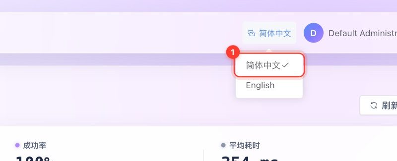
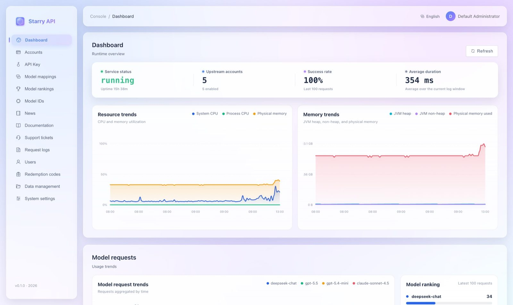

# 中英文界面

控制台支持 **简体中文** 和 **English** 两种界面语言，并且「使用文档」可以写成双语版本。

## 怎么切换语言

登录页和控制台右上角都有语言选择，点一下展开，选「简体中文」或「English」：



切换后整个界面立刻变成对应语言（下图是英文版仪表盘）：



**规则**

- **首次访问**：按浏览器的首选语言——中文浏览器显示简体中文，其他语言显示英文。
- **记住你的选择**：保存在当前浏览器的 `starry.locale` 里。刷新、重新登录、同源的其他标签页都会保持一致或自动同步。浏览器禁用了存储时，仍可在当前页面切换，只是不会被记住。
- **切换不打断工作**：不会重新加载页面，不会清空未保存的表单或文档草稿。导航、页面标题、按钮、表单校验提示、空状态、日期和数字的显示都会同步更新。已经弹出的消息是当时操作的结果，不会追溯修改。
- **覆盖范围**：用户端和管理端全部页面，包括 API Key 与 CC Switch 配置引导、充值和 Coding Plan、模型列表和定价、账号、工单、文档、系统设置、插件管理、数据管理。较长的英文标签会自动换行，手机端也能正常使用。

## 哪些会翻译，哪些不会

**只改变显示，不改变数据**：

- 语言设置**不会**转换货币、时区策略、计费倍率或额度。充值金额仍然是人民币（CNY），模型的官方成本仍然按美元计算。
- 模型 ID、协议名、Base URL、API Key、计费枚举值、复制出来的配置文件和 CC Switch 导入链接**保持原值**。
- 用户名、用户输入的内容、工单内容、管理员配置的品牌名与说明、新闻源正文、第三方插件自带的页面，**不会自动翻译**。
- 常见的后端错误会在界面上按完整消息翻译，**错误码不变**；没见过的错误和原始诊断信息保留服务端原文。服务端日志和邮件模板仍使用现有语言，目前没有账号级的「邮件语言偏好」。

## 双语使用文档

管理员在「系统设置 → 文档管理」里，编辑器提供 **原文 / English** 两个内容页签：

- English 版有**独立的标题、分类、摘要和正文**，与原文共享排序、附件和文档版本号。
- 界面语言和你正在编辑的内容语言**互不影响**。
- **保存或发布时，两种语言一起保存**；并发编辑仍受版本号保护。添加英文内容时要填标题、分类和正文；也可以随时移除英文版。
- **读者按界面语言阅读**；某篇文章没有英文版时，自动回退到原文。**未发布**的英文草稿不会出现在读者的搜索或阅读结果里。

接口层面：

- `GET /documentation?lang=en-US` 和 `GET /documentation/pages/{id}?lang=en-US` 返回**已发布**的英文内容，没有时返回已发布的原文。
- `en` 以及其他 `en-*` 标签同样选择英文；不传语言或语言不支持时返回原文。搜索针对实际返回的语言版本，列表只返回元数据。

**默认教程的英文版**：14 篇默认教程都带英文版。迁移 `V22__documentation_english.sql` 先为最初的六篇补充了英文，`V23__documentation_tutorials.sql` 又把它们扩充为 14 篇，并同步提供英文；`V24__documentation_user_focus.sql` 再把其中带有部署、运维和管理员操作的措辞删掉。它们都**只处理没被改过的默认文章**：升级时，仍是原样（草稿与发布一致、没有被编辑过）的旧教程会换成新版；你改过、只存了草稿、下线或删除的文章**不会被覆盖**。已经自定义过的教程，由管理员自行补充英文。

**附件权限**：检查同时覆盖原文和英文的草稿与发布引用——只在英文草稿里出现的附件不会对读者开放；已发布英文引用的附件可以阅读；只要任一草稿或发布版本还在引用，就不能删除该文件；下线文章后，两种语言的读者附件链接都会失效。

数据库恢复所需的迁移版本现为 **V1–V32**，仍然严格检查迁移历史和校验和。

---

## 给开发者：怎么维护翻译

- 翻译入口：`webui/src/i18n/index.ts`；英文词条：`webui/src/i18n/en.json`。
- 在代码里用显式的 `t('中文界面文案')`。**中文原文同时也是找不到翻译时的回退**。没有 DOM 文本替换、没有外部翻译请求，也没有额外的国际化运行库。
- 带变量的句子用完整消息加参数：

  ```ts
  t('已复制 {p0}', { p0: filename })
  ```

  参数通过回调替换，只识别 `{p0}`、`{p1}` 这样的占位符，**不会**把参数解释成消息或 HTML。文档里的 `{{api_base_url}}` 不会被界面翻译处理。**不要**把用户输入、协议标识或业务枚举当翻译键。

- 静态的选项数组，展示用的属性请用 **getter** 或在 `computed` 里创建，这样切换语言后不会缓存旧语言；可编辑的字段保持普通可写数据即可。
- 路由元信息里存的是**中文源标题**，在显示和浏览器标题处再翻译。

```bash
cd webui
npm run test:i18n
npm run test:documentation
npm run build
```

国际化测试检查：语言选择与持久化、跨标签同步、响应式文案、用户输入保持不变、代码与导入链接不变、模板占位符、词条参数一致、全站显式词条覆盖。文档后端测试覆盖语言选择、验证、回退、搜索与草稿隔离，以及英文附件权限。
