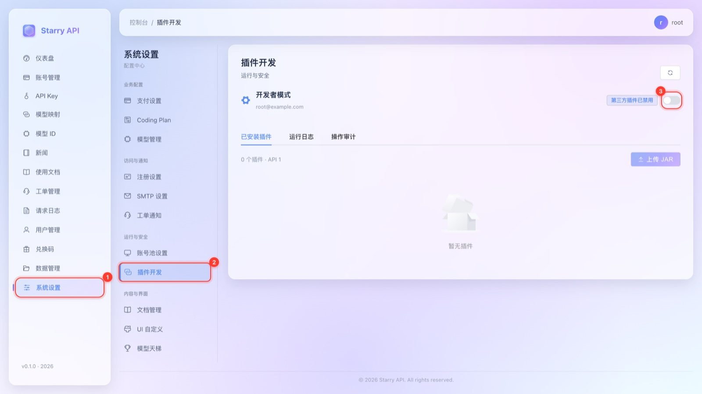
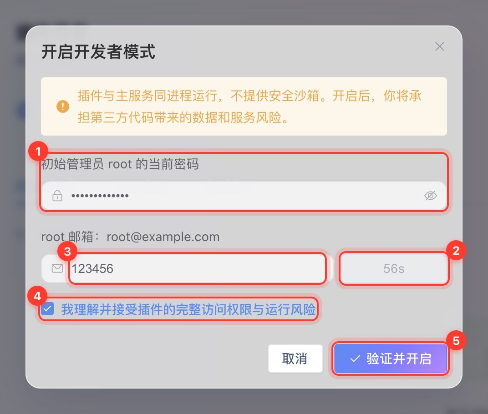
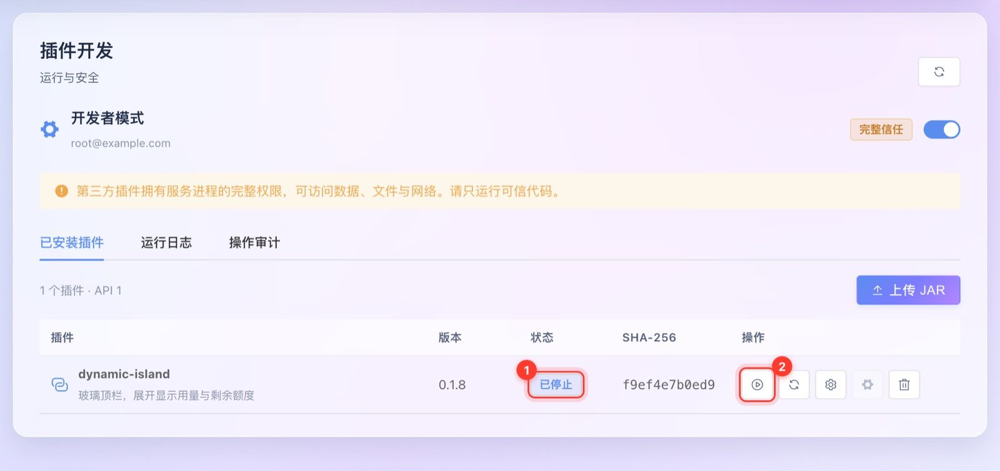
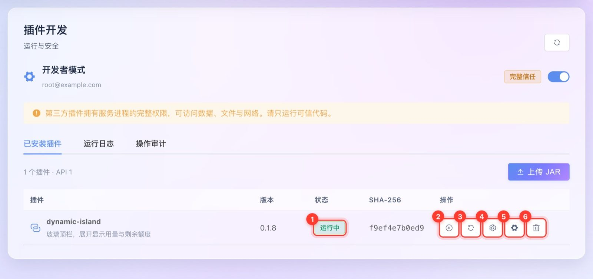
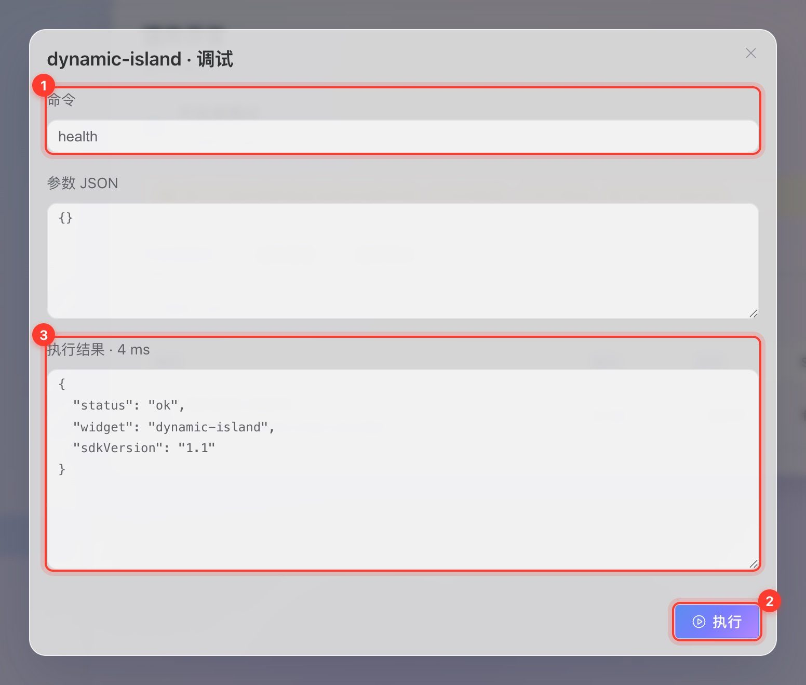
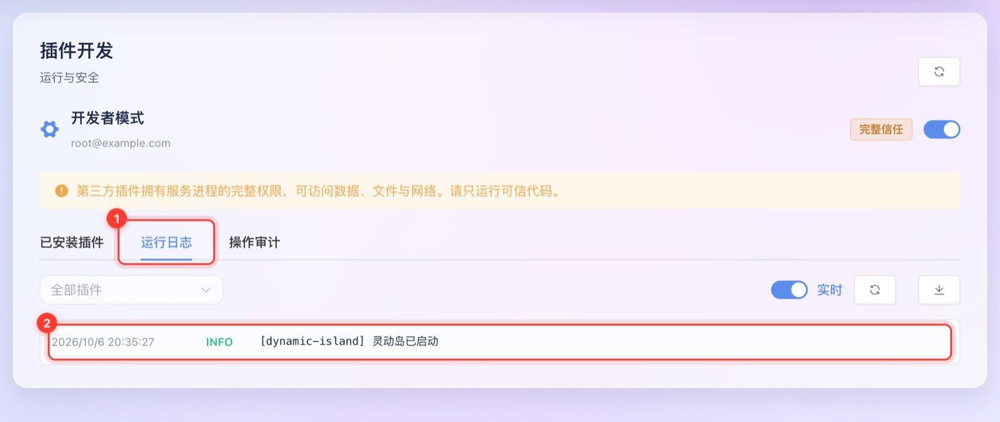
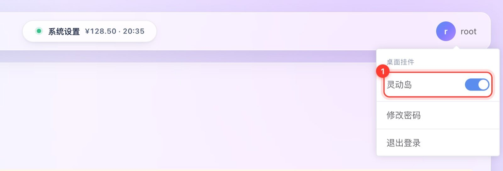
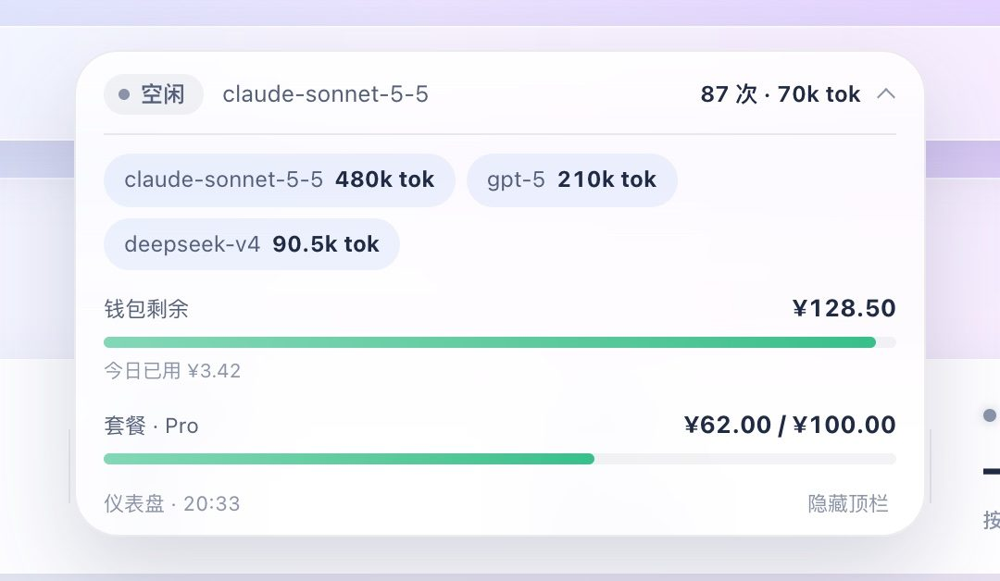

# 插件开发

Starry API 支持用 JAR 包扩展功能的插件机制（基于 PF4J）。典型用途：在控制台里加一个挂件、调用服务内部的业务能力、定时做点后台任务。

> ⚠️ **这是一个「完全信任」的、进程内的开发者插件系统。**插件和主服务在**同一个 JVM 进程**里运行，拥有对服务的**完整访问权限**——可以读数据、读写文件、访问网络。这里**没有**插件市场、没有签名要求、没有 Security Manager、没有网络沙箱，也不会自动审查插件的任意行为。**只运行你信任的代码。**
>
> 当前版本只支持**单实例**部署：已安装插件的元数据和授权是持久的，但已加载的类、生命周期串行化、日志和上传的文件都只在本实例内。**不要**在多个共享同一数据库的副本上启用它，没有集群范围的安装 / 重载 / 停止协调。

**目录**：[安装并启用插件](#安装并启用插件) · [开发者模式与授权](#开发者模式与授权) · [热重载与重启诊断](#热重载与重启诊断) · [应急恢复与目录](#应急恢复与目录) · [写一个插件（SDK）](#写一个插件sdk) · [示例：灵动岛](#示例灵动岛) · [日志与持久化](#日志与持久化) · [HTTP 接口](#http-接口)

---

## 安装并启用插件

整个流程在控制台的 **系统设置 → 插件开发**（`/#/settings/plugins`）里完成。**只有初始 Root 管理员能看到它**。下文的截图使用的是示例插件「灵动岛」。

### 第 1 步：打开「插件开发」

用 **Root** 登录，① 点左侧「系统设置」，② 点二级菜单「插件开发」。③ 就是「开发者模式」开关，默认关闭，此时「上传 JAR」是灰色的。



> 找不到「插件开发」？说明当前不是 Root 账号。其他管理员（包括你新建的 `ADMIN`）看不到这个入口。

### 第 2 步：开启开发者模式

点开关，在弹窗里依次：

1. 输入 **Root 的当前密码**；
2. 点「发送验证码」，验证码发到 **Root 绑定的邮箱**（所以必须先绑定邮箱并配好 SMTP）；
3. 填 6 位验证码；
4. 勾选「我理解并接受插件的完整访问权限与运行风险」；
5. 点「验证并开启」。



成功后开关变蓝，标签变成「完整信任」，并出现一条风险提示；「上传 JAR」变为可点：


### 第 3 步：上传 JAR

点「上传 JAR」，选择插件文件（只接受 `.jar`，不超过 **32 MiB**）。确认窗口里的提示很重要：**安装后保持停止状态**；同 ID 的旧插件会被停止并替换，**配置和数据保留**。


### 第 4 步：启动

安装后，插件出现在列表里，状态「已停止」。点 ② ▶ 启动：



状态变成绿色的「运行中」就成功了。一行里的按钮含义：



| 编号 | 按钮 | 作用 |
| --- | --- | --- |
| ① | 状态标签 | 显示当前状态；出错时悬停可看原因 |
| ② | ⏸ 停止 | 停止插件（已停止时是 ▶ 启动） |
| ③ | 🔄 重载 | 不重新上传，直接重启插件，并读取最新配置 |
| ④ | ⚙ 配置 | 编辑插件的 JSON 配置（改完要「重载」才生效） |
| ⑤ | 🛠 调试 | 向插件发送它自己定义的调试命令 |
| ⑥ | 🗑 移除 | 卸载插件（**数据目录保留**） |

状态含义：已停止 / 启动中 / 运行中 / 停止中 / 失败 / **需重启**（见下文「热重载与重启诊断」）。

### 调试与日志

点「调试」，填命令（如 `health`）和参数 JSON（≤ 64 KiB），点「执行」：



「运行日志」标签页可以实时看插件的日志，也能按插件过滤并导出当前记录；「操作审计」标签页是分页的历史记录：



### 让挂件显示出来

带前端挂件的插件启动后，**刷新一次浏览器页面**才会加载它的脚本。每个用户可以在右上角头像菜单的「桌面挂件」里**自己开关**：



---

## 开发者模式与授权

- 第三方插件在**全新数据库上默认禁用**。**没有任何环境变量**可以代替验证来开启开发者模式。
- 不可变的 `application_root_user_id` 标识初始管理员。**其他 ADMIN 账号和 `KIRO_ADMIN_TOKEN` 都不能管理插件**。
- 只有 Root 能看到「插件开发」导航项、打开它的路由。`GET /admin/plugins` 也要求 Root，对其他管理员返回 `403 PLUGIN_ROOT_REQUIRED`，而不是一个脱敏的状态页。配置、生命周期操作、调试、审计和日志都保留 Root 校验。
- 开启需要：Root 账号的**当前**密码 + **只发给它绑定邮箱**的 6 位验证码 + 明确的风险确认。最初引导用的明文密码既不保留也不复用。
- 验证码 **10 分钟**过期，**只能用一次**，并绑定请求的会话与 Root 凭据 / 邮箱指纹；重新发送会让旧码失效。
- 请求有 **60 秒**的发送冷却。**连续 5 次验证失败会锁定后续验证 15 分钟**。数据库行锁保护并发尝试；关闭开发者模式**不会**重置该锁定。
- SMTP 发送失败**不允许**激活。即使注册邮件设置里跳过了验证，也**绕不过**这个独立的验证码挑战。
- 验证码以加盐的 PBKDF2 哈希存储。密码、验证码、会话凭据、配置值和调试输入 / 输出都**不会**进入生命周期审计。

### 安装与生命周期

- **安装不会执行插件代码。**启动是显式操作；成功启动的插件会被标记为「下次服务启动时自动启动」，但**仅当开发者模式仍然开启**。**只是把 JAR 放进目录永远不会安装它。**
- 替换同 ID 的插件：先停止旧版本，**保留配置和数据**，新版本保持停止状态。移除插件会保留它的数据目录。
- **关闭**开发者模式：撤销新的加载、清除自动启动标记，并在 Root 授权通过后尝试停止所有已加载的插件。
- 正常的安装、替换、启动、停止、重载、移除都**不需要重启宿主服务**。同一 JVM 内的清理是「协作式」的，不是安全边界，见下文。

---

## 热重载与重启诊断

**重载时**，宿主按顺序：取消托管任务 → 调用 `stop()` → 撤销上下文及其临时 Root 会话 → 关闭已注册的资源 → 等待托管工作排空 → 卸载 PF4J 包装器 / 类加载器 → 用新的配置快照重新加载。关闭服务时走同一条清理路径，但**不会**清除成功插件的自动启动设置。普通的重载**不是零停机**：从停止到成功启动之间，插件不可用。

停止后的清理宽限期是 **2 秒**，由线程池终止、并发的资源释放和 SDK 请求终止共用。同步回调可能超过这个宽限：整个生命周期 / 调试操作有 **60 秒**总超时（含排队时间）。**仅仅一个被取消的 Future 并不能证明它的任务已经退出。**

`GET /admin/plugins` 返回 `restartRequired` 以及仅 Root 可见的 `restartReasons`（含 `pluginId`、`operation`、`code`、`detail`、`at`）：

| 代码 | 含义 |
| --- | --- |
| `INITIALIZATION_FAILED` | 在可用的宿主上下文出现之前构造就失败了，非托管的启动副作用不确定 |
| `STOP_FAILED` | 插件的 stop 回调失败 |
| `RESOURCE_CLOSE_FAILED` | 至少一个已注册资源关闭失败 |
| `RESOURCES_STILL_CLOSING` | 已注册的关闭回调还没结束 |
| `TASKS_STILL_RUNNING` | 托管线程池没能在清理宽限期内终止 |
| `REQUESTS_STILL_ACTIVE` | SDK 的 HTTP 订阅还没终止 |
| `CLEANUP_FAILED` / `UNLOAD_FAILED` | 清理或 PF4J 卸载抛了错误 |
| `OPERATION_TIMEOUT` / `OPERATION_CANCELLED` | 操作在进入插件代码后被中断，无法确认完全终止 |

这些原因在 JVM 生命周期内是**粘性的**，按插件 / 代码去重，同时记入运行日志和持久的审计事件。受影响的插件会报告 `RESTART_REQUIRED`；启动、重载、替换和调试都会被拒绝，返回 HTTP 409 `PLUGIN_RESTART_REQUIRED`，并且不再提供它的前端挂件资源（已经执行过的浏览器脚本不会被追溯撤销，改动挂件插件后请刷新页面）。Root 仍然可以编辑配置或重试停止 / 清理。移除要求清理成功；移除或之后成功的停止**都不会**清除历史的重启标记。请在调查并修正插件之后**重启服务**。失败 / 不确定的启动会清除自动启动标记，不会有插件在启动失败后被自动重试。

- 一次「部分失败的 `start()`」，只要成功停止并清理，只算 `FAILED`：修正配置或替换 JAR 后再启动，不需要重启服务。
- 仍在排队时超时的操作会被审计，但**不会**产生虚假的重启原因，也永远不会稍后再执行。
- 已超时的、正在运行的回调可能无视中断，但返回时它既不能发布一次成功的启动，也不能重新开启自动启动，它的 SDK 上下文会被立即撤销。串行的生命周期工作线程可能被一段永不返回的代码占住，之后排队的动作会超时，直到重启宿主。

这检测的是**托管**的清理失败，**不是所有 JVM 泄漏**。任意的宿主引用、未注册的监听器、裸线程、原生代码和已经派发出去的副作用，都无法被强制撤销或全面检测。关闭类加载器并不保证 JVM 立刻卸载类 / GC，也不会撤销对 Spring Bean 的直接引用。请通过 SDK 注册资源 / 任务，并让 stop 回调**幂等**。如果将来需要强制终止，请使用进程隔离，而不是对 PF4J 做更强的断言。

---

## 应急恢复与目录

**应急开关**：设置环境变量 `STARRY_PLUGINS_DISABLED=true` 并重启。这是单向的启动开关，界面无法覆盖它。它本身**不会**擦除已安装的包，也不会清除已存储的开发者模式设置；如果要让插件继续保持禁用，请在移除这个启动覆盖之前，先通过 Root 接口撤销开发者模式。

`STARRY_PLUGIN_DIR` 默认是 `${user.home}/.starry-api/plugins`：

```text
plugins/
  packages/<id>-<sha256>.jar
  data/<id>/
```

- 请把这个目录放在**持久的、服务拥有的文件系统**上。
- **数据库备份只包含安装元数据，不包含插件 JAR 和数据目录**，要单独备份它们。
- 恢复数据库时，请先**强制禁用插件**并把服务全新重启；没有任何沙箱能阻止持有服务直接句柄的完全信任代码。
- 源码 Compose、安装器和产物发布模板都把 `./data/plugins:/app/plugins` 挂载进去。**已有的部署**在安装插件之前，需要自己加上这个挂载和 `STARRY_PLUGIN_DIR=/app/plugins` 环境变量。

---

## 写一个插件（SDK）

### 项目与构建

SDK 1.1 的 Gradle 模块布局：旧的 `api` 模块现为 `service-api`（Java 包名和 HTTP 路由不变），它包含业务契约和 DTO（含插件管理 DTO）；`plugin-api` 只包含开发者 SDK。两个 API 模块互不依赖。

构建 SDK 和 `settings.gradle` 当前包含的插件：

```bash
./gradlew :service-api:jar :service-api:sourcesJar :plugin-api:jar :plugin-api:sourcesJar :plugin-whale-widget:jar
```

产物：

- `plugin-api/build/libs/plugin-api-0.1.0-SNAPSHOT.jar`
- `service-api/build/libs/service-api-0.1.0-SNAPSHOT.jar`
- 同级项目里插件的 jar（如 `../whale-whidget-plugin/build/libs/starry-whale-widget-plugin.jar`）

`settings.gradle` 会在**与 `starry-api` 同级的目录里存在**时，自动把可选插件项目（`../whale-whidget-plugin`、`../dynamic-island-plugin`）包含进构建。

**兼容性**：已经编译好的 SDK 1.0 插件在更新后的宿主上仍然可用。现有的上下文方法和 `Starry-Plugin-Api: 1` 清单不变，新的接口方法都有默认实现；使用新方法的插件需要 SDK 1.1 的宿主。`sdkVersion()` 和 `capabilities()` 描述的是当前上下文，**不是** Maven 构件版本。

**依赖规则**：

- 用 **Java 25** 编译。
- SDK、PF4J、Reactor 和任何宿主 API 依赖都用 `compileOnly`，**不要**打进插件 JAR。
- 第三方依赖必须包含在**一个普通 JAR** 里，必要时对冲突的库做重定位（relocate）。
- **不支持**：Boot 的 `BOOT-INF` 归档、外部清单 `Class-Path`、跨插件依赖。
- 上限：上传 32 MiB、展开后内容 128 MiB、最多安装 100 个。

```groovy
dependencies {
    compileOnly project(':plugin-api')
    compileOnly project(':service-api') // 仅在使用宿主业务契约时需要
}
```

### 必需的清单（Manifest）

```text
Manifest-Version: 1.0
Plugin-Id: my-plugin
Plugin-Version: 1.0.0
Plugin-Class: example.MyPlugin
Plugin-Provider: Example
Plugin-Description: Example integration
Starry-Plugin-Api: 1
```

### 插件类

继承 `tech.starryapi.plugin.sdk.StarryPlugin`，公共构造函数接收 `PluginWrapper`。宿主会在调用 `start()` **之前**初始化 `context()`；**构造函数里不要用它**。在 `stop()` 里释放非托管的订阅、客户端、文件和线程池，或者用 `manage(...)` 注册，让它们被自动清理。

```java
public record Settings(int heartbeatSeconds) {}

@Override public void start() {
    var settings = context().config(Settings.class);
    context().manage(() -> context().log(PluginContext.Level.INFO, "Resources closed"));
    if (settings.heartbeatSeconds() > 0) {
        context().tasks().repeat("heartbeat", Duration.ZERO,
            Duration.ofSeconds(settings.heartbeatSeconds()),
            () -> context().log(PluginContext.Level.DEBUG, "Heartbeat"));
    }
}
```

（示例需要标准的 `java.time.Duration` 和 SDK 的 import。）

### `PluginContext` 能做什么

| 方法 | 约定 |
| --- | --- |
| `service(Class<T>)` | 对已注册的宿主 Spring 服务和已实现的 API 契约的**完全访问**。没有业务域白名单。内部服务可能随宿主版本变化 |
| `service(name, Class<T>)` / `services(Class<T>)` | 选择具名的 Spring Bean，或以不可变 Map 的形式发现所有实现。有 `service-api` 里的契约时优先用契约 |
| `request(method, path, headers, bytes)` | 用一个短期的 Root 会话调用同主机已有的 HTTP API。已有端点的校验、计费和额外验证**仍然生效**。显式的 Authorization 头可以改为使用普通的代理 API Key |
| `requestStream(method, path, headers, bytes)` | 先发出一个 `PluginHttpEvent.Head`，再发出原始的 `Data` 块，不缓冲整个响应。空响应和非 2xx 响应会保留 HTTP 状态 |
| `configJson()` | 本次加载的不可变配置快照；改了配置要重载才生效 |
| `config(Class<T>)` / `json()` | 把配置解码为 record / DTO，并转换 JSON，而不暴露可变的宿主 mapper。DTO 里未知的字段被忽略；格式错误 / 尾随的 JSON 被拒绝；输入输出限 64 KiB 的 UTF-8 |
| `dataDirectory()` | 插件专属的持久数据目录 |
| `manage(AutoCloseable)` | 注册一个资源，返回一个只关闭一次的可释放句柄。响应式订阅可以注册 `subscription::dispose` |
| `tasks()` | 在每个插件懒创建的工作线程上运行具名的一次性任务和固定延迟任务 |
| `sdkVersion()` / `capabilities()` | SDK 1.1 声明 `json`、`service-discovery`、`managed-resources`、`managed-tasks`、`http-stream` |
| `log(level, message)` | 带标签的运行时日志，界面缓冲有界，并对常见的密钥做脱敏 |

**HTTP 帮助方法的限制**：拒绝外部 URL，日志里不包含敏感内容。`request` 最多缓冲 8 MiB 响应字节，总响应超时 60 秒。`requestStream` 在每个发出的信号之间有 60 秒的**空闲**超时，没有总时长或总大小限制——请施加背压并增量处理分块；块的边界既不是 SSE 消息边界，也不是 UTF-8 字符边界。下游消费太慢也会触发空闲超时。两个帮助方法在完成、取消、失败和超时时，都会撤销它们的临时 Root 会话。上下文被撤销会取消在途的调用并报告**错误**，而不是成功的部分输出。直接的服务 / 客户端调用**不会**自动获得这套审计 / 清理覆盖，普通的端点授权 / 计费 / 验证也**不会被绕过**。

### 托管的生命周期

- `manage` 每次插件加载最多允许 **256** 个存活资源。释放会移除注册；清理按注册的**逆序**进行。被拒绝的注册会立刻关闭传入的资源，包括与卸载的竞态。
- `tasks().schedule(name, delay, callback)` 只运行一次。`tasks().repeat(name, initial, delay, callback)` 的延迟从**完成时**算起，所以周期调用不会重叠。每次加载最多注册 **64** 个任务。名称只能用字母、数字、下划线、点或连字符，最长 64。
- 任务工作线程只在被使用时才创建，每个插件一个守护线程，独立于 Netty 事件线程和串行的插件生命周期线程。任务在 `stop` **之前**被取消，注册的资源在**之后**关闭——即使 `stop` 抛了异常。启动失败的清理也会关闭资源并取消任务。
- 取消会中断「协作式」任务，但**杀不死无视中断的代码**。资源清理回调也可能挂住；重启依然是最终的恢复手段。保留宿主服务的原始引用依然是完全信任的访问。
- 任务**不是**持久化的作业。重载或重启之后请在 `start` 里重新注册；修改 JSON 配置依然需要重载。撤销开发者模式期间，`stop` 应该使用**已经拥有的句柄**和 `log`，不要去请求新的上下文服务。
- 任务和资源清理的失败只包含异常类别和堆栈帧，**不含**任意的异常消息。周期任务在普通回调失败后继续运行。生命周期的 DEBUG 日志会标识任务的调度 / 取消。

`debug(command, json)` 是可选的、由插件自己定义的**同步**操作，输入输出都是 JSON（最大 64 KiB）。生命周期和调试回调运行在 Netty 事件线程之外一个串行的有界调度器上。**不要在你自己调度的插件回调里阻塞 Reactor / Netty 事件线程。**

---

## 示例：灵动岛

仓库里有一个完整的、可以直接构建的示例插件：**灵动岛（dynamic-island）**，是一个把控制台顶栏变成玻璃胶囊的前端挂件。它位于与 `starry-api` 同级的 `dynamic-island-plugin/` 目录，附带详细的 README。

| 空闲 | 计费中 | 展开 |
| --- | --- | --- |
|  |  |  |

它也是学习「前端挂件型插件」的好材料：插件的 Java 部分只有两行日志和两个调试命令（`health`、`capabilities`），真正的功能都在 `src/main/resources/web/widget.js`；挂件通过 `widget.json` 声明标题、缩略图和脚本，控制台从 `/system/plugin-widgets` 取到已启动的挂件列表，再从 `/plugin-assets/<插件ID>/` 加载它们。`/system/plugin-widgets` 只要求登录，所以**所有登录用户**（不只是管理员）都能看到挂件，并各自在头像菜单里开关。

构建（在 `starry-api` 目录里，`dynamic-island-plugin` 与它同级即可被自动包含）：

```bash
./gradlew :plugin-api:jar :plugin-dynamic-island:jar
```

---

## 日志与持久化

- Flyway V16 创建 `plugin_security_state`、`installed_plugins` 和 `plugin_audit`。
- 验证、模式切换、安装、生命周期、配置和调试操作都有**持久的审计事件**。插件回调失败只记录异常类别，**不记录**可能含密钥的任意异常消息。生命周期和调试失败还会在运行日志里记录最多 12 个堆栈帧用于诊断。
- 包的 SHA-256 只能发现磁盘上的**意外替换**，**不是签名**。
- 运行日志用 `tech.starryapi.plugins`，带插件 ID 标签，内存里最多保留 **2,000** 条（每次 HTTP 响应 500 条）。要持久化请用部署的日志方案。DEBUG 输出跟随服务端的日志级别。
- 生命周期审计保留 **90 天**。每小时的清理最多用一个范围很窄的数据库函数删除 10,000 条旧行。运行时数据库角色对审计表**没有**直接的 UPDATE / DELETE 权限。
- 这**不是**全面的网络监控，也不是对抗恶意同进程插件的防篡改审计：插件可以用任意形式记录密钥，或者完全绕过帮助方法。**不要把完全信任交给你不信任的代码。**

---

## HTTP 接口

所有路径都在 `/admin/plugins` 下，管理操作需要一个正常的 Root 会话。

| 方法 | 路径 | 用途 |
| --- | --- | --- |
| GET | `/` | 状态和已安装的包；其他管理员只会看到「需要 Root」的状态 |
| POST | `/verification` | 密码校验 + Root 邮箱验证码挑战 |
| POST | `/developer-mode` | 校验密码 / 验证码 / 风险确认并开启 |
| DELETE | `/developer-mode` | 关闭、让挑战失效并尝试停止插件 |
| POST | `/` | multipart 字段 `file` 上传 JAR |
| POST | `/{id}/actions/{action}` | `start`、`stop`、`reload`、`remove` |
| GET / PUT | `/{id}/config` | 读 / 写 JSON 配置 |
| POST | `/{id}/debug` | 用 JSON 字符串 `json` 执行 `command` |
| GET | `/logs?plugin=&after=0` | 有界的增量运行日志 |
| GET | `/audit?plugin=&before=0` | 每页 100 行的审计游标分页 |

---

## 开发者：测试

```bash
# 插件宿主与 SDK 的测试
./gradlew :service:test --tests 'tech.starryapi.plugin.*'

# 需要真实 PostgreSQL 的验证用例（默认跳过，只能用一次性测试库）
PLUGIN_DATABASE_TESTS=true POSTGRES_DATABASE=starry_plugin_test_local \
  ./gradlew :service:test --tests 'tech.starryapi.plugin.*' --rerun-tasks
```

可选的 PostgreSQL 套件使用名字以 `starry_plugin_test` 开头的**一次性数据库**，覆盖行锁并发、两种认证因素、过期、重放、重发、身份变更、邮件失败和锁定持久化。请先设置常规的 `POSTGRES_*` 连接变量，并初始化项目的 owner、migration、runtime 角色和 schema。**绝不要把这套测试指向线上数据库。**

测试覆盖：不加载类的归档校验、生命周期、配置、调试 / 重载 / 移除、启动失败、禁用模式的闸门、校验和、stop 回调、日志脱敏、游标行为、缓冲上限，以及真实 PF4J JAR 的回归（重载 / 替换时全新的类加载器、配置保留、干净的部分启动恢复、粘性的停止 / 关闭失败诊断、清理重试、挂件资源拒绝、无视中断的任务、运行中超时 / 取消、排队超时不执行）。

浏览器冒烟脚本 `webui/scripts/plugin-browser-smoke.cjs` 使用 Chrome / Playwright、仅回环的 SMTP 夹具、专用的 8082 后端和 5175 的 Vite；`scripts/start-plugin-preview.cjs` 只有在显式 opt-in 且指向 55438 上的一次性 PostgreSQL 集群时才会启动，**不会**改动已有的 8080 / 5173 服务。这些本地脚本是测试工具，不是生产启动器。
