# 快速开始指南

这篇指南带你从「服务刚启动」走到「用自己的客户端成功发出第一个请求」，一共 6 步。控制台里的步骤都配了截图，红框里的数字对应文字里的编号。

> **开始前**：确认服务已经运行。如果还没有，先看 [部署指南](DEPLOYMENT.md)。
>
> 下文用 `http://127.0.0.1:8080` 代表你的服务地址，部署到服务器后请换成你自己的域名（例如 `https://api.example.com`）。

**你需要认识的三个角色：**

| 角色 | 是谁 | 能做什么 |
| --- | --- | --- |
| **管理员（Root）** | 首次启动自动创建的 `admin` 账号 | 管理一切：上游账号、用户、价格、备份…… |
| **普通用户** | 管理员创建，或用邀请码 / 开放注册自行注册 | 创建自己的 API Key、充值、提交工单 |
| **客户端** | Cursor、Claude Code、Codex CLI、你自己的程序 | 拿着 API Key 调用 `/v1/...` 接口 |

---

## 第 1 步：登录并修改初始密码

### 1.1 找到初始密码

首次启动时，日志里会**只打印一次**自动生成的 `admin` 密码：

```text
Default admin user created. Save this password now.
Username: admin
Password: <一串随机字符>
```

- 本机运行：在启动命令所在的终端里找。
- Docker 部署（一键安装的服务器）：在服务器上执行 `sudo starry-api info`，它会显示控制台地址和初始密码。用仓库里的 `docker-compose.yml` 部署时，在仓库根目录执行 `./scripts/starry-api.sh info`。

> 密码只以加盐哈希保存，**读不回来**：`starry-api info` 只在「Root 还没改过密码，并且服务日志里还留着首次启动打印的那一行」时显示初始密码，更新或重建容器后日志就没了。这时在服务器上执行 `sudo starry-api reset-password`，会得到一个新的临时密码（并重启服务）；本机运行（非 Docker）没有这个命令，参见 [故障排查](TROUBLESHOOTING.md#首次启动密码丢了)。

### 1.2 登录

打开 `http://127.0.0.1:8080/#/login`，① 填用户名 `admin`，② 填上面的初始密码，③ 点「登录」。

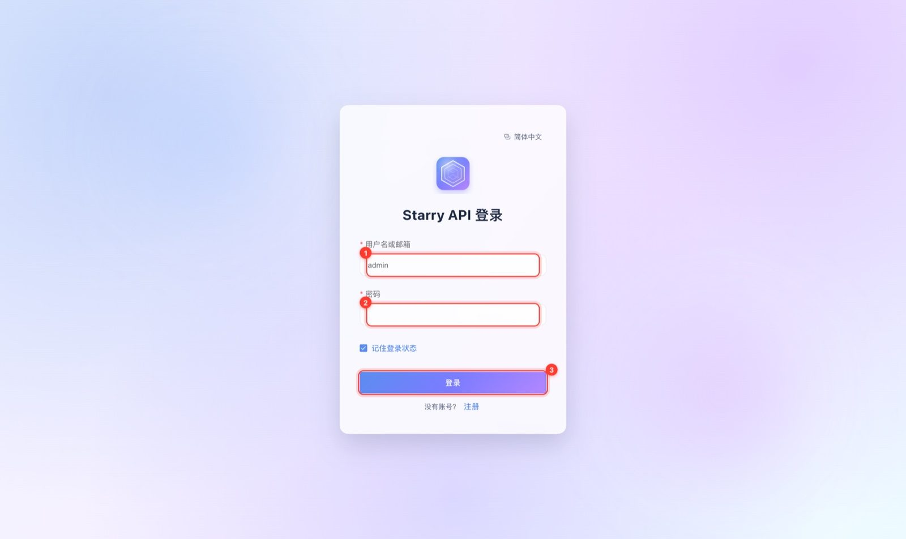

### 1.3 立即改密码

首次登录后，系统会**强制你先改密码**，改完才能使用其他功能。在页面里填入：① 当前密码（就是刚才那个初始密码）、② 新密码、③ 再确认一次新密码。

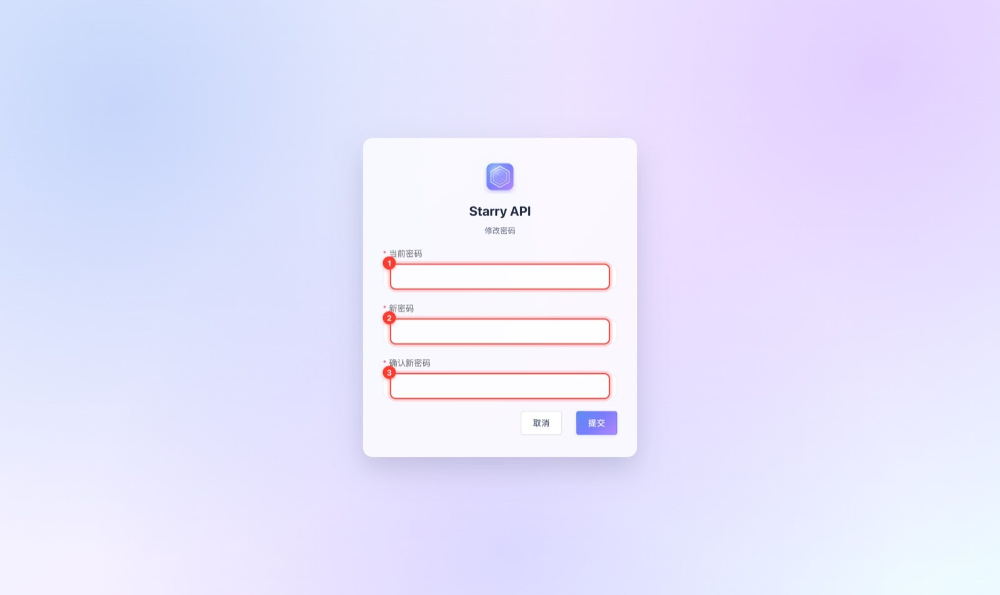

要点：

- 新密码**至少 12 个字符**（最长 128）。
- 改密码会让这个账号**所有已登录的会话失效**，包括当前这个，需要用新密码重新登录。
- 这条规则对所有账号都一样：**管理员新建的用户第一次登录，同样会被要求先改密码。**

登录成功后，你会看到仪表盘：

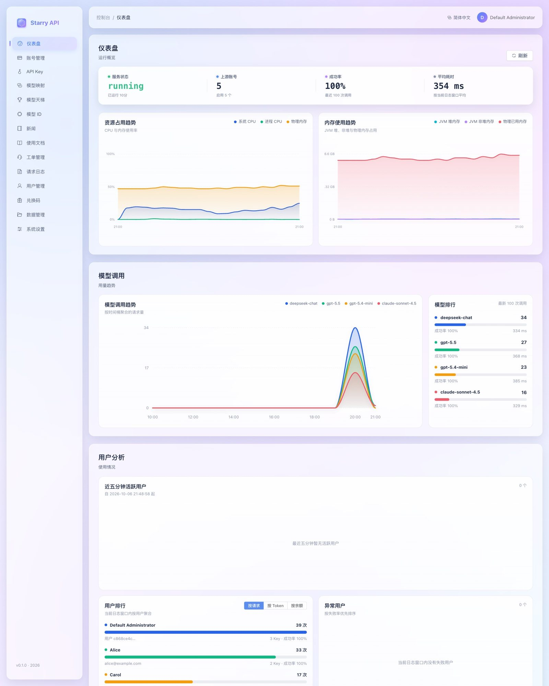

---

## 第 2 步：添加一个上游账号

「上游账号」就是真正提供模型能力的账号（比如你的 OpenAI Key）。Starry API 靠它们去完成请求。

打开左侧菜单 **账号管理**：

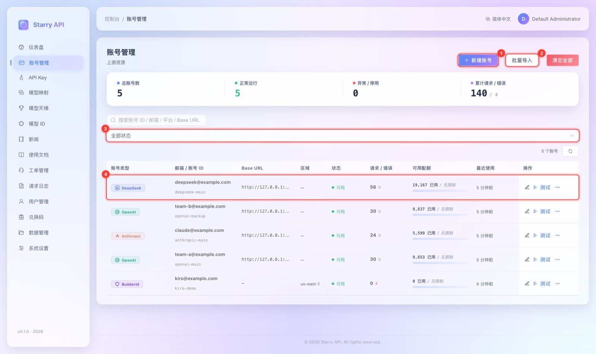

| 编号 | 位置 | 作用 |
| --- | --- | --- |
| ① | 新建账号 | 手动添加一个账号 |
| ② | 批量导入 | 一次导入多个账号（JSON），见 [运维手册](OPERATIONS.md#批量导入账号) |
| ③ | 状态筛选 | 按「可用 / 停用 / 异常」过滤 |
| ④ | 账号行 | 每行右侧有「编辑」「测试」和「…」更多操作 |

### 2.1 选对「账号类型」

点 ① 新建账号，在弹窗顶部先选**账号类型**，下面只显示这个类型需要填的字段：

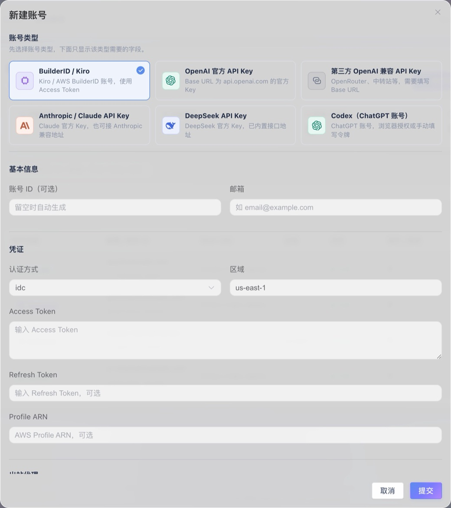

| 你手里是什么 | 账号类型选这个 | 要填的关键信息 |
| --- | --- | --- |
| OpenAI 官方 API Key（`sk-...`） | **OpenAI 官方 API Key** | API Key；Base URL 留空即默认 `https://api.openai.com/v1` |
| 第三方站点的 OpenAI 兼容 Key（OpenRouter、中转站等） | **第三方 OpenAI 兼容 API Key** | API Key + **Base URL**（站点地址，如 `https://openrouter.ai/api/v1`） |
| DeepSeek 官方 Key | **DeepSeek API Key** | API Key；Base URL 留空即默认 `https://api.deepseek.com/v1` |
| Anthropic（Claude）官方 Key（`sk-ant-...`） | **Anthropic / Claude API Key** | API Key；Base URL 留空即默认 `https://api.anthropic.com/v1` |
| Kiro / AWS BuilderID 账号 | **BuilderID / Kiro** | Access Token（必填），可选 Refresh Token、区域等 |
| ChatGPT 账号（走 Codex） | **Codex（ChatGPT 账号）** | 默认「ChatGPT 浏览器授权」，在浏览器里授权，不用手动复制 Token |

在「凭证」里粘贴 API Key。需要经代理访问上游时，在「出站代理」选择节点（节点在 系统设置 → 出站代理 里添加，见 [控制台手册：出站代理](CONSOLE_GUIDE.md#出站代理)）。「路由与限制」默认折叠，新账号使用其类别的默认值（在 系统设置 → 路由与限制 统一调整），初次使用不用动：

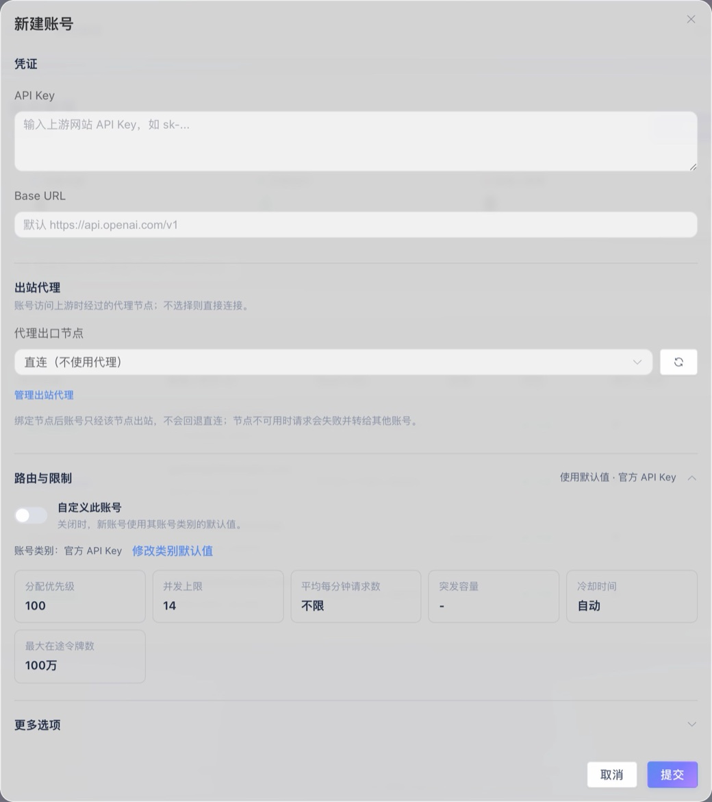

点「提交」。

> ⚠️ **容易配错的地方**：只有 **Base URL 的主机是 `api.openai.com`** 的账号，才会被当作「官方 OpenAI 账号」，服务普通的 `gpt-*` 请求。如果你给 OpenAI 账号填了别的 Base URL（中转站），它会被当作「第三方兼容账号」，**不会**自动接 `gpt-*` 请求，需要额外配置模型映射，见 [控制台手册：模型映射](CONSOLE_GUIDE.md#模型映射)。用中转站时，账号类型选「第三方 OpenAI 兼容 API Key」。

### 2.2 想用 ChatGPT 账号（Codex）？

账号类型选「**Codex（ChatGPT 账号）**」，凭证区默认就是「ChatGPT 浏览器授权」。需要经代理登录时，开始前先选好出站代理节点：登录请求和授权后生成的账号都会使用它。

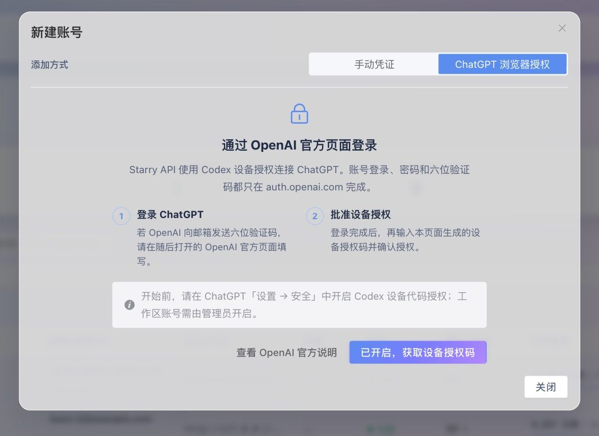

按页面指引，打开 `auth.openai.com` 显示的页面，输入一次性验证码即可，服务器会自动把授权结果保存成账号，**全程不需要你复制 Token**。

使用前请注意：

- 需要先在 ChatGPT 的安全设置里**开启设备码登录**（工作区账号需由工作区管理员开启）。
- 服务器要能访问 `auth.openai.com` 和 `chatgpt.com`。
- 这种账号**只适合可信的私有部署**。面向公开或多租户场景，请改用 OpenAI 官方 API Key 账号。
- 请只授权你有权操作的账号，并遵守 OpenAI 的条款。

### 2.3 测试一下账号是否可用

回到列表，点账号行右侧的「**测试**」。绿色「可用」表示通过；红色表示失败，鼠标悬停可看原因。

> 新添加的账号会先进入「预热」阶段：开始只开放 10% 的并发和请求速率，随着请求成功逐步放开到 25% → 50% → 100%。所以刚加的账号被密集请求时，偶尔会收到 `503`，等它预热完或降低请求频率即可。详见 [架构说明：账号池](ARCHITECTURE.md#账号池行为)。

---

## 第 3 步：创建一个 API Key

API Key 是客户端用来「证明身份」的凭据。打开左侧 **API Key**：

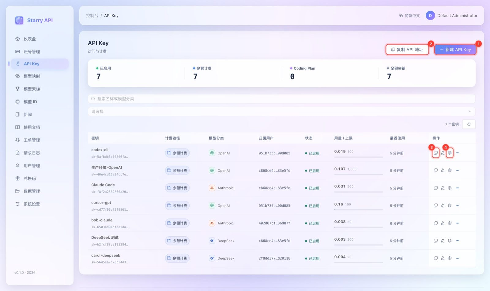

| 编号 | 位置 | 作用 |
| --- | --- | --- |
| ① | 新建 API Key | 创建一把新密钥 |
| ② | 复制 API 地址 | 一键复制 `…/v1` 地址，填到客户端的 Base URL |
| ③ | 复制密钥 | 复制完整的 `sk-...` |
| ④ | 客户端配置 | 生成各种客户端的现成配置（下一步用） |

点 ① 新建，填写：

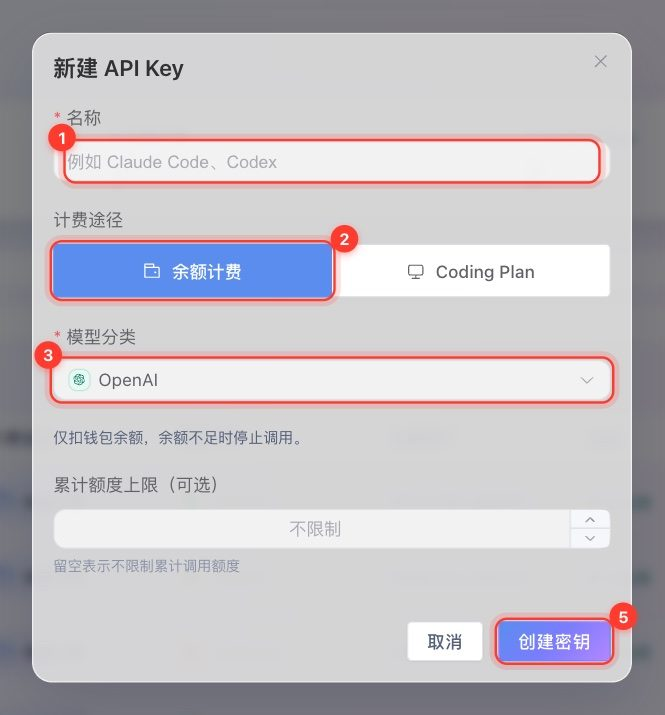

| 编号 | 字段 | 怎么填 |
| --- | --- | --- |
| ① | **名称** | 给自己看的，如 `cursor`、`生产环境` |
| ② | **计费途径** | **余额计费**：从钱包余额扣费；**Coding Plan**：用订阅额度，不会动用余额 |
| ③ | **模型分类** | 这把 Key 能用哪一家的模型：OpenAI、Anthropic、Google、DeepSeek，或你自己添加的厂商。**必选** |
| ④ | **累计额度上限** | 可选。留空表示不限制 |
| ⑤ | 创建密钥 | 点击完成 |

要点：

- **模型分类是硬性限制**：一把绑定了 `OpenAI` 的 Key，只能调 OpenAI 分类下的模型，想调 `claude-*` 会返回 `403 API_KEY_MODEL_PROVIDER_FORBIDDEN`。想同时用多家，就建多把 Key。
- 管理员自己名下的 Key **不会扣钱包余额**；普通用户的 Key 按余额或订阅额度计费。
- 新建的 Key 完整值会保存在你名下，之后可以随时点「复制密钥」；很早以前（旧版本）创建的 Key 只留了前缀，找不回完整值，需要重建。

---

## 第 4 步：把 Key 配到你的客户端

在 API Key 列表里点某把 Key 的「**客户端配置**」，会弹出现成配置：

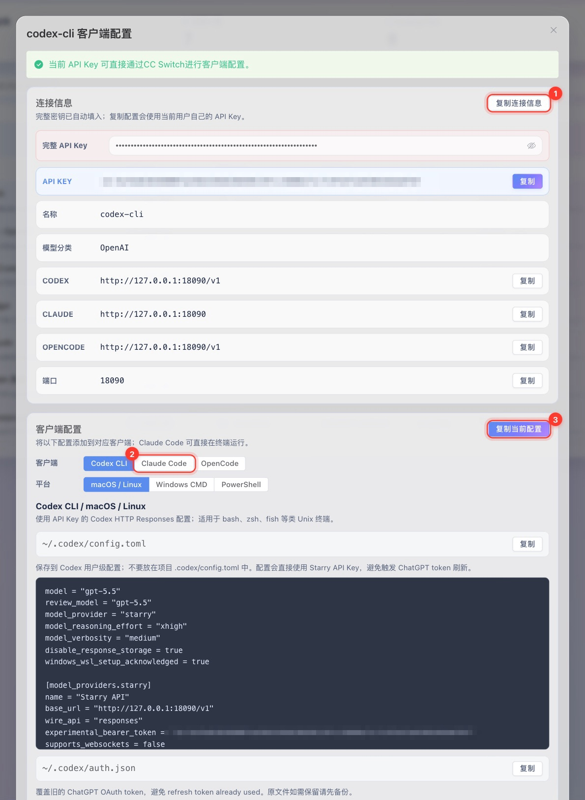

- ① **复制连接信息**：一次复制 Base URL 和 Key。
- ② **客户端 / 平台切换**：Codex CLI、Claude Code、OpenCode；macOS / Linux、Windows CMD、PowerShell。
- ③ **复制当前配置**：把当前选中的完整配置复制走，粘到对应位置。

如果你用 [CC Switch](https://github.com/farion1231/cc-switch)，弹窗里有「一键导入」，点一下就能把这把 Key 导入到 Claude Code / Codex / OpenCode。

不想用生成的配置，也可以手动填，关键就两项：

| 配置项 | 值 |
| --- | --- |
| **Base URL**（OpenAI 兼容客户端） | `http://127.0.0.1:8080/v1` |
| **Base URL**（Claude Code，Anthropic 协议） | `http://127.0.0.1:8080`（注意没有 `/v1`） |
| **API Key** | 刚才创建的 `sk-...` |

---

## 第 5 步：发出第一个请求

先看看这把 Key 能用哪些模型：

```bash
curl http://127.0.0.1:8080/v1/models \
  -H "Authorization: Bearer sk-你的Key"
```

然后发一个对话请求（模型名换成你账号能用的）：

```bash
curl -X POST http://127.0.0.1:8080/v1/chat/completions \
  -H 'Content-Type: application/json' \
  -H "Authorization: Bearer sk-你的Key" \
  -d '{
    "model": "deepseek-chat",
    "messages": [{"role": "user", "content": "用一句话介绍你自己。"}],
    "max_tokens": 256
  }'
```

> 请求头用 `Authorization: Bearer sk-...` 或者 `X-Api-Key: sk-...` 都可以。

能返回一段 JSON 回复，就说明整条链路通了。

### 用其他协议调用

```bash
# Anthropic Messages 协议
curl -X POST http://127.0.0.1:8080/v1/messages \
  -H 'Content-Type: application/json' \
  -H 'anthropic-version: 2023-06-01' \
  -H "x-api-key: sk-你的Key" \
  -d '{"model":"claude-sonnet-4.5","max_tokens":256,
       "messages":[{"role":"user","content":[{"type":"text","text":"你好"}]}]}'

# Gemini GenerateContent 协议
curl -X POST http://127.0.0.1:8080/v1beta/models/gemini-2.5-pro:generateContent \
  -H 'Content-Type: application/json' \
  -H "Authorization: Bearer sk-你的Key" \
  -d '{"contents":[{"role":"user","parts":[{"text":"你好"}]}]}'
```

---

## 第 6 步：在控制台里确认一下

回到控制台，打开 **请求日志**，刚才的请求应该已经在最上面了：

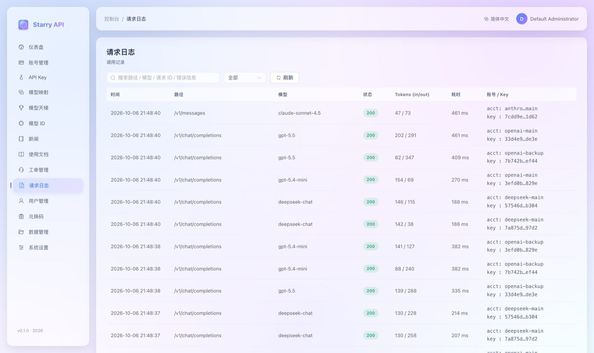

每一行显示：时间、请求路径、模型、HTTP 状态、输入 / 输出 token、耗时，以及是哪个上游账号、哪把 Key 处理的。出问题时，从这里入手排查最快。

仪表盘上的「成功率」「平均耗时」「模型调用」图表也会随之更新。

---

## 恭喜，基本流程已经通了

接下来可以按需继续：

| 想做什么 | 看哪里 |
| --- | --- |
| 给团队成员发账号 / 让用户自助注册 | [控制台手册：用户与注册](CONSOLE_GUIDE.md#用户管理) |
| 让用户充值或用兑换码 | [控制台手册：余额充值与兑换码](CONSOLE_GUIDE.md#余额充值与兑换码) |
| 把 `gpt-5.5` 这类名字转发到别的上游 | [控制台手册：模型映射](CONSOLE_GUIDE.md#模型映射) |
| 上线前：备份、HTTPS、安全加固 | [运维手册](OPERATIONS.md) · [配置参考](CONFIGURATION.md#生产环境建议) |
| 遇到 `401` / `403` / `503` | [故障排查](TROUBLESHOOTING.md) |
