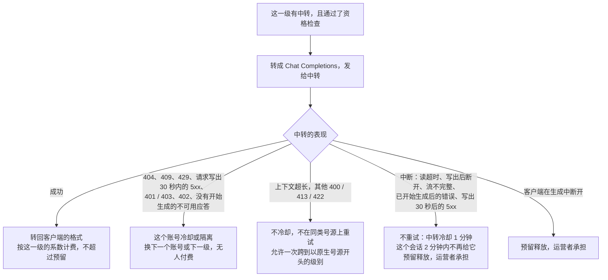

# 号源分级与跨协议中转

这份文档写 [号源分级](OPERATIONS.md#号源分级) 和 [跨协议中转](OPERATIONS.md#跨协议中转) 的完整规则。选号流程图和启用步骤在运维手册的这两节，接口见 [API：号源分级](API.md#号源分级)。

**目录**

- [号源分级](#号源分级)：[选号](#选号) · [降级后停留](#降级后停留) · [计费](#计费) · [自动复查](#自动复查) · [预占租约](#预占租约) · [没有配置的厂商](#没有配置的厂商) · [启用分级](#启用分级) · [号池的成员与指定号池](#号池的成员与指定号池) · [全端点统一](#全端点统一) · [Key 的号源偏好](#key-的号源偏好) · [看状态](#看状态) · [在别处看到号源](#在别处看到号源) · [报账](#报账)
- [跨协议中转](#跨协议中转)：[上线步骤](#上线步骤) · [成员设置](#成员设置) · [映射与上限](#映射上下文上限图片上限与最大输出) · [缓存口径](#缓存口径) · [验证](#验证) · [门控](#门控从名单里的-key到所有-key以及紧急开关) · [请求遇到中转时会发生什么](#请求遇到中转时会发生什么) · [费用与 UNBILLED](#费用与-unbilled) · [指标与升级证据](#指标与升级证据) · [隐私](#隐私) · [多节点与滚动升级](#多节点与滚动升级) · [各客户端的效果](#各客户端的效果) · [Claude Code 的缓存成本](#claude-code-的缓存成本) · [排错](#排错)

---

## 号源分级

「系统设置 → **号源分级**」把一个厂商的账号分成有序的**号池**（级别，1 最好），每个号池有名称和价格系数。典型用法：Anthropic 的 1 级放官方 API Key，2 级放 Kiro 与 Claude OAuth 并给 0.6 的系数；OpenAI 的 1 级放官方 Key，2 级放 Codex（需要先关闭 `isolateCodexPool`，否则 Codex 与官方 Key 不会在同一个请求里互相回退）。

### 选号

新会话从 1 级开始。一个请求里 1 级的账号**全部**不可用（停用、被挂起、额度耗尽、冷却，也包括并发、限速、在途 token 已满的**繁忙**）才会用到 2 级。

### 降级后停留

会话真实降级后停在降级后的号池，直到空闲 10 分钟（可按厂商关闭）。由 2 级服务不一定算降级，要看 1 级为什么没有服务：

- **算降级**：1 级的账号只是额度耗尽，或者因为并发、限速、冷却而不能服务，这些也算 1 级不可用：会话照样停在 2 级，账号恢复后也不回去。
- **不算降级：整个 1 级的账号都被停用或挂起**。被停用的账号不在账号缓存里，被挂起的账号也是（挂起会同时停用账号），所以 1 级对请求就像这条路由上没有账号一样。请求由 2 级服务，但会话不会停在 2 级，账号恢复后回到 1 级。
- **不算降级：这条路由根本用不到某个号池的账号**（例如只有 Codex 能服务的模型对只放官方 Key 的 1 级）。

降级后的号池比 1 级贵时，会话在 1 级恢复后仍按这个更贵的号池计费，直到空闲。

**客户端固定了号池的请求**不读也不改会话停留的号池，但算作会话在使用（所有入口一样）：

- 一个一直在发固定请求的会话不算空闲，停留的号池不会因此过期。
- 它产生的响应成了 Responses 链的最近一环、它的账号成了链的 owner 时，会话停留的号池也一样不变。之后的自动请求（链可以在别的账号上重放时）只在 owner 正好在它本来要开始的号池（会话停留的号池，没有停留就是 1 级）里才先用 owner，否则忽略 owner，从那个号池开始并按它计价。所以固定请求留下的 owner 不会把链留在固定的号池里，会话空闲满 10 分钟回到 1 级后，链也跟着回到 1 级。

**多节点部署时「停留」只部分成立**：

- 会话所在的号池只记在处理它的那个节点的内存里，与会话亲和一样，节点之间不同步、重启即忘。
- 空闲时长是 `STARRY_SESSION_AFFINITY_TTL`，默认 10 分钟；`STARRY_SESSION_AFFINITY_ENABLED=false` 时完全不停留。
- 负载均衡若不把同一个会话固定到同一个节点，落到另一个节点的请求会从 1 级重新开始，并按 1 级计费。

要让「停留」可靠，请在负载均衡上按会话标识做会话粘性：Claude Code 的 `x-claude-code-session-id`、OpenCode 的 `x-session-affinity`、Codex 的 `session-id` 请求头（核对过的版本见 [API：号源分级](API.md#号源分级)）。网关怎么认出同一个会话（这些头，没有时用对话开头的内容指纹）也写在那里的「会话键」。

### 计费

单价 = 标准价 × **实际服务这个请求的号池**的系数。

**预留**按这个厂商可能用到的号池里预留最多的那个定额，结算时按服务的号池退回多余的部分。

- 厂商没有只放中转的号池时，预留最多的就是系数最高的号池。
- 只放中转的号池按它的中转收到的输出预留（见下面[「中转的输出和它的窗口」](#中转的输出和它的窗口)），所以系数更高的号池也可能预留得更少。
- 客户端固定了号池的请求只按固定的号池（带 `+` 时按它和它以下的号池）预留。
- 续写一个不能离开 owner 账号的 Responses 链的请求只能由 owner 所在的号池服务，也只按那一个号池预留。

**余额不够自动请求的预留时**，返回的 `402` 会列出预留更少的可选号池，说明的写法看情形：

| 情形 | 说明里写什么 |
| --- | --- |
| 各号池预留的输出相同（厂商没有只放中转的号池，或请求自己写了输出上限），并且预留更少的号池的系数都比预留最多的那个低 | 预留更少就是更便宜，写「更便宜的号池」。这是平常的情形：中转的请求体和 Kiro 的差几个字节，预留差一点，系数低的那个预留得少，当然更便宜 |
| 预留的输出不同，或预留更少的号池里有一个系数不低于预留最多的那个 | 写「预留更少的号池」，不说更便宜，每个号池后面写着它的系数。例如中转看得见一张只给了地址的图片，它所在的号池按 100 万令牌的输入预留，而系数更高的 Kiro 号池只预留文字 |
| 厂商没有打开「公开号池名称」（用户在 Key 表单里也选不了号池） | 只说明预估是按可能服务的号池里预留最多的那个算的（各号池预留的输出相同时写「最贵号池」），不列出号池 |

不限厂商的旧 Key 没有号源偏好，提示里不让它去 Key 的设置里选。

「用户可选」关闭的号池不能被客户端固定（`403 SOURCE_TIER_NOT_SELECTABLE`），也不会出现在这条提示里。

### 自动复查

打开「账号不可用时自动复查」（账号页的停用账号定期复检）后，分级请求在一轮选号全部落空时复查一次，有账号恢复就再选一轮；每个请求至多一次。

- 只复查这个厂商已启用的号池里、这条路由用得上的停用、被挂起或额度耗尽的账号，不是整个平台的。
- 请求已经离开、被限制在别的号池或被某号池拒绝太多次的号池不为它复查。
- 请求计划里因为没有任何账号能服务（全部被挂起、额度耗尽或停用）而被略去的号池，它的账号也在复查之列，否则那个号池不会恢复。只是这个请求不会改用它们，下一个请求才会。

### 预占租约

按号源分级服务的请求，每次派发都会把预占的租约续到「从现在起 `max(15 分钟, STARRY_REQUEST_TIMEOUT × (STARRY_MAX_RETRIES + 1) + 60 秒)`」，默认 16 分钟。

- 派发给中转时再多一项：该中转成员的单次时限 + 60 秒。三项取最长的，所以单次时限比前两项长时租约跟着变长。
- 只延长、不缩短，也不会超过预占创建后的 1 小时。
- Kiro 自己按 `STARRY_REQUEST_TIMEOUT` 限制每次重试，已在租约之内。

**流式响应的续期。** Anthropic、OpenAI、Codex 的流式响应只受「两次读取之间」的超时限制，可以一直有数据而超过租约。所以派发还在进行时，网关每隔租约的四分之一（默认 4 分钟）续一次，派发结束（完成、失败或客户端断开）就停止。

- 某次续期失败（例如数据库暂时不可用）会在下一次再试。连续失败两次，租约仍有四分之一窗口的余量；连续失败三次，租约就可能到期，清扫器随后会把它转为「待核对」，流结束时的结算会清掉。
- 清扫器是先选出过期的预占、再另行转为待核对，转换时不再检查是否刚被续上。所以恰好在这个间隙里被续上的租约仍可能被转为「待核对」，同样由流结束时的结算清掉。

因此一个请求可以持续到预占创建后 1 小时而不被网关打断，答案照常按服务它的号池结算。

**超过 1 小时。** 派发租约无法再续：清扫器会把它的预占转为「待核对」并保留冻结额度，这期间该用户的新请求会被拦住；流结束时的结算会清掉这个待核对并按服务的号池扣费（未分级的请求超过 15 分钟租约时也是这样）。

**多节点部署**：续期由处理这个请求的节点发出、写在共享的数据库里。如果这个节点中途停止，没有人续期，租约会在一个窗口内到期，由任一节点的清扫器转为待核对。

没有预占的匿名调用没有租约。没有配置分级的厂商不变。

### 没有配置的厂商

没有配置的厂商路由、价格、结算和响应都与分级出现之前完全一样。

号池被删光、只剩厂商一行的厂商同样算没有配置：模型名里的 `@` 留在 id 里，请求头和 Key 的偏好被忽略，响应不加号源头。

### 启用分级

配置先保存、再「启用」才生效；当前版本还不能运行的设置（页面顶部有提示）不能保存。

所有节点都升级到支持分级的版本之后，再启用分级。

### 号池的成员与指定号池

号池里有两种成员：

- **原生号池**：同一个厂商里，这条路由本来就能用的账号（官方 Key、Kiro、Claude OAuth、Codex 等）按类别或手动指定分到各级，分级不会给路由增加它原本用不到的账号。
- **跨协议中转**（OpenAI 格式的兼容 Key）：在号池分级页的「跨协议成员（中转）」里登记，登记、映射、验证、门控和指标见下面的 [跨协议中转](#跨协议中转) 一节。

客户端可以用 `模型@标识` 或请求头 `X-Starry-Tier` 自己指定号池（见 [API：号源分级](API.md#号源分级) 的「指定号池」），点号池表里的「复制」就得到写法。号池用不上时，结果看是哪种写法：

- 后缀是对这一个请求的要求，号池用不了（不存在、这条路由在里面没有账号）就被拒绝。
- 请求头和 Key 的偏好是客户端或 Key 的默认选择，用不上时忽略，请求照常按自动服务，响应带 `X-Starry-Tier-Status: ignored`。所以控制台生成的客户端配置（写请求头）不会因为选了一个这个客户端用不上的号池而整条失效。

Anthropic 的「全端点统一」是唯一会改变路由的开关，见下一节。

### 全端点统一

只有 Anthropic 有，默认关闭。

**关闭时**：Chat 和 Responses 入口上的 Claude 模型原本只由 Kiro 服务，官方 API Key 不在它们的路由里，所以放官方 Key 的 1 级号池对这两个入口是空的。这些请求只落在 Kiro 那一级，按那一级的系数计价。

**打开后**（在 Anthropic 页面打开「全端点统一」，预设和向导不会替你勾选）：这两个入口上的 Claude 目录模型和 Messages 入口一样走 Anthropic 路由。

- 每一级里 Anthropic API Key（官方或第三方）在前、Kiro 在后，Claude Code 和 OpenCode 因此看到同样的号池顺序、同样的降级和同样的价格。
- 派发、换账号的次数上限（[「账号路由策略」](OPERATIONS.md#账号路由策略)里 Anthropic 那一项，不再是 Kiro 那一项）和预留也都按这条路由。
- **成本可能上升**：原来只用 Kiro 的 Chat 和 Responses 请求现在先用官方 Key。

它只改变这些请求。不受影响的有：Gemini 入口、`auto` 和 `simple-task` 这样的路由预设、CodeWhisperer 内部 ID、Gemini 等其他厂商的模型 ID、已经带 `anthropic/` 或 `openai/` 前缀的模型。

厂商没有启用分级时，开关保存了也不起作用。

**所有节点都升级到支持它的版本之后再打开**：旧节点仍只用 Kiro 服务这两个入口。

### Key 的号源偏好

用户在「API Key」的新建 / 编辑表单里为一把 Key 选一个号池（或「及以下」），它的请求在没有写后缀和请求头时就按这个选择服务。

**普通用户只有在厂商打开了「公开号池名称」时才看得到可选的号池**（管理员总能看到）。没有打开时，普通用户的表单里没有可选的号池：

- 这一项只在这把 Key 已经设了偏好时出现，显示当前值（标明「这里没有列出它」）。
- 用户只能保留它或清回「自动」，换不成别的号池。
- 已经设好的偏好照常生效。

**不适用就忽略。** 偏好是 Key 的默认选择，不适用时被忽略（号池被删除、停用、改成不可选，或这个入口 / 这个 Responses 链用不上它），响应带 `X-Starry-Tier-Status: ignored`。

**账号不可用时失败。** 选定后只用这个号池。它的账号都不可用（忙、额度耗尽，也包括都被停用或挂起：健康检查失败会挂起账号）时请求失败（`503 SOURCE_TIER_UNAVAILABLE`，不会改由别的号池按另一个价格服务），要换到更低的号池须选「及以下」。号池里这条路由根本没有账号类型时才忽略偏好、按自动服务。

**旧 Key。** 旧的不限厂商的 Key（`*`）没有偏好，也存不了偏好（`400 API_KEY_TIER_PREFERENCE_INVALID`，须在同一次编辑里先选模型分类）。

**换模型分类。** 偏好属于 Key 当前的模型分类：通过 API 把 Key 改到另一个模型分类又没有带新的偏好时，偏好清回「自动」（控制台编辑里换模型分类也是这样），不会让另一个厂商里同名或同级的号池悄悄固定住这把 Key。

**按级别写的偏好。** 通过 API 按级别写的偏好（`l2`、`2+`），控制台在号池列出时显示成那一级的号池并注明是按级别选的。

### 看状态

页面下方的**运行状态**每 15 秒刷新一次，是应答节点的视角：

| 列 | 含义 |
| --- | --- |
| 账号：就绪 / 繁忙 / 冷却 / 不可用 / 已停用 | 号池收下的每个账号只计入第一个让它不能服务的层：已停用；被挂起或额度耗尽；分配生命周期里冷却或隔离中；并发或在途 token 已到上限；其余为就绪。每分钟请求数、突发和会话数的限制，以及按模型的冷却，只在请求到来时才知道，这里不计 |
| 现在服务 | 厂商已启用、号池已启用、至少一个账号就绪 |
| 最近 15 分钟：服务 / 失败 | 取自请求日志，覆盖所有节点。1 级失败又由 2 级服务的请求，算 1 级一次失败、2 级一次服务 |
| 降级率 | 网关自己选号池的请求里，由低于「已启用的最好一级」服务的比例。长期偏高说明 1 级经常不可用，先看它的「繁忙」和「冷却」 |

账号数是**这个节点**的（账号缓存最多晚 30 秒）；多节点部署请对每个节点分别看，配置则由所有节点共用，保存后各节点立即刷新，最迟 30 秒。

号池里登记了中转时，状态页多出这些内容：

- **尚未开放**：账号一列多这一层（只有中转有）。没有任何入口的门控对它开放，或没有已验证的映射，请求不会派给它。要先在「跨协议成员」里验证映射、在「门控」里对你自己的 Key 打开入口。
- **「跨协议成员」一节**：每个中转有自己的层、最近 15 分钟的尝试、成功率、用量估算比例（超过 5% 标红）、中断数和 p95。下面列出本节点自启动以来**没有把请求交给中转的原因**（Key 不在门控名单里、没有映射、映射未验证、请求带了中转承载不了的特性、转换后的请求没通过严格检查、请求超过上下文上限、刚中断过这个会话；数的是被跳过的中转次数）。
- **「门控」一节**：每个入口旁是这个入口的同样的指标和被丢掉的请求特性。
- **「升级证据」**：按统一标准（名单里的 Key 下至少 200 次尝试、严格检查失败 0、转换被拒不到 1%、用量估算不到 5%、中断不到 2%）列出每个对最近 7、30 或 90 天的数字，可以下载成 JSON。达标的对由升级任务改为已验证后，门控才能对所有 Key 打开。

「中断」是中转可能已经生成、但不向用户收费的尝试，由运营者承担。

### 在别处看到号源

- **账号页**：「号源级别」列显示账号在每个已配置厂商里的号池（手动指定的带回形针图标；悬停可看它为什么在这个号池，落入最低级的会特别说明；当前没有按它服务的号池显示为灰色）；可按号池筛选，勾选账号后用「设为号池…」批量指定或取消指定。没有配置任何号池时不显示这些。
- **请求日志**：新增「号源」列，显示服务这次尝试的号池名称、级别和系数（客户端指定的另有标记）；请求有多次尝试（1 级失败后换 2 级）时每次一行。点开一行还能看到选号方式、派发方式、用量来源、停止原因等号源细节。没有任何按号池服务的请求时不显示这一列。
- **计费核对**（Coding Plan 页的「费用核对」）：按号源分级服务的请求，列表和对话框显示实际服务（或最后派发到）的号池，以及**该号池的报价和估算**，核对金额的默认值也是这个估算。核对时请按它，不要按预占金额：预占是按预留最多的号池留的。
- **定价**（系统设置 → 模型管理 → 价格倍率 → 价格预览）：预览启用了分级的厂商的模型时，另列每个号池的价格。规则只命中**一条**，号池系数在它之后再乘。
- **`/v1/models`**：开启了分级的厂商的模型按它的第一个号池标价；打开「公开号池名称」才会列出号池，见 [API 参考](API.md#号源分级)。

### 报账

按号池汇总的收入：

```sql
SELECT source_tier_ref, sum(credits) FROM api_usage_events GROUP BY 1;
```

管理员核对后结算、或租约过期的请求，归到它最后派发的号池。

---

## 跨协议中转

**跨协议中转**让一把 **OpenAI 兼容 Key**（第三方中转站）当作另一个厂商某一级的号源：网关把客户端的请求转成 Chat Completions 发给它，再把应答转回客户端的格式，按这一级的价格计费。典型例子：Anthropic 的 1 级放一个能服务 Claude 的 OpenAI 格式中转（系数 1.0），2 级放 Kiro 与 Claude OAuth（系数 0.6）。Claude Code（Messages 入口）、OpenCode（Chat 入口）和 Codex（Responses 入口）的 Claude 请求先试中转，中转用不了或服务不了这个请求时，由 Kiro 兜底。

这一版提供九个（入口，厂商）对，全部是**试用中**：门控只能设为「名单里的 Key」，不能对所有 Key 打开（见「门控」）。

- Chat、Messages 和 Responses 三个入口各有 anthropic 和 openai 两个厂商的对。
- Chat 入口另有 google 厂商的对（OpenCode 一类的客户端问 Gemini 模型）。
- Gemini 入口有 anthropic 和 google 两个厂商的对（用 `:generateContent` 的 Gemini SDK 客户端问 Gemini 模型，或问 Claude 模型）。Gemini CLI 的对话用 `:streamGenerateContent`，网关还没有这个流式端点，所以今天只有它的摘要、网页抓取的回退这类 `generateContent` 请求到得了这些对：带 `urlContext` 的网页抓取请求和带 `googleSearch` 的搜索请求是硬特性，由原生号源服务，对话要等流式。

没有的对是：Gemini 入口问 gpt 模型，Messages 和 Responses 入口问 Gemini 模型（没有这样的客户端）。

deepseek 和自定义厂商不能登记中转（`400 SOURCE_PROFILE_NOT_APPLICABLE`）：它们本来就把兼容 Key 当作自己的账号。

> 没有登记中转的部署完全不受影响：没有成员行，跨协议的代码不会被调用，专用排除是空操作，价格、结算、响应和日志都和以前一样。

### 上线步骤

1. **先把所有节点升级到带跨协议的版本。** 登记中转和打开门控都要每个节点认识它们：不带跨协议的旧节点把不认识的（入口，厂商）对当作「未提供」，不会把请求派给中转，所以滚动升级本身是安全的；但旧节点不认识专用排除，会让中转继续服务 GLM 等兼容池的请求，同一个会话落在新、旧节点上也会得到不同的服务。
2. **建号池。** 「系统设置 → 号源分级」选 Anthropic，点「套用预设」选「OpenAI 中转 + Kiro」（1 级放中转，2 级放 Kiro 与 Claude OAuth，系数都是 1，Kiro 要便宜多少自己定），改好名字和系数，保存，再把「启用」打开。
3. **登记中转。** 「跨协议成员（中转）」→「登记中转」：选一把 OpenAI 兼容 Key（只有兼容 Key 能选）和它所在的号池，填好下面的「成员设置」和「映射」，保存。
   - 中转单独保存，页面上有没保存的修改时先保存或放弃它们。
   - 中转登记在号池里：之后改号池的标识，中转跟着走。删除还登记着中转的号池、或套用预设而预设里没有它所在的号池（预设里标识相同的号池会留住它），页面会拒绝，要先在这里把中转移到别的号池或移除。
   - **从保存起这把 Key 就是专用的**（见下），门控还关着时它也已经不再服务 GLM 等兼容请求。
4. **验证映射。** 在成员对话框里点「验证映射」（需要缓存口径证据时勾选「同时运行缓存探针」，见下）。只有验证通过的映射才会进入请求的计划。
5. **对自己的 Key 打开门控。** 「门控」里找到入口（「Messages 入口」是 Claude Code，「Chat Completions 入口」是 OpenCode，「Responses 入口」是 Codex，「Gemini 入口」是用 `:generateContent` 的 Gemini SDK 客户端，问 Gemini 模型或 Claude 模型），状态选「名单里的 Key」，名单里选你自己的 Key（至多 50 把），保存。
6. **用自己的 Key 试用。** 用 Claude Code、OpenCode、Codex 或 Gemini SDK 客户端发几个请求。「运行状态」里这个中转的层应是「就绪」，尝试数在涨；请求日志的「号源」列显示服务的号池，管理员另能看到派发方式 `OPENAI_CHAT` 和发给中转的模型名。
7. **盯指标，攒证据。** 见「指标与升级证据」。证据够了、对升级为「已验证」之后，门控才能对所有 Key 打开；在那之前不要把试用放给别人。

### 成员设置

| 设置 | 默认 | 说明 |
| --- | --- | --- |
| 专用（`exclusive`） | 开 | 这把 Key 只服务中转的请求：不再服务 GLM 等未分级的兼容模型请求，也不再作为 Responses 链的 owner。**成员行一保存就生效**，不等门控。关闭后它同时还服务那些请求；只服务 Claude 的中转会对它们回 `404`（不重试），而且它的自动测试和定时复测会用第一条映射的模型名，由结果决定它在 GLM 池里的去留（测哪个模型还没有定论），所以只在中转确实也服务那些模型时才关 |
| 图片（`vision`） | 关 | 中转的这些模型能看图。关闭时图片换成 `[image omitted]` 的标记（模型知道图片在那里），记为降级特性 `image`；原生账号能看图的 gpt 类请求带了图，就不派给中转 |
| `json_schema` | 关 | 中转支持 `response_format` 的 `json_schema`。关闭时降为 `json_object`，或（原生账号会照做的 gpt 类请求）不派给中转 |
| `priority_tier` | 关 | 中转支持 `service_tier: priority`。只有按 fast 计费的 OpenAI 请求用得到；关闭时 fast 请求不派给中转 |
| `cache_control` 透传 | 关 | 把消息里的 `cache_control` 原样发给中转。只在中转认得它时打开：验证会带着 Claude Code 放标记的几个位置（system 的文字、带调用的助手消息、回答它的 tool 消息）问一次，严格的中转在验证里就被挡住，它的映射不进请求的计划 |
| 上游流式（`upstream_stream`） | 开 | 向中转要流式应答（网关缓冲完整再合成给客户端），长生成不会被读超时切断。关闭则整体返回，中转要在读超时（`STARRY_REQUEST_TIMEOUT`，默认 300 秒）内给出第一个字节，单次时限超过它不起作用 |
| 思考映射（`reasoning_mode`） | 不发送 | 选「映射为 reasoning_effort」时，客户端请求思考就把预算映射成 `reasoning_effort`（小于 4k 为 `low`，小于 16k 为 `medium`，否则 `high`）。中转不认这个参数就不要选。Anthropic 厂商的成员同时打开 `cache_control` 时有代价，见「Claude Code 的缓存成本」 |
| 单次时限（`max_duration_seconds`） | 540 秒（30 到 900） | 一次请求最多等中转多久。到时还没完整返回，就当中转可能仍在生成：不再派给别的账号，这次请求不向用户收费，由你承担。映射写了很大的「最大输出」时要一起调：按每秒约 60 个令牌，写完至少需要「最大输出 ÷ 60」秒（32,000 约 533 秒），最高只能设 900 秒，最大输出超过约 54,000 的中转写不完（见下面 Codex 一节的「原生源的时限」）；没写最大输出的中转只收到 4,096，不受影响 |
| 缓存读 / 写已含在 `prompt_tokens` 内 | 必填 | 见「缓存口径」 |

### 映射、上下文上限、图片上限与最大输出

映射把目录里的模型对到中转自己的模型名。请求的模型没有映射的，这个中转不参与。

- **模型**：同厂商的、已启用的目录模型（不含路由预设和 CodeWhisperer 内部 ID）。别名与它指向的目录模型共用一行：`sonnet` 用 `claude-sonnet-4.5` 的映射；`starry/`、`anthropic/` 前缀和 `-fast` 后缀先去掉再查。先精确匹配（不分大小写），再按别名。
- **中转的模型名**：原样发给中转，字母、数字和 `. _ : / @ + -`，以字母或数字开头，至多 255 个字符，不能有通配。点「从上游拉取」（`GET …/upstream-models`）可以从中转的 `/models` 里选，它写明窗口的会预填上下文上限。
- **上下文上限**（必填）：中转给这个模型的窗口。
  - 请求按网关的估算（去掉 base64 的输入）超过它，中转就不参与，由窗口更大的原生号池服务。Claude Code 的压缩请求带着整个历史，常常因此直接去 Kiro。
  - Responses 入口（Codex）没写输出上限的请求，映射写了大于 4,096 的「最大输出」时，估算的输入加这个输出也要装得下，装不下的话中转这一轮收到 4,096 的请求，窗口只量提示（见下面的「最大输出」）。
  - 填大了不会更好：中转真实的窗口小于它时，请求会在中转那里被拒（上下文超长），见下面的[「学到的上限」](#学到的上限)。
- **图片上限**（默认 8192，1 到 1,000,000）：预留时每张内联图片最多算这么多令牌，截图不会把预留抬到 100 万令牌。远程图片（URL、`file_id`）无法估算，预留仍按 100 万令牌上界算。
- **最大输出**（可选，1 到 1,000,000）：中转的上游给这个模型写的最大输出，网关自己不知道。
  - **只在 Responses 入口（Codex）、客户端没写输出上限时用到**：写了的，中转收到的输出上限是它，不超过网关给这个请求的默认输出（模型自己的最大输出和 `STARRY_RESPONSES_DEFAULT_OUTPUT_TOKENS` 中较小的，见下面 Codex 一节）；没写的，中转收到 4,096，和以前一样。
  - 客户端自己写了上限的请求，不论映射怎么写，都照客户端写的发；Chat、Messages、Gemini 入口不变。
  - 输出上限大于 4,096 时，估算的输入加这个输出要装得下「上下文上限」：装不下，中转这一轮收到 4,096 的请求（窗口只量提示，和没写最大输出时一样），连提示也装不下才不参与；这个节点见过中转拒绝这样大的、带着最大输出的请求时也一样（见下面的[「学到的上限」](#学到的上限)）。
  - **写上游真正的上限，不要写大**：写得比上游实际能写的大，中转会以 `400` 拒绝每个没写上限的 Codex 轮次，不论提示多短，网关什么也学不到（请求日志里记为 `CONVERSION_REJECTED`），下一级有选得到的原生账号时这一轮由它们服务。
  - 它不属于验证所证明的东西，改它不会让映射回到未验证。

#### 学到的上限

中转因为长度拒绝一个请求（上下文超长）时，**这个节点**记下这个请求的估算大小，6 小时内同样大或更大的请求不再发给这个（中转，映射）。

**被拒的请求带着映射的最大输出**（Codex，客户端没写上限）时，记下的是估算大小加上多出 4,096 的那部分输出：被拒的不一定是提示本身，网关的估算常常偏少，同一个提示配 4,096 的输出，窗口也许放得下。此后这样大的请求不再带着最大输出发，而是收到 4,096，仍是这个中转的；4,096 的请求再被拒，这个节点才把中转挡在这个大小的提示之外，和没写最大输出时一样。

**带着最大输出的请求被拒时**，这个节点还另记被拒请求的（提示估算，输出）（每个映射最多 8 组，只留没有更小的）。此后 6 小时内，提示不小于它、输出不少于它的请求不再发给这个中转，不论谁写的上限：同一个映射上客户端自己写了上限的 Responses 请求、Chat 和 Messages 请求也一样（它们按提示本身比较，上面那个值分不出它们和被拒的请求）。同一个请求的 4,096 的体不受影响，仍是这个中转的。

**Anthropic「input length and `max_tokens` exceed context limit …」这样的说法**只说提示加输出放不下。只有被拒的是网关自己选了输出上限的 Responses 请求（4,096 的体或带着最大输出的体）时才当作长度拒绝记入这里；客户端自己写了上限的请求和 Chat、Messages、Gemini 入口的请求被拒时是转换被拒，什么也不记。

它只在节点内存里，重启即忘，每个节点各学一次；映射的窗口、模型名或验证变了，就当另一个映射重新开始。

### 缓存口径

网关按平台口径计费：输入包含缓存读 / 写，缓存是输入的子集。有的中转报的 `prompt_tokens` 已经包含缓存读 / 写，有的另外报（`cache_read_input_tokens` 等），网关要知道是哪一种，才能不多收也不少收：

- **「已含」**：`prompt_tokens` 已包括缓存令牌，网关原样用。配错只会少收。
- **「不含」**：缓存令牌另外报，网关加到输入上。配错会**多收**，所以「不含」要缓存探针的证据才能保存（`400 SOURCE_TIER_CACHE_EVIDENCE_REQUIRED`）。读和写可以分别设。
- **流程**：先都存成「已含」→ 验证时勾选「同时运行缓存探针」（每个映射多问两次约 4,800 令牌的提示，由你付费）→ 看探针给出的建议和依据的数字 → 把设置改成建议的值保存（这个改动会让验证失效）→ 再验证一次。
- **探针看得到什么**：探针靠中转缓存一个约 4,800 令牌的提示。
  - 这比最新 Claude 模型开始缓存的最小前缀（4,096 令牌）还大，更旧的模型 1,024 或 2,048 令牌起，所以目录里的模型都缓存得了；更短的提示在最小前缀大的模型上不会被缓存，探针就得不出结论。
  - 映射的模型缓存的最小前缀比这还大，或中转根本不缓存时，同样看不到缓存。
  - 成员打开 `cache_control` 透传时，探针的提示带着 `cache_control` 标记（Claude Code 的请求就是这样到中转的），所以只靠显式标记才缓存的中转（Anthropic 的 `cache_control`）也看得到缓存，「不含」就存得了。
  - 成员没有打开透传时探针不带标记，这样的中转在探针里看不到缓存，得不出结论，「不含」存不了：对它保持「已含」，或先打开透传再验证。
  - 中转若按「不含」报告缓存而配成「已含」，Claude Code 的每一轮都会少收（报出的用量被钳到上界，请求日志的 `CLAMPED` 是仅有的痕迹，差额由运营者承担），所以打开透传的成员请务必跑一次缓存探针。
- 中转没有报用量，或只在第一个数据块里报了提示用量、没有报完成用量时，网关只估算缺的那一项（用量来源记为 `ESTIMATED`）；报得比上限还多就钳到上限（`CLAMPED`）。状态页里估算占已服务尝试的比例超过 5% 标红。

### 验证

`POST /admin/source-tiers/{vendor}/members/{accountId}/verify`（控制台的「验证映射」）用请求真正用的客户端和解析器向中转发探针：基本问答、函数调用、两轮工具循环，以及（按设置）流式、图片，和成员打开 `cache_control` 时的一轮带标记的工具循环（system 的文字、带调用的助手消息、回答它的 tool 消息上各一个标记，是 Claude Code 放标记的地方），细节见 [API：号源分级](API.md#号源分级)。

- 全部必需的探针通过，映射才算「已验证」；有探针失败，原来的验证被收回。
- 成员设置、中转给模型的名字、账号的 provider 或 base URL 变了，验证自动失效，要重新验证。
- **探针由你付费**，所以同一个账号 30 秒只能验证一次（限流是每个节点各自的），整体最长 4 分钟，来不及问的探针标为已跳过（不算通过）。很慢的中转让控制台请求先超时，服务器上的验证仍会做完，稍后刷新看结果。
- 账号测试和定时复测对中转用它映射的 wire 名，不再用兼容 Key 的默认测试模型。

### 门控：从「名单里的 Key」到「所有 Key」，以及紧急开关

门控决定每个入口是否把请求派给这个厂商的中转，每个（入口，厂商）一个，三种状态：

| 状态 | 含义 |
| --- | --- |
| 不开放（`OFF`） | 默认。没有行就是不开放。启用分级**不会**打开任何一个门控。一个厂商的门控对某个入口不开放时，这个厂商的中转不看这个入口的请求，也不记任何跳过原因：登记了中转但还没开门控，不影响这个厂商的请求。网关只在某个厂商打开了这个入口时才读这个入口的请求（读一次，各厂商共用），所以在没有厂商打开的入口上，请求不添任何开销 |
| 名单里的 Key（`KEYS`） | 只有名单里的 Key（至多 50 把）的请求会派给中转，其余的 Key 照常只用原生号源。试用中的对只能到这一步，设为 `ON` 返回 `409 SOURCE_PAIR_GATE_FORBIDDEN` |
| 所有 Key（`ON`） | 所有 Key。只有「已验证」的对才能设，这一版没有已验证的对 |

- **KEYS → ON 要走升级，不是在控制台点一下。** 用名单里的 Key 实际用一段时间，在「升级证据」里看这个对最近 7、30 或 90 天的数字：
  - 名单里的 Key 下至少 200 次尝试；
  - 严格检查失败 0 次（按这个对的入口数：别的入口的转换失败不挡它）；
  - 转换被拒不到 1%；
  - 用量估算不到 5%（占已服务的尝试）；
  - 中断（UNBILLED）不到 2%（只数中转真的断了的，网关扣下的应答 `WITHHELD` 另算）。

  「严格检查失败」是应答节点自己从启动起数的，只有节点在整个窗口里一直运行才能判：窗口里重启或升级过一次（包括默认的 30 天），这一项就算未达标，要等节点连续运行满窗口，或选更短的窗口，所以请按发布计划安排试用的窗口。

  达标后下载证据 JSON，交给维护者；对由代码里的注册表标成「已验证」（随版本发布），之后门控才能设为所有 Key。
- **紧急开关。** 把门控设为「不开放」保存：配置版本一变就经数据库通知所有节点立即刷新（最迟 30 秒兜底），之后的请求不再派给中转，原生号源照常服务。已经在飞的请求按它们冻结的计划完成，会话的号池绑定不受影响。

  更重的开关：停用中转账号（本节点立即，其他节点最迟 30 秒），或在号池分级页把厂商的「启用」关掉（整个厂商回到未分级的行为）。
- 门控和号池配置一起保存，都带版本号：别人在你之前改过，会收到 `409 SOURCE_TIER_VERSION_CONFLICT`，刷新后再改。
- **所有节点都升级到支持跨协议的版本之后再打开门控**，原因见「多节点与滚动升级」。

### 请求遇到中转时会发生什么

#### 资格

对每个请求，计划先逐个检查号池里的中转，第一个不满足的条件就是它被跳过的原因（状态页的「跳过原因」按这些名字数）：

| 原因 | 含义 |
| --- | --- |
| `GATE` | 这个入口的门控对一部分 Key 开着（「名单里的 Key」），而这把 Key 不在名单里；这个厂商的门控不开放的入口不看这个厂商的中转，也就不计这个原因（别的厂商打开了这个入口，请求会被读，也不改变这一点） |
| `NOT_A_RELAY` | 账号已经被改成官方 OpenAI Key、Codex 等类型，不能再当中转 |
| `NO_MAPPING` | 请求的模型在这个中转上没有启用的映射 |
| `UNVERIFIED` | 映射没验证过，或验证之后设置、模型名、账号地址变了 |
| `FEATURE` | 请求带了中转承载不了、而原生账号能承载的特性（下表的 HARD） |
| `CONVERSION` | 转换成中转格式的请求没通过严格检查，或转换本身失败了（Gemini 请求里带点或冒号的函数名不在其内，那是客户端的写法，记为 `FEATURE` 的 `function_name`；状态页的 `CONVERSION` 计数把厂商各个入口的加在一起；只有升级证据的「严格检查失败」按入口分开数，一个入口的转换失败不挡同一厂商别的入口的升级） |
| `CONTEXT` | 请求比映射的上下文上限大，或比这个中转拒绝过的长度大 |
| `INTERRUPTED` | 中转刚中断了这个会话的应答（或应答被网关扣下，见下面的失败表），2 分钟内客户端的重试不再给它。放在最后判断：只有本来会给这个请求的中转才记这一项，超过窗口或转换不了的请求记的是 `CONTEXT`、`CONVERSION`，不因为会话里别的请求被中断而受影响 |

整个号池的中转都被跳过时，号池就像没有它们一样。客户端得到什么，看跳过的原因：

- **`FEATURE`，且没有任何号源能服务**：返回 `400 SOURCE_TIER_FEATURE_UNSUPPORTED`（信息里点出特性名），不会泄露中转的存在。
- **`CONTEXT`（提示比中转的窗口长），且没有任何号源能服务**（固定到只有中转的号池，或号池里没有原生账号）：返回 `400`，信息是 `prompt is too long: …`，第一次和以后每次都一样，Claude Code 这样的客户端据此压缩对话。这与中转自己拒绝这个长度时的回答相同（中转拒绝的是 4,096 的请求，或客户端自己写了上限的请求；拒绝的是带着映射最大输出的请求时，回答不是它，而是下面可以重试的 `503`，见[「中转的输出和它的窗口」](#中转的输出和它的窗口)）。
- **号池里有原生账号、只是忙或额度耗尽**：这时让客户端压缩对话是白白有损，所以不像上面那样回答。请求回可以重试的 `503`（自动的请求是 `NO_AVAILABLE_ACCOUNT`，固定了号池的是 `SOURCE_TIER_UNAVAILABLE`），重试时这个节点已知道中转放不下，由原生账号服务。

  中转拒绝的是带着映射最大输出的请求时除外：它没有被剪掉，只学到这个宽体放不下，重试发给它的是 4,096 的请求，按它所在号池的系数计价，窗口放得下就由它服务；请求头 / Key 偏好固定到只有中转的号池时，提示也不丢。
- **用模型后缀固定到只有中转的号池**：这是对这个号池的要求。中转拒绝的是 4,096 的请求，或客户端自己写了上限的请求时，始终是 `prompt is too long`；拒绝的是带着映射最大输出的请求时是 `503 SOURCE_TIER_UNAVAILABLE`，重试发 4,096 的请求。
- **只剩 `INTERRUPTED`（中转只是暂时不给）**：不拒绝。固定了这个号池的请求回 `503 SOURCE_TIER_UNAVAILABLE`（带 `Retry-After`），客户端重试即可。

  请求头和 Key 偏好也一样，但只对中转本来会服务的请求：提示超过它的窗口，或转换不了的请求，请求头不固定，由原生账号按级别顺序服务；中转被停用、挂起时同理（停用的中转只在它回来后本来会服务这个请求时，才把请求头固定的请求留给它）。

号池里有的中转因为**这个请求**被跳过（`FEATURE`、`CONVERSION`、`CONTEXT`、刚中断过），号池里其余的成员（别的中转，或原生账号）又都用不了、由下一级服务时，**不算会话降级**，也不会把会话钉在下一级：换一个小一点、普通一点的请求，或者过了 2 分钟，被跳过的中转还会服务它。缺映射、映射未验证、门控没开这几种对同一个会话和模型是稳定的，不算在内（会话的级别绑定本来就是按模型分的）。

#### 特性

请求里的特性按「本请求路由的原生号源会怎么处理」来定：原生同样会丢的，中转丢掉并记录（软）；原生能承载而这个中转不能的，跳过中转（硬）。丢掉的特性名记在请求日志的「降级特性」里，状态页汇总最多的五个。

| 入口 | 硬：跳过中转 | 软：丢掉并记录 |
| --- | --- | --- |
| Messages（Claude Code） | 服务端工具和 Anthropic 定义的工具（`web_search`、`web_fetch`、`code_execution`、`bash`、`text_editor`、`computer`、`memory`）、`mcp_servers`、`container`；`stop_sequences` 多于 4 个 | 文档（同原生）；图片（成员没有 vision，或转换给不了：Files API 的 `file` 源、没有数据的、助手轮里的）、工具结果里的图片（`tool_output_image`，模型收到 `[image omitted]` 标记；文档收到 `[file omitted]`）、`cache_control`（成员没开透传时；开了就携带）；历史里的 thinking、`top_k`、`metadata`、`service_tier`、`context_management`、其他 beta；`tool_search_tool_*`（去掉这个工具，延迟加载的工具照普通函数发送）；`thinking`（除非成员设为「映射为 reasoning_effort」，且不是 Claude 模型的工具续接轮） |
| Responses（Codex） | 自定义工具（`apply_patch` 除外）；这个节点展开不了的 `previous_response_id` 链（中转只会拿到最后一轮）；上下文留在 OpenAI 那边、请求里只是指向它的：`conversation`、保存的 `prompt`、`item_reference` 和 `compaction` 项（中转拿不到它们，会在缺了上下文的情况下回答并收费；Kiro 照旧不读它们）。**gpt 类请求**（原生账号会照单转发）还有：OpenAI 自己运行的内置工具（任何不是函数、也不是自定义工具的类型：`web_search`、`file_search`、`code_interpreter`、`image_generation`、`computer_use_preview`、`local_shell`、`mcp` 等）和客户端的工具搜索（`tool_search`、`namespace`），工具输出里的图片（`view_image`），成员不能承载的图片（成员没有 vision，只有 `file_id` 的图片，中转读不了 OpenAI 的文件；developer / system 消息里的图片，转换只保留这类消息的文字）、`json_schema`、音频 / 文件，限定工具的 `tool_choice`（`allowed_tools`） | `reasoning` 项（含加密内容，不能跨号源携带）、`include`、`store`、`truncation`、`max_tool_calls`、`prompt_cache_key`、`metadata`、`service_tier` 等；`reasoning.summary`（`none` 不算）；`text.verbosity` 为 `low` / `high`（同 Chat：Codex 给每个 gpt 请求都带 `low`）；`reasoning.effort`（成员没设映射时丢掉；设了映射就携带，只有 Claude 模型的工具续接轮例外，同 Messages）；**Claude 请求**（原生 Kiro 只读文本）的内置工具、图片（包括上面不能承载的）、`json_schema`、音频 / 文件、限定工具的 `tool_choice`、工具输出里的图片。`apply_patch` 不受影响：中转拿到的是同样的补丁函数（一个字符串参数 `patch`），描述是网关写的，说明补丁放在 JSON 参数里（Codex 自己的描述说「自由格式，不要包成 JSON」，对这个函数是反话，原生 Codex 账号拿到的是 Codex 的），应答里它的调用还是 `custom_tool_call`；下一轮落到 Kiro 或 Anthropic Key 时，链里的这个调用和它的结果作为函数调用及其结果重放。在有中转成员的厂商上，客户端把 `apply_patch` 声明成自定义工具时（Codex 就是），Kiro 和 Anthropic Key 被告知的也是这个补丁函数，重放的参数因此是 `patch`，它们的调用同样渲染成 `custom_tool_call`；客户端声明成函数的（Codex 的 JSON 工具），它们拿到客户端自己的函数，重放的参数是那个函数的字符串参数（`input`），调用仍是 `function_call`，和没有中转的厂商一样，一切照旧。客户端函数工具的参数 schema（包括 `$defs`、`$ref`、`anyOf`）和 `strict` 照客户端所写原样发给中转，和 Chat 入口一致；根没有 `type` 或 `properties` 的 schema（MCP 无参数工具的 `{}`）补上 `type: object` 与 `properties: {}`。`strict` 只跟着客户端自己写的 schema 走：网关写的 `apply_patch` 函数发给中转时不带客户端的 `strict` |
| Chat（OpenCode 等） | `n` > 1、`stop` 多于 4 个、`web_search_options`、旧版 `functions`、非函数工具；fast 请求而成员没有 `priority_tier`。**gpt 类请求**（原生账号会照单转发）还有：成员不能承载的图片、`json_schema`、音频 / 文件，限定工具的 `tool_choice`（`allowed_tools`），`logit_bias` | `user`、`metadata`、`store`、`logprobs`、`prompt_cache_key` 等；`verbosity` 为 `low` / `high`（只是对回答长短的建议，对所有请求都是软的：OpenCode 给每个 gpt 请求都带 `low`，硬了中转就接不到它的 gpt 请求；`medium` 是默认值，不算特性）；`cache_control`（成员没开透传时）；`reasoning_effort`（成员没设映射时）；**Claude 请求**（原生 Kiro / Anthropic 只读文本）的图片、`json_schema`、音频 / 文件、限定工具的 `tool_choice`、`logit_bias`；**Gemini 模型的请求**（OpenCode 一类的客户端问 Gemini 模型，(Chat, google) 对）走 Kiro 的路由，同 Claude 请求，按这一套软的处理 |
| Gemini（`generateContent` 的 SDK 客户端；Gemini CLI 的对话要等流式） | 多于 4 个的 `stopSequences`、`candidateCount` 大于 1、`googleSearch` / `googleSearchRetrieval`（`web_search`）、`codeExecution`、`urlContext`（`web_fetch`）、`computerUse` 和其他不是函数的工具、`cachedContent` 和 `continuationToken`（上下文留在 Google 那边）；函数名带点、冒号或超过 64 个字符（MCP 工具常见，`function_name`）而中转不属于 `google` 厂商：别家的上游会拒绝这个请求，Kiro 和 Anthropic Key 照常收下，所以硬，固定到只有这样的中转的号池的请求得到 `400 SOURCE_TIER_FEATURE_UNSUPPORTED`，说明里点出 `function_name`。Gemini 入口没有「透传型」的基线（它的路由是 Kiro 和 Anthropic Key，只读文本），所以成员承载不了的图片、`json_schema`、音频 / 文件都不是硬的 | 成员承载不了的图片（没有 vision，或 Files API / `gs://` 的文件、模型轮和函数答案里的图片）、响应 schema（成员没开 `json_schema` 时降为 `json_object`）、音频 / 文件、`thinkingConfig`（`thinkingBudget` 大于 0 或 `thinkingLevel`，成员没设「映射为 reasoning_effort」时；动态的 -1 和 0 不算）、`toolConfig` 里只允许一部分函数的限制（`allowed_tools`；`VALIDATED` 模式本身不强制调用，和默认一样，不是特性）、`safetySettings`、`topK`、`logprobs`、非文字的 `responseModalities`、`text/x.enum` 的枚举答案（`enum_answer`）、历史里 `thought: true` 的思考摘要、历史里的 `executableCode`、`codeExecutionResult`、`toolCall`、`toolResponse`（`server_tool_history`）、函数答案里的图片 / 音频 / 文件（模型收到 `[image omitted]` 一类的标记）、`serviceTier`（`flex`、`priority` 等非默认档，`service_tier`）、`thinkingConfig.includeThoughts`（`reasoning_summary`：中转按自己的格式返回推理，网关不把它渲染成 `thought: true` 的部件，Gemini CLI 每个请求都带）；anthropic 厂商的 Claude 模型在工具续接轮上还丢掉 `thinkingConfig`（它下一轮需要上一轮的 thinking） |

#### 采样参数（所有入口，按厂商）

Anthropic 的 API 对 4 代及以后的 Claude 模型拒绝大于 1 的 `temperature`，也拒绝同时设 `temperature` 和 `top_p`，转发给它的中转把这个错误原样传回，每次尝试都失败、请求去下一级。Gemini 和 OpenAI 格式的客户端常常两个都写（Gemini 客户端的常见写法是 `temperature` 1、`topP` 0.95，Gemini 的 `temperature` 可以到 2）。

所以 anthropic 厂商的成员收到的 `temperature` 最大为 1，也不带 `top_p`（两个都写时留 `temperature`），损失记为降级特性 `temperature`（大于 1 被改成 1）和 `top_p`（被去掉）。这不是剪掉成员的理由，其他厂商的成员照客户端写的收到两者。

这条规则属于厂商，所以 Chat、Messages、Responses、Gemini 入口一视同仁。

#### Codex（Responses 入口）

**工具声明。** Codex 对 Claude 模型声明的 `web_search` 和 `multi_agent_v1` 命名空间，对 Kiro 来说本来就没有用，是软的，Claude 请求照常交给中转（内置工具和工具输出里的图片按基线规则：透传型是硬的，Kiro 类是软的）。

Codex 对 gpt 模型默认还声明 `web_search` 和 `tool_search`，gpt 请求的原生账号（OpenAI、Codex）会收到它们，所以这样的请求是硬的，中转不接，仍由原生账号服务。要让 gpt 请求走中转，请在 Codex 的 `config.toml` 里关掉它们（Codex 0.142.5：`web_search = "disabled"`，`[features]` 里 `multi_agent = false`，工具搜索跟着多智能体功能走）。

**历史。** Codex 不带 `previous_response_id`，每一轮都发完整历史（`store: false`），中转因此可以服务任何一轮。

用 `previous_response_id` 续写的客户端，链由这个节点保存的历史展开。展开不了的请求交不给中转，只剩中转可用时返回 `409 RESPONSE_CHAIN_NOT_PORTABLE`。展开不了的情况有：重启、换了节点、超过 6 小时，或者被这个节点的历史上限挤掉（每个节点最多保存 512 条历史、共 64 MB，满了先删最旧的，压缩后超过 8 MB 的历史根本不保存；Codex 这样每轮都存完整历史的流量会很快占满它，可用 `starry.responses.state-max-total-bytes`、`starry.responses.state-max-entry-bytes` 调大）。

中转服务的应答**不记 owner**：链的下一轮由网关保存的历史重放，哪个号源都能接，也不会让未分级的 OpenAI 链把请求发给中转。

**推理项。** 中转应答里的推理项（网关自己渲染的：没有加密内容、没有摘要，只有 `reasoning_text`）会照常给客户端，但不记进链的历史。

在有中转成员的 OpenAI 厂商上，客户端回放历史时带回来的这种推理项也不会发给 OpenAI 账号（OpenAI 自己的推理项带加密内容或摘要，原样发送），因为 OpenAI 可能拒绝带着它的 `store: false` 请求，而这种拒绝是请求的失败，不会换别的级别再试（没有中转的厂商照旧原样发送）。

因此移除这个厂商的所有中转、或关掉它的分级之后，还在回放这种推理项的会话（Codex 把历史存在本地）会把它们原样发给 OpenAI 账号，OpenAI 可能拒绝；这样的会话需要新开一个。

> **移除中转或关闭分级之前请注意。** 网关只在有中转成员的 OpenAI 厂商上去掉它自己渲染的推理项，没有中转的厂商一切照旧、原样发送。所以要从 OpenAI 厂商移除最后一个中转、或把这个厂商的分级关掉之前，先看一下还有没有会话在回放这样的推理项（Codex 的老会话、`previous_response_id` 链都可能）：之后它们的下一轮会被 OpenAI 拒绝，且不会换号源重试，用户得到的是上游的错误。要保险，就让这些会话新开一个；或者先只把中转的门控关掉、保留成员（只要厂商的分级还开着，仍会去掉这样的推理项），等这些会话结束后再移除。

> **Anthropic 厂商同样要注意。** 在有中转成员的 Anthropic 厂商上，客户端把 `apply_patch` 声明成自定义工具时（Codex 对 Claude 模型就是这样），Kiro 和 Anthropic Key 也把它的调用以 `custom_tool_call` 写进会话历史，所以**从头到尾只由 Kiro 服务的 Codex 会话**也依赖这个厂商还有中转成员。网关数的是登记在厂商下的任何中转成员，不看它的门控和映射，所以移除一个只为 Messages 开着门控的中转也算。
>
> 移除最后一个中转成员、或把这个厂商的分级关掉之后，这样的会话的下一轮：
>
> - 历史里的 `custom_tool_call` 及其输出会作为空的用户消息发给 Kiro 和 Anthropic Key，模型不知道补丁已经应用（这一轮照常收费）；
> - 客户端那个空 schema 的自定义声明也原样发给它们，它们对 `apply_patch` 的调用回来是 `function_call`，Codex 0.142.5 报 `Fatal error: tool apply_patch invoked with incompatible payload` 并给模型回 `aborted`，补丁没有应用。
>
> 要保险，就让这些会话新开一个；或者先只把中转的门控关掉、保留成员（只要厂商的分级还开着，Kiro 和 Anthropic Key 仍把补丁调用渲染成 `custom_tool_call`），等这些会话结束后再移除。

#### Codex 的默认输出上限

Codex 不发 `max_output_tokens`，也没有任何设置能让它发（Codex 0.142.5 的配置里没有这样的项）。**网关给每个没写上限的 Responses 请求加上一个默认的输出上限**：

- 默认 **16,000 个令牌**，用 `STARRY_RESPONSES_DEFAULT_OUTPUT_TOKENS` 调整（4,096 到 1,000,000，超出范围服务启动失败，见[配置](CONFIGURATION.md)；设成 4,096 就是没有这个默认值时的请求体和预留）。
- **不超过这个模型自己能写的最大输出**：模型列表里这个模型的 `max_output_tokens` 和厂商标价目录给这个模型列的 `max_output_tokens`，两个目录都有时取较小的，只有一个有时取那一个，都没有时 4,096。

**各模型得到的数。** 默认设置下，目录里大多数 Claude 和 GPT 的别名（例如 `claude-sonnet-4.5`、`gpt-5`、`gpt-5.4`）是 16,000。模型列表给大多数别名写同一个 64,000，高于有的上游自己的上限，这样的模型由价格目录的数封住：

- 价格目录列得比设置小的，就是那个数：
  - `gpt-4`、`gpt-4-turbo`、`gpt-3.5-*`、`claude-3-haiku-20240307`、`claude-3-opus-20240229` 和 `gpt-4o-2024-05-13` 是 4,096（官方 Key 会以 `400` 拒绝更大的；不带日期的 `claude-3-haiku`、`claude-3-opus` 是别名，按它们指向的 4.5 模型服务，价格目录没有给它们列数，得到设置的值）。
  - `gemini-2.0-flash` 是 8,192。
- 列得比 16,000 大、要把设置调高才看得出的：
  - `gpt-4o`、`gpt-4o-mini`、`gpt-5-chat-latest` 和它们带日期（`gpt-4o-2024-05-13` 除外，它是 4,096）、音频、搜索的变体是 16,384。
  - `claude-opus-4.1` 是 32,000。
- DeepSeek 的 `deepseek-v4-*`：模型列表写 384,000，随包的价格目录写 8,192，而价格目录默认每 10 分钟从远端刷新（`STARRY_MODEL_PRICING_REMOTE_REFRESH_ENABLED`，默认开启，见[配置](CONFIGURATION.md)），刷新后的目录写 393,216，所以默认部署里它们得到设置的值（16,000）；只有关掉远端刷新、用随包目录的部署取较小的 8,192。

默认调到 32,000 时，大多数 Claude 和 GPT 的别名是 32,000，`claude-opus-4.1` 仍是 32,000，`gpt-4o` 一类是 16,384（不是 32,000），4,096 和 8,192 的仍是各自的数。

**价格目录的数是目录当前的数，不是写死的**：默认部署会定期从远端刷新它，某个模型的默认值会随目录变化。这里列的是随包的目录（2026-10-28 刷新后的目录与它只有 `claude-sonnet-4-6`（64,000 变成 128,000，默认设置下仍是 16,000）、`deepseek-v4-*` 和一个语音合成预览模型不同）。要让某个模型的默认值不随目录变，让这个请求写自己的 `max_output_tokens`。

**模型列表没有列出的模型，和由运营者自己的后端服务的模型，用 4,096。** 后者有三种，都由 OpenAI 兼容 Key 服务：

- 运营者自己加的自定义模型；
- 用 `openai-compatible/` 前缀写的模型（前缀后面即使是某个内置模型的名字也一样：自己的 vLLM 把模型叫作 `gpt-4o-mini` 这样的兼容名字很常见，请求去的是运营者的后端，不是那个内置模型）；
- 管理员在控制台把内置模型改成指向自己的厂商（提供方改成了 OpenAI、Anthropic、Google、DeepSeek 这些内置厂商之外的，请求格式是 OpenAI Chat）之后的这个模型。

模型列表给它们写的 64,000 是占位（改过的内置模型保留的是内置时的 64,000），不是后端的最大输出（网关不知道，它们写的上下文窗口也不是输出上限），所以也用 4,096，价格目录也不去问；没改过的内置模型不受影响。

看的是请求映射之后实际去的那个模型，不是客户端写的名字：key 的模型映射把内置模型名（例如 Codex 的 `gpt-5.4`）指到运营者的自定义模型、或指到目录没有列出的模型时同样是 4,096，否则窗口比默认上限小的后端会拒绝每个没写上限的请求。

**各号源收到什么。** 预留和原生源收到的请求体用的是同一个数：Codex 账号会去掉这个字段，Kiro 收到 `maxTokens`，官方 OpenAI Key 收到 `max_output_tokens`，Anthropic Key 收到 `max_tokens`。

**中转收到的不是这个数**：网关不知道一个中转的上游最多写多少，对它们发 16,000 会让上游写得少的中转拒绝每一轮。所以：

- 映射写了「最大输出」的中转收到它（不超过这个数）。
- 没写的收到 4,096，也就是没有这个默认值时所有号源收到的数，请求体逐字节相同。
- 中转收到 `max_tokens`（GPT-5 系列和 o 系列是 `max_completion_tokens`），中转用量的钳制是它收到的数。

客户端自己写了上限（`max_output_tokens`、`max_completion_tokens`、`max_tokens`）时用它的值，其他入口不变：**Chat、Messages 和 Gemini 的请求没写上限时仍是 4,096**（Messages 的客户端必须写；Chat 和 Gemini 的客户端常常不写）。

这样做有下面几项后果。

##### 预留变大

一个没写上限的 Responses 请求，可以放原生账号的号池按默认的输出上限预留（只有中转的号池例外，最低的已启用号池不算它们，见下）。输出价 $15/M 的模型，16,000 个令牌要预留约 0.24 美元的额度乘这个号池的系数（再加输入的预留），4,096 个令牌只要约 0.06 美元。

输入按**请求的字节数**（再加 1,024）预留，不是按令牌数：中文和代码的请求，字节数比令牌数多得多，所以按令牌数估算会少算。单价取输入、缓存读、缓存写三个价里**最高的**（claude-sonnet-4.5 是缓存写的 $3.75/M，不是输入的 $3/M）。

以 claude-sonnet-4.5 的价：

| 一轮的令牌数 | 请求大小 | 以前预留 | 现在预留 |
| --- | --- | --- | --- |
| 约 1.2 万个 | 约 50 KB | 约 0.25 美元 | 约 0.43 美元 |
| 约 4 万个（Codex 带着完整历史的一轮常常是这个量级甚至更大） | 约 160 KB | 约 0.67 美元 | 约 0.84 美元 |

默认调得越高预留越大（32,000 个令牌约 0.48 美元）。

这些数是系数为 1、可以放原生账号的号池的。预留取各号池中最大的，各按自己的系数计：以中转 1 级系数 1、Kiro 2 级系数 0.6 的配置为例，是 Kiro 的 0.6 乘默认输出，和中转的 1.0 乘 4,096 中较大的那个（输入很大时是后者：按 claude-sonnet-4.5 的价，请求约 54 KB 以内是前者，更大是后者）。

预留在派发之前做，所以下面几种情况都在没有预留、没有任何号源被问到的时候被拒：

- 余额少的用户：预留不起时得到平常的 `402 INSUFFICIENT_BALANCE`；
- 设了额度上限（`credits_limit`）的 Key：已用额度、在飞的预留再加这一次的预留超过上限时得到 `429 CREDITS_LIMIT_EXCEEDED`，所以剩下不到一次默认预留的 Key（约 1.2 万个令牌的一轮约 0.43 美元，约 4 万个令牌的一轮约 0.84 美元），以前还能服务的轮次现在每一轮都被拒（以约 1.2 万个令牌的轮次算：上限 20、已用 19.7 的 Key，以前能服务，现在被拒）；
- Coding Plan 用户：套餐可用额度不够这次预留时得到 `402 CODING_PLAN_QUOTA_EXCEEDED`，同理；
- 每个在飞的请求各占一份预留（约 1.2 万个令牌的一轮约 0.43 美元，约 4 万个令牌的一轮约 0.84 美元），所以并行的几轮比一轮的真实成本更早碰到余额或额度上限：余额 2 美元的用户，以约 1.2 万个令牌的轮次算，以前同时能有约 7 轮在飞，现在约 4 轮，第五轮同时发出就得到 `402`；以约 4 万个令牌的轮次算，以前约 3 轮，现在约 2 轮。

请求里写一个自己的 `max_output_tokens`，按那个预留，能避开这些；Codex 写不了（上面）。结算仍只按实际用量，预留的其余部分退回。

**每个号池按它能被发出的输出预留。** 预留是各号池里最大的那个的上界：

- 可以放原生账号的号池按默认的输出上限。
- 只有中转的号池按它的中转收到的数（4,096，或映射的最大输出但不超过默认值）。
- 客户端自己写了上限的请求，各号池都按它写的。

中转用量钳制的上限是它收到的数，所以收费不会超过预留。

**固定到只有中转的号池的请求**（`模型@号池名` 的后缀）按中转收到的数预留，和没有这个默认值时一样：没写最大输出的是约 0.06 美元（再加输入的预留），不是 0.24 美元，余额只够这个数的用户可以这样用。

「只有中转的号池」按配置认：有中转行、没有原生成员行、没列类别，也不是最低的已启用号池。最低的已启用号池收下没有别处可放的账号，所以只放中转的厂商、或中转在最后一级的厂商，固定到它的请求也按默认输出（约 0.24 美元）预留，这个规则不看账号缓存里那个号池有没有原生账号。

**自动选择的请求**按预留最多的一级预留：上面的配置里，按 claude-sonnet-4.5 的价，请求约 54 KB 以内是 Kiro 的 0.6 乘默认输出，更大是中转的 1.0 乘 4,096。预留不起时得到的 `402` 这样说明：

- 号池名公开的厂商会点出预留更少的号池。各号池预留的输出不同（请求没写输出上限，又有只放中转的号池）时说「预留更少」，不说它们更便宜：请求小时被预留的是 Kiro，点出的就是这个中转的号池，它的系数 1 比 Kiro 的 0.6 高，只是预留的输出少，每个号池后面写着它的系数，预留少不等于单价低。
- 号池名不公开的厂商，说明里写预估按预留最多的那个号池算，不写「最贵号池」（这个例子里预留最多的是系数较低的 Kiro，最贵的是中转）。
- 没有只放中转的号池的厂商，和请求自己写了输出上限的请求，各号池预留的输出相同，预留更少的号池只要系数比预留最多的低，就是更便宜，说明里的话和以前一样（「更便宜的号池」「最贵号池」）。

**会话停在只放中转的号池时**，它上面不比它更贵的号池（按默认输出预留）也算进预留，所以预留可以比会话所在号池自己的大：余额只够会话所在号池的用户会因上面那个号池被拒，402 里点出的就是他可以固定的号池。

中转服务时，预留比它可能用到的大，多出的部分随结算退回。

##### 账号的在飞令牌不变

准入给账号预留的在飞输出令牌仍是 4,096（客户端自己写了上限的，按它写的），不是这个上限。每个账号的「在飞令牌上限」（`maxInflightTokens`，默认 1,000,000，输入加输出）是原有的上限，不会因为默认上限变大而更容易被占满，也不会让一个输入很大的请求永远准入不了。

##### 个别上游的真实上限比目录写的低

模型列表给大多数别名写同一个最大输出（例如 `gpt-4o` 也是 64,000），所以网关还要把这个默认上限限制在厂商标价目录给这个模型列的数以内（上面）。

运营者自己加的自定义模型、用 `openai-compatible/` 前缀写的模型，和被管理员改成指向自己厂商的内置模型，没有网关知道的最大输出，它们走 OpenAI 兼容 Key，按 4,096，不会因为列表里的占位被兼容后端以 `400` 拒绝（内置模型被这样改了、窗口写成 32,768 的后端，不会被发去 16,000：输入超过约 16,700 个令牌的一轮就放不下了）。

价格目录也没有列、真实上限仍低于模型列表的内置模型，官方 OpenAI Key 仍会以 `400` 拒绝没写上限的请求；这是上游的拒绝，预留确定释放，不收费。Codex 没有设置能写 `max_output_tokens`，绕不开这样的拒绝，其他客户端写一个自己的 `max_output_tokens` 即可。Codex 用的 GPT-5 系列不受影响。

##### 中转的输出和它的窗口

网关不知道一个中转的上游最多写多少，也不知道它怎么数窗口，所以没写上限的请求不把默认的输出上限给中转（上游写得比它少的中转会以 `400` 拒绝每一轮）。

- **映射没写「最大输出」的中转**收到 4,096，和以前一样，窗口只量提示（输入的估算比「上下文上限」大的中转这一轮不参与，由窗口更大的原生号池服务）。
- **映射写了「最大输出」的**（见上面[「映射、上下文上限、图片上限与最大输出」](#映射上下文上限图片上限与最大输出)），中转收到它，不超过这个请求的默认输出（模型自己的最大输出和 `STARRY_RESPONSES_DEFAULT_OUTPUT_TOKENS` 中较小的）。高于 4,096 时，估算的输入加这个输出要装得下「上下文上限」，装不下，中转这一轮收到 4,096 的请求，窗口只量提示，还是它的；连提示也装不下的，才不参与（计划里记为上下文超长）。

Codex 每轮都带完整历史：窗口 131,072、最大输出 16,000 的中转，约在输入 115,000 个令牌之前收到 16,000，更长的轮次收到 4,096。

**装得下的请求仍可能被中转拒绝。** 网关对提示的估算（字符数除以 4）常常比中转自己的分词少，所以装得下的请求中转自己仍可能以 `400`「maximum context length …」拒绝，或以 Anthropic 的「input length and `max_tokens` exceed context limit …」拒绝。

后一种说法来自 Claude 4.5 之前的模型（3.x、Sonnet 4、Opus 4、Opus 4.1）、Bedrock 和 Vertex，前面挂着它们的中转原样转出。它只在被拒的是网关自己选了输出上限的请求时才当作长度拒绝；客户端自己写了上限的请求和 Chat、Messages、Gemini 入口的请求被拒时是转换被拒，什么也学不到，客户端得到的答案也不变。

这和任何一次平常的长度拒绝一样处理，不再问一次：

- 下一级有选得到的原生账号的，跨过去由它们服务。
- 没有的，被拒的是带着最大输出的请求时，客户端得到可以重试的 `503`（没有可用账号）：中转已经学到了，重试发的是 4,096 的请求，窗口放得下的中转就服务它，不会让客户端把一段放得下的对话当作「提示放不下」去有损压缩（Codex 不重试 `400`，遇到就结束这一轮）。
- 被拒的是 4,096 的请求（或客户端自己写了上限的请求）时，客户端得到 `prompt is too long`。

**网关学到什么。** 它学到的是被拒请求的估算大小，带着最大输出的请求被拒时，再加上多出 4,096 的那部分输出（见上面[「学到的上限」](#学到的上限)）：此后 6 小时内这个节点不再把带着最大输出的、这样大的请求发给这个中转，它们收到 4,096，窗口放得下提示的仍是中转的。

客户端自己写了上限的请求按提示的大小比较，这个值分不出它和被拒的请求，所以这个节点另外记下被拒请求的提示和输出：提示不小于它、输出不少于它的请求（同一个请求再发一次，或写了更多输出的），不论谁写的上限，6 小时内也不再发给这个中转。

写了很大的最大输出的中转，在窗口边缘因此比没写的多一些被拒的轮次（被拒的这一轮由下一级有选得到的原生账号服务，没有可跨的下一级时是客户端的一次重试；同样大小的下一轮不再重复）。这样的轮次要紧的话，把「上下文上限」写得保守些，或不写最大输出。

客户端自己写的输出上限不计入窗口，也不被映射改动。

##### 上游能写的输出比默认值小的中转

不受默认值影响：映射没写「最大输出」的中转收到 4,096；上游最多写得比 4,096 还少的，在映射里写它的最大输出，中转收到那个数。

映射写得比上游真实的上限大，中转会以 `400`（`Invalid max_tokens value … [1, 8192]` 一类）拒绝每个没写上限的 Codex 轮次，不论提示多短。这不是长度的拒绝，网关什么也学不到，每一轮都这样（请求日志里记为 `CONVERSION_REJECTED`）：

- 这一轮由中转的下一级有选得到的原生账号（Kiro）服务，按它们那一级的价。
- 这些账号忙时，每一轮包括 Codex 的重试都是可以重试的 `503`。
- 中转是唯一能用的号源时，客户端得到中转的拒绝。

所以写上游真正的上限，不要写大。

##### 原生源的时限

Kiro 和官方 OpenAI Key 在 Responses 入口上是阻塞调用：网关等整段应答生成完才有第一个字节，所以 `STARRY_REQUEST_TIMEOUT`（默认 300 秒）就是一轮生成的时间上限。

以前一轮被限在 4,096 个令牌，通常一两分钟内完成。现在默认可以写到 16,000 个令牌，按每秒约 60 个令牌算要约 270 秒，300 秒的时限只留一点余量。默认值就是按「一轮普通的生成在默认时限里写得完」选的，它不保证每一轮都写得完，比这慢的（例如较高推理强度的 GPT-5 系列）会超过。

**超过时限的一轮是在请求发出之后超时的，网关不知道上游有没有生成并计费，所以这笔预留（按默认的输出上限，约 0.24 美元加输入）不会释放，而是留作待核对，之后这个用户的每个请求都会得到 `BILLING_REVIEW_REQUIRED`，直到管理员处理**（Chat 入口上写了很大 `max_tokens` 的请求早就是这样）。客户端自己也可能因为长时间没有数据而断开（Codex 的流空闲时限据信约 5 分钟，没有核对过），断开发生在派发之后的同样留作待核对。

**默认值和时限要一起调**：想让一轮写得更长，把 `STARRY_RESPONSES_DEFAULT_OUTPUT_TOKENS` 调大的同时，把 `STARRY_REQUEST_TIMEOUT` 调到至少「默认值 ÷ 60」秒再加余量（例如 32,000 个令牌配 600 秒；时限只对按号源分级服务的请求是预占租约窗口的一部分，见上面[「预占租约」](#预占租约)）。

**映射写了很大的「最大输出」的中转，还要把成员的「单次时限」一起调**（没写最大输出的中转只收到 4,096，约 70 秒，不用调）：

- 中转的每次派发由成员的「单次时限」（默认 540 秒，只接受 30 到 900 秒）限着，`STARRY_REQUEST_TIMEOUT` 抬不动它（派发还不超过预占租约剩下的时间减 60 秒）。
- 按同样每秒约 60 个令牌，32,000 个令牌的一轮要约 533 秒，在 540 秒里没有余量。所以最大输出（和默认值中较小的）是 32,000 时，把中转成员的「单次时限」调到至少「那个数 ÷ 60」秒再加余量（约 600 秒）。
- 成员的时限最高 900 秒，所以最大输出超过约 54,000 时，中转写不完一轮满的输出。这样的轮次按中断处理（不向用户收费，运营者承担；中转冷却 1 分钟，这个会话 2 分钟内不再给它），去下一个号源，Codex 的重试每次都可能是一次白付费的尝试。
- 上游不流式（`upstream_stream` 关）的中转，网关要等整段应答生成完才有第一个字节，这个字节也要在 `STARRY_REQUEST_TIMEOUT` 内到，成员的「单次时限」超过它不起作用，两者要一起调。

**没有分级的厂商的请求租约固定 15 分钟，不随时限变长**：一轮超过 15 分钟（按每秒约 60 个令牌，默认值超过约 54,000；64,000 个令牌配 1200 秒的一轮约 1,070 秒就是这样）时，清扫器在这一轮结算之前就把它的预留转为待核对，这个用户的其他请求在这段时间里得到 `BILLING_REVIEW_REQUIRED`，直到这一轮结算，结算会清掉它。所以没有分级的厂商，默认值不要调到约 50,000 以上；64,000 配 1200 秒只在分级的厂商的原生源上租约才跟得上（中转不行：成员的时限最高 900 秒，见上）。

只调大默认值，就是拿超时和待核对的预留换更长的应答。想少碰到超时，就把默认值调小（最低 4,096，约 70 秒），并留意待核对的预留（`BILLING_REVIEW_REQUIRED`）。把原生源的 Responses 调用改成流式并向客户端发保活，现在没有做。

中转不留待核对：超过成员的「单次时限」（默认 540 秒）或客户端断开的尝试按中断处理，运营者承担，预留确定释放；但 Codex 会重试最多 5 次，每次都可能是一次白付费的尝试。

#### 截断与被扣下的应答

Codex 把 `response.incomplete` 当作流的失败，会把同一个请求再发五次，每一次中转的应答都要付费，而它已经执行过应答里的工具调用。所以中转在**网关给它的输出上限**（4,096，或映射的最大输出）处停下的应答这样处理：

- 只有文字、没有丢失工具调用的，按完成（`completed`）返回，和原生账号的应答一样，已经完整的工具调用保留。
- **丢了一个被截断的工具调用**（一轮的第一个动作是用一条命令或一个大补丁写大文件，写到默认的输出上限还没写完才会这样），或**没有文字也没有完整的调用**（只有推理）的，被网关扣下：用户得到 `502`、不付费（运营者承担），这个会话 2 分钟内不再把请求给这个中转，Codex 自己对 5xx 的重试去下一个号源。

**那里不一定写得完**：

- 不受输出上限约束的只有正在服务请求的 Codex 账号：OpenAI 厂商里 Codex 客户端的请求（隔离 Codex 号池开不开都是）、`gptUsesCodexAccounts` 开着时任何客户端的 gpt Responses 请求、只有 Codex 账号提供的模型，以及隔离关着时混合号池里的那部分。
- 官方 Key、Kiro 和 Anthropic Key 受默认的输出上限约束（它通常比中转收到的大，所以中转写不下的调用，Kiro 往往写得下）。
- 在 Anthropic 的中转加 Kiro 上，一次长于默认输出上限的调用哪一级都写不下，中转这一趟只是多绕了一圈，Kiro 的应答被截断、按完成返回、调用的参数不完整，并按 Kiro 的价收费。
- 没有别的号源可去时，重试得到没有可用账号的 `503`。

中转的内容过滤停下的应答同样是被扣下的。

被扣下的应答**不是中转的故障**：不计入账号的错误数和准入的错误率，没有冷却，不启动自动健康测试，别的会话照样用这个中转。

只有客户端**自己写的**上限被用尽时，才以 `incomplete`（`max_output_tokens`）结束，并且这样的应答不带工具调用（客户端会重试它）。

请求日志和指标仍记中转的停止原因（被扣下的尝试是 `WITHHELD`，状态接口的 `figures.withheld` 单独数着它们，不算在 `interrupted`、也不算在升级证据的 `unbilled` 里；中转真的断了的是 `INTERRUPTED`，其余如 `MAX_TOKENS`）。

**被扣下的应答花了多少，看得到。** 被扣下的应答是中转答了、你付了费的，中转报告的用量（和已服务的应答同一读法：按成员的缓存口径折算，钳到这次派发给中转的上限，没有报告时由网关估算）记在这一行请求日志的 `withheld_input_tokens`、`withheld_output_tokens`（管理员日志的 `withheldInputTokens`、`withheldOutputTokens`；日志详情里的「被扣下应答的用量」）。

**这两列不是用户的用量**：这一行的 `input_tokens`、`output_tokens` 和 `credits` 仍是 0，用户没被收费，用户自己的日志看不到这两列，用户统计（按天、按模型的用量）也不会多出这些令牌。

状态页「扣下」的提示和升级证据里按中转、按入口给出这些令牌的和（接口的 `figures.withheldInputTokens`、`figures.withheldOutputTokens`）。日志里没有费用列：这笔成本要按你和中转的价自己折算。

中转的应答只有推理、没有文字也没有工具调用、以 `stop` 结束时：Codex 上渲染成一个推理项加一条空消息，Codex 什么也不显示就结束这一轮（真实的 Codex 0.142.5 对这样的应答只发一次请求，不重试），并**照常按中转所在级的价收费**，因为中转生成了这些令牌，用户也拿到了一个完整的应答；用户可以在 Codex 里再发一条。Messages 入口上这样的应答没有地方放推理，按中断处理，不收费。上面「被扣下」的是另一种：在网关默认的上限处被截断的、只有推理的应答，那个不收费。

工具调用的 id 由网关重新生成（Messages 是 `toolu_…`，Chat 和 Responses 是 `call_…`），中转给的 id 不会到客户端；每轮都返回 `call_0` 的中转因此没有问题。

#### 失败怎么办

原则是**一次生成**：中转可能已经生成之后，请求绝不再派给别的账号或级别。



| 中转的表现 | 网关怎么做 | 谁付费 |
| --- | --- | --- |
| 404，或说「模型不存在」 | 这个（账号，映射）冷却 10 分钟；换下一个账号或下一级 | 无人 |
| 409 / 429，以及请求写出 30 秒内的 5xx | 同原生账号的规则：冷却，换下一个账号或下一级 | 无人 |
| 401 / 403（中转拒绝了账号自己的 Key，如 `invalid_api_key`），或 200 里带认证 / 权限错误 | 这是**这个中转账号**的故障，不是用户的：账号像原生账号的凭据失效那样隔离 10 分钟（不会被停用，Key 换好后到期自动恢复；连续两次被拒会自动做一次健康测试，账号页的测试也一样，它们即使在中转的原文里读到「token_invalidated」「account disabled」一类字样，也不会据此停用中转账号），请求换下一个账号或下一级（如 Kiro），按服务的号池计价；日志里这次尝试的停止原因是 `KEY_REFUSED`，状态接口的 `figures.keyRefused` 数着它们（控制台的失败总数里有，没有单独一列）。没有别的号源时用户得到的是没有可用账号的 `503`（固定了号池的是 `SOURCE_TIER_UNAVAILABLE`），**绝不是**中转的 `401` / `403`，所以 Claude Code 不会把它读成「你的 API Key 无效」。原生账号的 401 / 403 规则不变 | 无人 |
| 402 / 余额不足 | 当作这个账号额度不足（同原生账号）；换下一个账号或下一级，用户不会被锁进「待核对」 | 无人 |
| 上下文超长，或其他 400 / 413 / 422（中转拒绝了转换后的请求） | 不冷却，不在同类号源上重试；允许**一次**跨到以原生号源开头的级别（如 Kiro）；超长的还记入「学到的上限」（Anthropic 的「exceed context limit」说法只对网关自己选了输出上限的 Responses 请求算超长，其余请求仍是转换被拒）。拒绝转换的计入「转换被拒」。没有原生账号可去时，客户端得到中转的拒绝（被拒的是带着映射最大输出的请求时除外：没写输出上限的 Responses 请求、映射写了大于 4,096 的最大输出、中转收到的是它的体，这一次也是可以重试的 `503`，自动的请求是 `NO_AVAILABLE_ACCOUNT`，固定了号池的请求是 `SOURCE_TIER_UNAVAILABLE`，重试发 4,096 的体，窗口放得下就是中转的，见上面「中转的输出和它的窗口」；被拒的是 4,096 的体，或客户端自己写了上限的体，才是中转的拒绝）；有原生账号、只是暂时用不了（忙、额度耗尽），或这个请求已不能跨级（已超过 240 秒、预留的租期不够再派一次、重试名额用完又没有预留槽）时，得到可以重试的 `503`（不论预留槽开着还是关着，也不会被同一请求里更早失败的中转的错误顶替）；但同一请求里更早的原生尝试可能已经生成或计费的，不论请求多老，都照实得到中转的拒绝，不邀请重试。转换被拒不会被学到，请求头 / Key 偏好固定的范围里没有原生账号（只含中转的号池，如 `relay`）时，照实告诉客户端中转的拒绝（被拒的是带着最大输出的体时同样除外，是上面的 `503`，模型后缀固定到只有中转的号池也一样）；范围里有（如 `relay+`、`1+`）就是可以重试的 `503`，重试会跨到原生账号 | 无人 |
| 200 但应答不可用（空的、不是 JSON 或事件流的网页、格式错误），而没有任何已经开始生成的迹象 | 当作可恢复的 `502`：换下一个账号或下一级 | 无人 |
| 200 里带错误（带内错误），而没有任何已经开始生成的迹象 | 和带着同样内容的错误状态一样，按错误的种类映射：404（模型不存在）、402（额度）、429 换下一个账号或下一级；认证 / 权限错误按 401 / 403 处理，同上一行；`invalid_request` 是 `400`，同其他 400，只允许跨一次、跨到以原生号源开头的级别 | 无人 |
| **中断**：读超时、单次时限到了、写出后连接断开、流在输出之后不完整、已经开始生成之后出现的带内错误或不可用的应答、请求写出 30 秒之后的 5xx、408 / 504 / 524 | **不重试、不复测、不回升**；该中转冷却 1 分钟；这个会话 2 分钟内不再给它（`INTERRUPTED`），客户端的自动重试去别的成员；用户得到 `502` | **运营者**（UNBILLED） |
| **扣下的应答**（仅 Responses 入口）：中转的内容过滤停下的应答，或在网关给它的输出上限（4,096，或映射的最大输出）处丢了调用、只有推理的应答 | 不重试；这个会话 2 分钟内不再给该中转；**不是中转的故障**：没有冷却，不计账号错误，不启动自动健康测试，准入记一次应答；用户得到 `502`；日志的停止原因是 `WITHHELD`，中转报告的用量记在 `withheld_*` 两列（不是用户的用量） | **运营者** |
| 客户端在中转还在生成时断开 | 预留确定释放 | **运营者** |

两个时间规则：

- 距请求开始超过 **240 秒**不再跨级（否则客户端会在原生尝试中断开）。
- 每个厂商的「跨级保留槽」（默认开）让派发数最多比今天多 1，换来「两个 1 级中转都确定失败，仍能到 2 级」，关掉则预算用尽就失败。

中转的原文不会出现在客户端消息或用户可读的请求日志里，只写一行服务端 WARN 日志（至多 2 KB，凭证已遮蔽）；一个一直回 429 的中转每个请求写一行，注意日志的量和访问权限。

### 费用与 UNBILLED

- **用户只为服务了自己的号池付费**：金额 = 标准价 × 实际服务的号池的系数，跨协议再取「实际用量的费用」和「该号池的预留」中较小的一个，所以用户付的从不超过预留。
- **UNBILLED 由运营者承担**：中断、客户端在生成中断开，中转可能已经生成（也可能向你收了费），但不向用户收费，预留确定释放。
  - 中断写一行请求日志，计入「中断」指标；客户端断开不写请求日志行，所以不在这个指标里。这个指标是损耗的下限，实际要再加上断开的请求。
  - 即使中转在出错前报告了用量也不向用户收费。
  - 验证和缓存探针的调用同样是你付费。
- 所以号池系数要把这些损耗算进去；「中断」占比长期超过 2% 时先查中转的稳定性或单次时限。

### 指标与升级证据

「运行状态」每 15 秒刷新（最近 15 分钟，取自请求日志，覆盖所有节点；账号层和跳过原因是应答节点自己的）：

- 每个中转：层（`ready`、`busy`、`resting`、`unavailable`、`disabled`、`unopened`）、已启用 / 已验证的映射数、尝试数、成功率、用量估算比例（超过 5% 标红）、中断数、「扣下」数（被网关扣下的应答，见上面的失败表：Responses 入口上被内容过滤、或在网关的输出上限处丢了调用的应答；不算在「中断」里，成本同样由运营者承担；提示里有中转为这些应答报告的令牌数）、p95。
- 每个入口的门控：同样的指标，以及被丢掉的请求特性。
- 「没有把请求交给中转的原因」：应答节点自启动以来每个跳过原因的次数（数的是被跳过的中转次数，不是请求数）。`CONTEXT` 很多说明上下文上限填得偏小或客户端请求偏大；`FEATURE` 很多说明客户端在大量使用中转承载不了的特性（Claude Code 的 WebSearch 子请求就是）。
- 「升级证据」：按厂商和对给出最近 7、30 或 90 天的数字和每条标准是否达标，可下载成 JSON，字段见 [API：号源分级](API.md#号源分级)。多节点时「严格检查失败」的计数每个节点各看一次；节点运行的时间比所选窗口短时（窗口里重启或升级过），这一项没有数值，算未达标。

「带内错误」（200 里带错误）和「疑似少报」目前没有计数，只在服务端日志里。

### 隐私

登记中转，就是把客户端请求里的**完整提示词、代码和工具输出**交给一个第三方：请只登记你信任的中转，并告知用户。

- 中转只看到白名单过的请求体（顶层、消息、部件三级白名单）、`Authorization: Bearer <这把 Key>` 和账号的出口路由；看不到客户端的请求头、`metadata.user_id`、会话标识、`user`。
- 中转的原文错误不进客户端消息和用户的请求日志；服务端 WARN 日志里有（见上），请限制日志的访问。
- 验证和模型预取也是管理员的调用，经同一条出口、受限流。

### 多节点与滚动升级

- 号池、成员、映射、验证和门控都在共享的数据库里，保存后经通知立即刷新所有节点，最迟 30 秒。
- 这些是**每个节点各自的**，不同步、重启即忘：会话的号池绑定（降级后的停留）、学到的上下文上限（6 小时）、中断后的 2 分钟短期排除、跳过原因计数、验证和模型拉取的限流。负载均衡若不把同一个会话固定到同一个节点，换了节点的请求会从 1 级重新开始；要让它们可靠，请在负载均衡上按会话标识做会话粘性（见上文「号源分级」的「降级后停留」）。
- **升级顺序：先升级所有节点，再登记中转、再打开门控。** 旧节点不认识新的（入口，厂商）对，也不认识专用排除，所以只要还有旧节点在服务，就可能把中转当作 GLM 等兼容池的普通账号，或者对同一个会话给出与新节点不同的服务。
- 升级到带 V33 的版本后请立即做一次新备份（V32 及更早的备份不能再从控制台恢复，见 [数据库备份与数据传输](OPERATIONS.md#恢复流程)）。

### 各客户端的效果

#### Claude Code（Messages 入口）

- 文本、工具、并行工具和原生号源一样；截断如实报告（`max_tokens`）；不输出 thinking 块（原生也不）。
- **图片**：
  - 用户轮里的图片（截图）在成员能看图时以 data URI（`base64` 源）或地址（`url` 源的 http / https 地址）交给中转，预留按映射的「图片上限」算，不按 base64 的长度，只给了地址的图片按 100 万令牌的下限预留。
  - 成员不能看图时中转收到 `[image omitted]` 的标记（模型知道图片在那里），记为降级特性 `image`。
  - Files API 的 `file` 源、没有数据的图片和助手轮里的图片中转取不到，同样只被标记并记录。
  - 工具结果里的图片（`Read` 读一张图）放不进 Chat 的 tool 消息，模型收到同样的 `[image omitted]` 标记（降级特性 `tool_output_image`），不再是「[no output]」，工具结果里的文档同理（`[file omitted]`）。
  - 成员不能看图时，截图上的缓存标记落在顶替它的 `[image omitted]` 文字上。
- `tool_result` 的 `is_error` 写在结果文字的开头（`Error: …`，没有文字时就是 `Error`），不是降级特性。
- 文档被丢掉（原生也丢）。
- WebSearch 子请求（`web_search_*`）、没有映射的小模型（如 Haiku）和超长的请求，只让**那一个请求**去原生号池，主循环的号池不变（会话只在真实降级时才换号池）。
- 网关没有 `count_tokens` 端点（所有号源都是 `404`），客户端一般会回退为本地估算。
- 成员打开 `cache_control` 时，Claude Code 的缓存标记发给中转（验证也带着标记，严格的中转在验证里就会被挡住），没打开时不发，缓存成本见 [Claude Code 的缓存成本](#claude-code-的缓存成本)。

#### OpenCode（Chat 入口）

接近透传。「降级后停留」靠它发的 `x-session-affinity`（1.18.16 核对过）。网关合成的流没有 usage 块，OpenCode 无法据此提前压缩上下文；中转的窗口比目录窗口小时，由上下文超长的跨级和「学到的上限」兜底。

#### Codex 客户端（Responses 入口）

- Claude 请求由中转服务；gpt 请求只有在关掉 `web_search`、多智能体（工具搜索）之后才会走中转，否则仍由原生账号服务（见上面的[「Codex（Responses 入口）」](#codexresponses-入口)）。
- `apply_patch` 由网关仿真，应答里是 `custom_tool_call`，不论是中转、Kiro 还是 Anthropic Key 答的。Codex 只应用自定义工具调用，对 `apply_patch` 的 `function_call` 会报 `Fatal error: tool apply_patch invoked with incompatible payload` 并给模型回 `aborted`，所以在有中转成员的厂商上，客户端把 `apply_patch` 声明成自定义工具时，Kiro 和 Anthropic Key 被告知的是和中转同一个补丁函数（参数 `patch`），它们的调用也渲染成 `custom_tool_call`，补丁在落到 Kiro 的那一轮同样会应用。
  - 移除这个厂商的最后一个中转成员、或关掉它的分级，这一点就不再成立，见上面「Anthropic 厂商同样要注意」。
  - 这只涉及给 Claude 模型声明了 `apply_patch` 的 Codex：0.142.5 里 `features.apply_patch_freeform` 已移除，要在 `model_catalog_json` 里给这个模型设 `apply_patch_tool_type: freeform` 才会声明。
  - 没有中转的厂商，和把 `apply_patch` 声明成函数的客户端，一切照旧。
- 截断：没写上限的请求被限在网关给的输出上限内（中转：4,096，或映射的最大输出；原生源：默认的输出上限，见上面的[「Codex 的默认输出上限」](#codex-的默认输出上限)）。在这个网关给的上限处，只有文字的应答按完成返回，丢了调用或只有推理的被扣下（`502`，不收费，不是中转的故障，重试去下一个号源，那里未必写得完），客户端自己写的上限才是 `incomplete`（见上面的[「截断与被扣下的应答」](#截断与被扣下的应答)）。
- 会话靠 `session-id` 请求头，没有时靠内容指纹。

#### Gemini 客户端（Gemini 入口）

Gemini 入口只有 `:generateContent`，没有流式。Gemini CLI 的对话循环调用 `:streamGenerateContent`，要等网关支持这个流式端点，试用的证据也要等它。今天用得上这些对的是非流式的 SDK 客户端，以及 CLI 的摘要、网页抓取的回退一类的辅助请求：带 `urlContext` 的网页抓取请求和带 `googleSearch` 的搜索请求是硬特性，由原生号源服务。

**字段写法。**

- 请求里的字段名驼峰和下划线两种写法都认（JavaScript SDK 写驼峰；Python SDK 的消息里写下划线，如 `inline_data`、`parameters_json_schema`、`thinking_budget`），规整一次再交给判断和转换，原生号源收到的请求不变。
- 内联图片 Python SDK 用 URL 安全的 base64，发给中转前改回标准字母表。

**中转承载的内容。** 文本、`systemInstruction`、多轮、函数声明、`functionCall` / `functionResponse`、`toolConfig` 和 `generationConfig` 里的温度、`topP`、输出上限、停止序列、惩罚和 `seed` 由中转承载。

**函数调用的配对。**

- 每个调用有自己的 id（客户端写了且没人用过的用它，否则 `call_1`、`call_2` ……），函数的答案先按答案自带的 id、再按函数名先进先出配对，所以同一个函数在一轮里调用两次也不会混；配不上的答案是用户的文字。
- 只在最近一步的调用里按函数名配：客户端没回答一个调用就接着做别的事、模型又调用了同一个函数时，新的答案回答新的调用，旧的调用留在历史里由规范化器补上 `Tool result missing`（原生 Gemini 会拒绝这样的历史，它来自 Kiro 答过的一轮，网关修补了没人回答的调用）。

**中转给不了的轮次。**

- 一轮用户的内容里没有中转给得了的东西（没有 `parts`、空白文字、只有思考摘要）仍是一条用户消息，规范化器填成 `[non-text content omitted]` 并记 `empty_user_message`，免得中转答上一个提示。
- 只有媒体的模型轮写成 `[image omitted]` 一类的助手消息，前后的用户轮不会被并成一条。
- 读不懂的一轮（不是对象、`parts` 不成形）不会被悄悄丢掉：这个请求不给中转，由原生号池服务。

**图片。** 用户轮的内联图片（`inlineData`）在成员能看图时以 data URI 交给中转，预留按映射的「图片上限」算，不按 base64 的长度；只给了地址的图片（`fileData` 的 http / https 地址）按 100 万令牌的下限预留，Google 的 Files API 或 `gs://` 的文件中转取不到，只被丢掉并记录。

**工具调用的签名和函数名。**

- 模型签过名的工具调用（`thoughtSignature`）由 `google` 厂商的中转往返，别的厂商不带。
- 没有签名的工具调用（Kiro 答的、Chat 客户端重建的、验证探针里的）发给 `google` 厂商的中转时，每条助手消息的第一个调用带 Google 文档里的占位值 `skip_thought_signature_validator`（Gemini 3 要求每一步的第一个调用有签名），别的厂商不带，也不会让客户端看到。
- 函数名带点或冒号（MCP 加的工具名）而中转不属于 `google` 厂商时，中转被跳过（别家的上游只收字母、数字、`_` 和 `-`，至多 64 个字符），由原生号池服务；这是硬特性 `function_name`，不是转换失败，不计入升级证据的「严格检查失败」。
- `toolConfig` 的 `ANY` 是 `required`（只允许一部分函数时，是网关发不了的限制，记为 `tool_choice`），`VALIDATED` 不强制调用，和默认一样。

**思考请求。** `thinkingBudget` 大于 0 或 `thinkingLevel` 在成员设为「映射为 reasoning_effort」时转成 `reasoning_effort`，动态（-1）和 0 不算请求（`MINIMAL` 和 0 想要更少的思考，中转收到的是模型的默认档位，这一点还没有定论）。

**网关不能替中转做的。**

- `googleSearch`、`codeExecution`、`urlContext` 等不是函数的工具、多于 4 个的停止序列、多个候选（`candidateCount` 大于 1）和指向 Google 那边上下文的 `cachedContent` 会让中转被跳过，由原生号池服务。
- `topK`、`serviceTier`（`service_tier`）、`thinkingConfig.includeThoughts`（`reasoning_summary`）、`safetySettings`、`logprobs`、不是文字的 `responseModalities`、历史里的思考摘要、音频 / 文件只被丢掉并记录。

**其他。**

- anthropic 厂商的中转收到的 `temperature` 最大为 1，也不带 `top_p`（见上面的「采样参数」）。
- 没有声明任何函数却带着工具调用历史的请求（客户端为总结而去掉了工具的重发），历史的调用写成文字再交给中转，记为 `tool_history_flattened`。
- 一个不写 `maxOutputTokens` 的请求（Gemini CLI 就不写）给中转的上限是 4,096，预留也是。
- 不支持 `streamGenerateContent`。

### Claude Code 的缓存成本

**成员打开 `cache_control` 时，网关把 Claude Code 的缓存标记发给中转。** 发给中转的请求由客户端的原始 Messages 体转换，这份转换给图片、`cache_control` 和工具失败留了位置；Kiro 和官方 Key 收到的请求是另一份转换（只有文字），不变。

- Claude Code 标在 `system` 的块上、最近几轮文字的最后一块上、工具结果上和带调用的助手轮上的标记（`{type: ephemeral}`，带 `ttl` 时一并保留）原样发给中转。
- `ttl` 为 `1h` 的缓存写入，上游按 2 倍输入价收，网关只有一个缓存写价（5 分钟的 1.25 倍）并按它向用户收费，差额（Sonnet 上每百万令牌 $2.25）由运营者承担，用户不会多付。Claude Code 的抓包里没有 `ttl`，有它的是别的客户端。
- 文字按标记切成部分发出：各块之间隔一个换行连成一段，只在带标记的块之后切开。所以标记在一条消息最后一块上时（Claude Code 的做法），它是恰好一个部分，文字与标记移到后面的轮次之后的字符串相同，中转上一轮缓存的前缀这一轮仍对得上。system 的各块各是一个部分。
- 请求自己的顶层 `cache_control`（自动缓存）标在最后一条消息上。
- 标在工具定义上的标记在 Chat 的函数里没有位置，不发（后面第一个标记已经覆盖了它们）。
- 网关不增不减标记的个数，一个请求最多几个由客户端和中转决定（Anthropic 的限制是 4 个）。

**成员没有打开 `cache_control` 时**，缓存标记被丢掉并记为降级特性 `cache_control`，system 和历史的文字是一整段（没有图片、也没有失败的工具结果的消息与以前相同）。有变化的是：

- 带图片的用户轮是文字加 `[image omitted]` 标记（以前图片整个消失）；
- 失败的工具结果以 `Error: ` 开头；
- 工具结果里的图片是 `[image omitted]`；
- 不发计费头（修补 `billing_header_dropped`）。

这时中转只有自己按前缀自动缓存的本事才用得上缓存；没有的话每一轮都按全价计输入，而 Kiro 会计缓存读。Claude Code 每轮都重发整个历史，所以号池系数相同时，中转所在的级别可能比 Kiro 每轮贵数倍。

**只在中转认得 `cache_control` 时打开这个开关**：验证会带着 Claude Code 放标记的几个位置（system 的文字、带调用的助手消息、回答它的 tool 消息）问一次，严格的中转在验证里就被挡住，没通过的映射不进请求的计划，所以它不会让每个请求先失败一次。只有在这一项验证出现之前就验证过的映射，或后来改了行为的中转，才会在运行中回 `400`，请求在一次失败之后去下一级。

**不让请求头挡住中转自己的前缀缓存。** Claude Code 的 system 第一块是 `x-anthropic-billing-header: cc_version=…; cch=<哈希>;`，哈希每个请求都不同，压平后成了 system 消息的第一行，整个请求的开头每次都变，按前缀缓存的中转永远命中不了。所以发给中转的请求这样处理：

- 只由这一行构成的 system 块（文本去掉首尾空白后以这个名字开头、没有第二行，大小写照 Claude Code 的写法）整块不发，只有它一块时就不发 system 消息。这一步记为修补 `billing_header_dropped`（不是特性，所以每个带这块的 Claude Code 请求的「降级特性」里都有它）。
- 在这一行后面还带着系统提示的块（客户端或 SDK 把 system 规整成单个块时就是这样，丢掉它中转就收不到任何指令）、整个字符串写成的 system、只是提到这个名字的块、用户的文本都不动，也不记修补。
- Kiro 和官方 Key 收到的请求不变，仍带这一块。
- 打开 `cache_control` 的成员，这一块同样不在 system 的各个部分里（带标记的部分也不例外）。

中转若报告缓存命中，按成员的缓存口径计入，缓存读按缓存读价计费。

例：claude-sonnet-4.5（$3/M 入、$0.30/M 缓存读），100k 令牌的提示、其中 90k 命中缓存：按缓存计费约 10k×$3/M + 90k×$0.30/M = $0.057；没有缓存则是 100k×$3/M = $0.30，约 5 倍。请把中转所在号池的系数定得能覆盖这一点（控制台在登记中转时也会提示）。让 Claude Code 在中转级别用上缓存：在成员上打开 `cache_control`（中转认得它时），验证时带上缓存探针（探针的提示带标记，只认标记的中转也看得到缓存，再按它的建议设缓存口径），确认中转报告的缓存读写与成员的缓存口径一致；中转自己的前缀缓存不受请求头的影响。

**Anthropic 厂商的成员同时打开 `cache_control` 和「映射为 reasoning_effort」有代价。** `reasoning_effort` 在用户提示的轮次发，紧接着工具结果的轮次不发（那一轮没有可回放的签名思考块，发了 Claude 的下一轮会被拒绝或没有思考）。中转若把 `reasoning_effort` 映射成 Claude 的思考开关，同一场对话里思考就来回切换，而 Anthropic 的缓存规则是思考或 effort 的变化总会让消息缓存失效：每次切换，整段历史按缓存写价而不是读价计费（Sonnet 上是 12.5 倍；100,000 令牌的历史，稳定的一轮约 $0.03，切换的一轮约 $0.375），每个用户提示至少两次。控制台在两者同开时警告。

要稳定地用上缓存，把「思考映射」设为「不发送」。另一个办法是这样的成员任何一轮都不发 `reasoning_effort`，记为降级特性 `thinking`，开关在整场对话里不变；这个办法目前代码里没有。

### 排错

| 现象 | 看哪里 |
| --- | --- |
| 中转的层一直是「尚未开放」 | 没有任何入口的门控对它开放，或没有已验证的映射：先验证，再开门控 |
| 试用的请求没有走中转 | 「没有把请求交给中转的原因」：`GATE`（Key 不在名单里？入口选错？）、`NO_MAPPING`（客户端用的模型没有映射，Claude Code 的小模型常见）、`FEATURE`、`CONTEXT` |
| 中转突然全部 `UNVERIFIED` | 账号的 base URL、中转的名字或成员设置变了，重新验证 |
| 成功率低、转换被拒多 | 中转对某类请求回 400（严格中转没有 tools 却带工具历史的请求；打开 `cache_control` 的成员，严格中转在验证里就被挡住，运行中的 `400` 只会来自验证之前存下的映射或后来改了行为的中转）：看服务端 WARN 日志里的原文，调整成员设置 |
| 中断多 | 中转慢或不稳：打开上游流式，调大单次时限，或换中转 |
| 估算比例高 | 中转不回用量或只在首块回：换中转，或接受估算的误差 |
| GLM 等请求不走这把 Key 了 | 它是专用的；确实要它也服务这些请求再关闭「专用」 |
| 用户的请求都由 Kiro 这类下一级服务，中转像是不工作了；或收到没有可用账号的 `503` | 先看请求日志里这个中转的失败尝试是不是 `KEY_REFUSED`（状态 `401` / `403`，错误信息 `Source error 401 (invalid_api_key)` 一类），也看状态页里它的层是不是 `resting`：中转拒绝了它自己的 Key，这个账号被隔离 10 分钟，之后再试一次，仍被拒就再隔离。中转的状态永远不会映射给用户。到账号页测试这把中转 Key，换上有效的 |
| 同样的 Claude Code 任务，中转那一级比 Kiro 贵很多 | 成员没有打开 `cache_control`、中转自己也不按前缀缓存的话，每一轮都按全价计输入，见上一节「Claude Code 的缓存成本」：中转认得 `cache_control` 时打开它，或调高中转所在号池的系数，或把它放在 Kiro 之后 |
