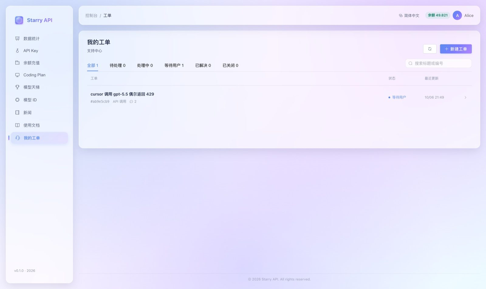
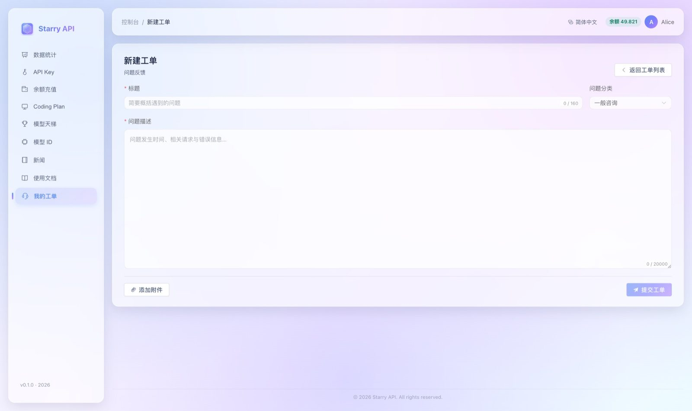
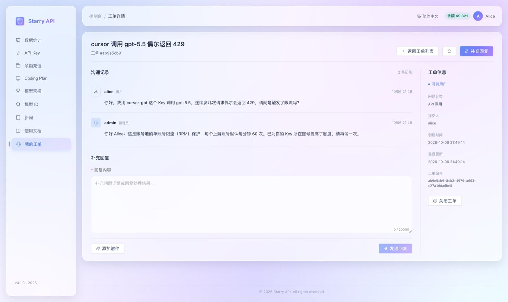
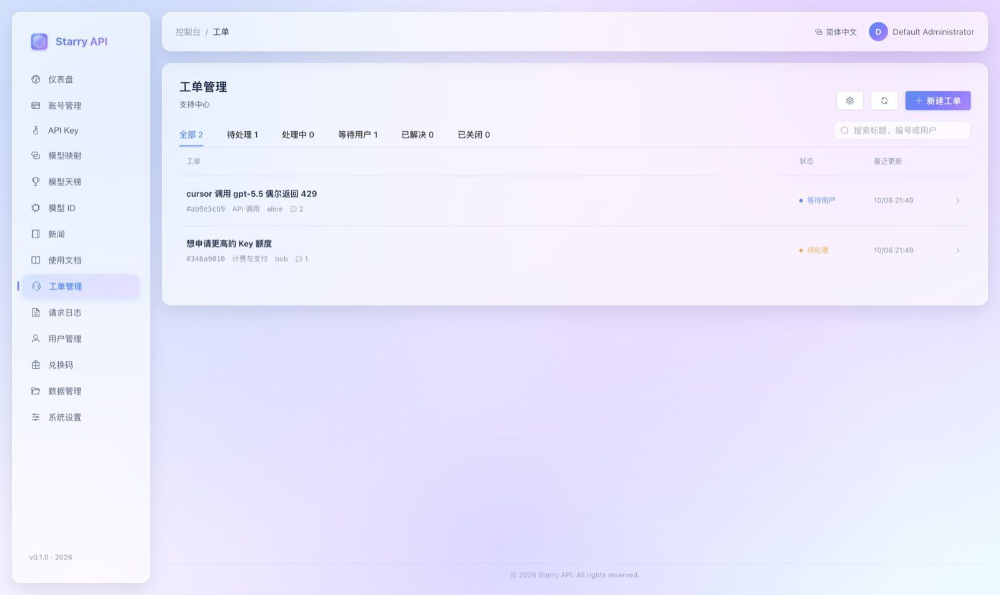
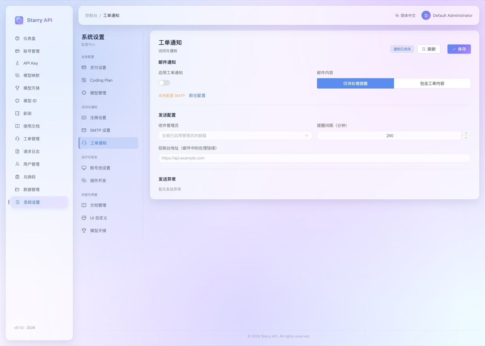

# 工单系统

工单系统让用户在控制台里向管理员提问、上传截图和日志，管理员在同一个地方回复和跟踪，全程不需要离开控制台，也不需要额外的文件存储。

## 一分钟了解

| 角色 | 入口 | 能做什么 |
| --- | --- | --- |
| **普通用户** | 左侧菜单「我的工单」 | 新建工单、上传附件、看回复、补充问题、关闭或重新打开工单 |
| **管理员** | 左侧菜单「工单管理」 | 看所有用户的工单；按状态筛选；按标题 / 编号 / 用户名搜索；回复并设置处理状态 |
| **管理员** | 「系统设置 → 工单通知」 | 配置邮件提醒（默认关闭） |

工单详情有固定链接 `/#/tickets/{工单ID}`，但打开它仍然要求登录，并且只有工单的提交人和管理员能看。

---

## 用户怎么提交工单

### 1. 打开「我的工单」



列表里能看到自己提交过的所有工单、当前状态和最近更新时间，也可以按状态筛选。点右上角新建。

### 2. 填写并提交



- **标题**：最多 160 字，一句话说清问题。
- **问题分类**：一般咨询、API 调用、计费与支付、账号问题、问题反馈。
- **正文**：最多 20000 字，按**纯文本**显示（不会渲染 HTML）。
- **附件**：最多 3 个，每个不超过 2 MiB，不能是空文件。适合放截图、日志。

> 提交失败时，你填的正文和待上传的附件都会保留，不用重写。

### 3. 看回复、补充问题



工单详情页分为三块：

- 左侧是**沟通记录**，用户和管理员的每次回复按时间排列，附件可以下载。
- 下方是**补充回复**编辑区，可以继续追问或回复处理结果。
- 右侧是**工单信息**：状态、分类、提交人、创建与更新时间、完整的工单编号，以及「关闭工单」按钮。

要点：

- 管理员回复后，工单会变成「**等待用户**」，轮到你回复了。你回复后又变回「待处理」。
- **已解决**和**已关闭**的工单需要先**重新打开**才能继续回复。
- 如果你有没发送的内容却想离开页面，浏览器会提醒你确认。草稿只保存在当前页面内存里，刷新后不会恢复。

---

## 管理员怎么处理工单



管理员在「工单管理」里看到全部用户的工单。进入某张工单后：

1. 阅读用户的描述和附件。
2. 在「补充回复」里写回复。发送时可以**选择回复后的状态**；不选的话默认设为「等待用户」。
3. 问题解决了就标记「已解决」，或者直接「关闭工单」。

### 工单状态怎么流转

| 谁做了什么 | 工单变成 |
| --- | --- |
| 用户新建工单 | 待处理（`OPEN`） |
| 管理员开始处理 | 处理中（`IN_PROGRESS`） |
| 管理员回复 | 等待用户（`WAITING_USER`），发送时也可以选别的状态 |
| 用户补充回复 | 待处理（`OPEN`） |
| 管理员确认完成 | 已解决（`RESOLVED`） |
| 用户或管理员关闭 | 已关闭（`CLOSED`） |
| 用户重开已解决 / 已关闭的工单 | 待处理（`OPEN`） |

权限边界：

- 普通用户**不能**把工单标记成「处理中」「等待用户」「已解决」，也不能访问别人的工单、回复或附件（访问他人的工单会表现为 404）。
- 回复和状态修改都要带当前的**版本号**。两个人同时改同一张工单时，后到的会收到 `409` 冲突提示，页面会刷新工单并**保留你没发出去的回复**。

---

## 邮件通知

默认**不发邮件**。需要时，管理员在「系统设置 → 工单通知」里开启：



**开启前提**：先在「SMTP 设置」里配好发件邮箱，并且至少有一位**已启用**的管理员填写了邮箱。

| 设置项 | 说明 |
| --- | --- |
| 收件人 | 只能从已启用的管理员邮箱里选；**留空表示所有已启用管理员**。发送时会重新检查，被禁用的管理员不会再收到 |
| 通知内容（仅提醒 `SUMMARY`） | 邮件包含工单编号、标题、提交人和状态，**不含**正文和附件 |
| 通知内容（含正文 `CONTENT`） | 包含最初的问题、最近 9 条记录和附件名称，**不含**文件本身 |
| 提醒间隔 | 默认 240 分钟，允许 15 分钟到 7 天 |
| 控制台地址 | 可选。填了以后邮件里会附上工单直达链接；不会从请求的 Host 自动推断 |

通知规则：

- 新工单、用户回复、重开工单会触发「待发送」。后台默认**每 30 秒**检查一次，每批最多处理 5 张。
- 「待处理」「处理中」的工单会**持续按间隔提醒**；「等待用户」「已解决」「已关闭」则停止提醒。
- 短时间内的多次更新会**合并成一封**，不是每条回复一封。
- 关闭通知期间，待处理状态会保留；重新启用后会处理到期的工单。
- 发送失败会指数退避重试（从 30 秒起，最长 6 小时），重启服务后继续。设置页会显示最近 20 张工单的发送错误，并提供**手动重试**。

注意事项：

- SMTP 本身只能保证「至少尝试一次」：对端已收到但响应丢了、进程在确认前崩溃等情况，可能产生**重复邮件**，无法撤回。
- 本功能**不接收邮件回复**，也不给普通用户发回复提醒——沟通都在控制台内完成。

---

## 限制与存储（运维必读）

**附件与请求**

| 项 | 限制 |
| --- | --- |
| 每次提交 / 回复的附件 | 最多 3 个，每个 ≤ 2 MiB，整个请求 ≤ 7 MiB |
| 并发 | 单实例同时最多接收 4 次提交 / 回复，超出返回 `429` |
| 标题 / 正文 | ≤ 160 字 / ≤ 20000 字 |
| 每用户频率 | 每天最多新建 20 个工单；同时最多 20 个未解决；每分钟最多 20 次提交 / 状态操作 |
| 单张工单 | 达到 200 条记录后不再接收新回复（仍可改状态），长问题请新建工单 |
| 每个上传者的历史附件总量 | ≤ 100 MiB，管理员也适用 |

**存储与安全**

- 附件直接存在 PostgreSQL 的 `BYTEA` 字段里，与工单、消息**同一个事务**提交，失败会回滚，不会产生孤立文件。**不需要额外的文件卷或 Redis**。
- 附件会随数据库一起备份，同时会增加数据库和备份体积。这套系统适合以截图、日志为主的小规模支持场景；长期大规模使用建议后续迁移到私有对象存储并加上归档策略。
- 第一版**不自动清理**历史记录，也没有附件清理界面；需要扩容 / 归档时由运维处理。
- 附件只能通过**需要登录**的接口下载，强制 `application/octet-stream`、`Content-Disposition: attachment`、`nosniff`、`no-store`；文件名会去掉路径和控制字符；服务器不会执行或解压附件。

**调度参数**（环境变量，默认值见下表）

| 环境变量 | 默认值 | 作用 |
| --- | --- | --- |
| `STARRY_TICKETS_NOTIFICATION_POLL_INTERVAL` | `PT30S` | 通知调度的检查间隔 |
| `STARRY_TICKETS_NOTIFICATION_INITIAL_DELAY` | `PT30S` | 启动后第一次检查前的延迟 |

---

## 开发者备注

- 数据库表由 Flyway `V19__support_tickets.sql` 创建：`support_tickets`、`support_ticket_messages`、`support_ticket_attachments`。
- **迁移编号约定**：`V17`（公告）、`V18`（公告权限）已在已部署库中使用，**必须保留原始脚本和校验和**，工单迁移从 V19 起。不要改动或重新编号已发布的迁移。
- 运行时数据库角色只对工单主表有 `UPDATE` 权限；回复和附件是只读 / 追加。
- 数据库恢复校验要求当前版本完整的迁移历史（当前为 **V1–V31**），旧备份需先在隔离环境升级到相同版本再迁移，不能绕过校验。
- 通知任务使用 PostgreSQL 行锁、`SKIP LOCKED` 和 5 分钟租约领取，不会被多个实例重复发送，但项目整体依然是**单实例**部署模型；通知也遵守系统维护开关。
- 发送邮件在阻塞的工作线程里进行，不占用 WebFlux 事件线程，也不持有数据库事务。

**测试**

```bash
./gradlew test -PskipWebuiBuild=true
npm --prefix webui run build
```

数据库集成测试 `TicketDatabaseIntegrationTest` 默认跳过。它只能在独立的测试库上运行：设置 `TICKET_DATABASE_TESTS=true`、`POSTGRES_DATABASE=starry_ticket_test`（可带 `_v19` 等小写字母 / 数字 / 下划线后缀）、`POSTGRES_PORT=55438`。该测试会关闭测试库中已有的工单，**不能指向业务库**。浏览器冒烟脚本见 `webui/scripts/ticket-browser-smoke.cjs` 和 `ticket-ui-smoke.cjs`（需要 Playwright，仅访问本地预览端口）。
