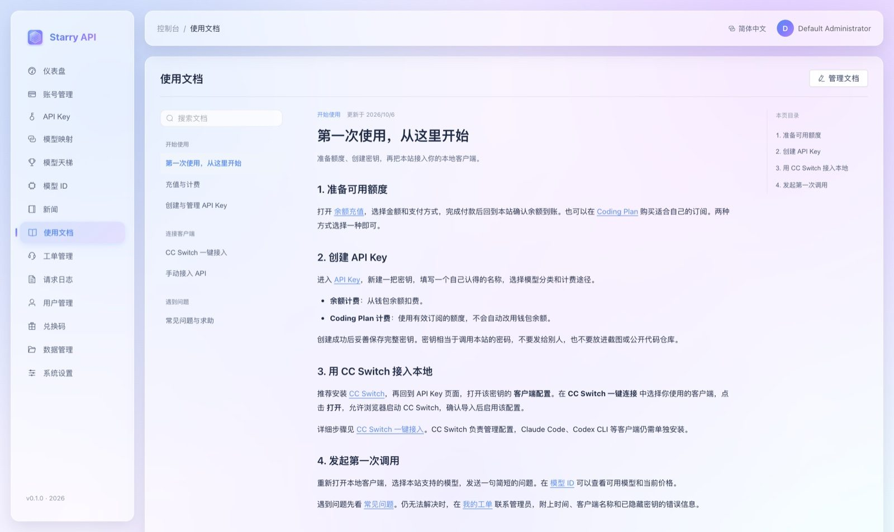
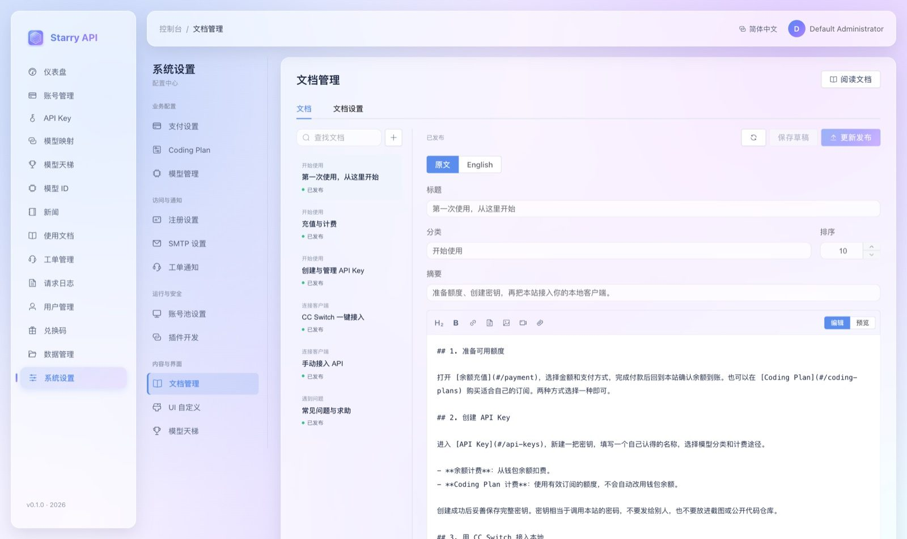

# 用户文档系统

控制台内置了一个「使用文档」系统：管理员可以在线编写教程，所有登录用户都能阅读。适合放上手指南、客户端接入教程、计费说明和常见问题，不用另外搭文档站。

## 读者怎么看

登录后，点左侧菜单 **使用文档**（`/#/documentation`）：



读者页的功能：

- 左侧是**分类目录**和**全文搜索**；右侧是**本页目录**；文章底部有上一篇 / 下一篇导航。
- 文章里可以有站内链接，如 `#/api-keys`，点击直接跳转到对应页面。
- 如果配置了 Apifox，页面上会出现 **API 参考** 入口，见下文。
- 管理员还会在右上角看到「管理文档」按钮。

### 默认内容

系统自带 **14 篇**中英文双语的教程，装好就能给用户用。它们是写给**普通用户**看的，只讲会用到的操作，不含部署、运维和管理员的操作：

| 分类 | 教程 |
| --- | --- |
| 开始使用 | 第一次使用，从这里开始 · 认识控制台 · 充值与计费 · 使用 Coding Plan 订阅 · 创建与管理 API Key · 选择模型与查看价格 |
| 连接客户端 | CC Switch 一键接入 · 手动配置 Claude Code · 手动配置 Codex CLI · 手动配置 OpenCode · 手动接入 API |
| 遇到问题 | 错误码速查 · 常见问题与求助 · 如何提交工单 |

它们优先引导用户走「API Key → 客户端配置 → **CC Switch 一键连接**」，并明确区分「余额计费」和「Coding Plan 计费」（订阅用完**不会**自动动用钱包）。

这些都是普通的、可编辑的文档：

- 你改过的内容，升级和重启都**不会**被覆盖；你下线或删除的教程，也**不会**被重新发布。
- 升级到带有新教程的版本时，**还没被改过**的旧教程会更新成新版；改过的保持原样（包括只保存了草稿、已下线或已删除的）。
- 新增的教程会在升级时**一次性**加入。如果你不想要某一篇，下线或删除它即可，之后不会再回来。
- V30 起，「创建与管理 API Key」「选择模型与查看价格」「错误码速查」和三个客户端教程（手动配置 Claude Code、Codex CLI、OpenCode）讲了号源分级：Key 的**号源偏好**、客户端配置里的**号池**、模型页的 `模型@标识` 写法，以及相关的错误码（其中「错误码速查」里 `403` 一行原来只讲模型分类，现在也讲 `SOURCE_TIER_NOT_SELECTABLE`）。这六篇照上面的规则更新：你改过的保持原样，需要时请自己把新增的内容补进去（原文在 `V30__documentation_source_tiers.sql` 里）；没配置号源分级的站点，这些内容里的功能不会出现，读者可以跳过。
- 默认教程里的占位符 `{{site_url}}` 和 `{{api_base_url}}` 会替换成读者浏览器当前的站点地址，所以换了域名也不用改文档。

> 默认教程是文字版，不带截图——附件文件存放在磁盘上，没法随数据库迁移一起发布。想给某一篇配图，在编辑器里用「图片」按钮上传，见下文「图片、视频与附件」。

---

## 管理员怎么编辑

路径：**系统设置 → 文档管理**（`/#/settings/documentation`）。普通用户不能调用管理接口。



### 基本操作

- **新建文档**：可选「空白」「操作指南」「客户端接入」「常见问题」四种模板。
- **设置元信息**：标题、分类、摘要、排序（数字小的靠前）。
- **Markdown 工具栏**：标题、加粗、链接、代码、图片、视频、附件；编辑与预览可切换。
- **保存草稿** vs **发布**：保存草稿**不会**影响读者正在看的内容；点「发布 / 更新发布」才会替换线上版本。
- **下线**：保留草稿，但读者看不到。
- **删除文档**：逻辑删除——停止展示、撤销附件的读者访问，但数据库记录和文件保留，**当前界面不提供恢复入口**。

### 防止互相覆盖

保存、发布、下线、删除都会检查版本号。两个人同时编辑时，后保存的会收到 `409 DOCUMENTATION_CONFLICT`，**不会覆盖对方的修改**。看到冲突提示时，先把自己没保存的正文复制出来，刷新后再合并。

编辑器里有未保存的正文或设置时，离开页面会提示确认。

### 容量限制

最多 **200 篇**有效文档，每篇正文最多 **100,000** 字符。

---

## 写作语法

### Markdown、链接和代码

- 普通 Markdown 链接支持 HTTP/HTTPS、邮箱地址，以及 `#/api-keys` 这类站内路径。外部网页在新标签页打开，并带 `noopener noreferrer`。
- 围栏代码可以标注语言：`bash`、`json`、`python`、`javascript`、`typescript`、`toml`、`yaml`、`http`、`sql`、`xml`、`css`、`text`。没标注且比较短的代码会尝试自动识别；识别不了就按纯文本显示。**复制按钮复制的是原始代码**，空格和换行都保留。

### 占位符

正文里可以写：

| 占位符 | 会被替换成 |
| --- | --- |
| `{{site_url}}` | 读者当前浏览器的站点地址 |
| `{{api_base_url}}` | 上面的地址 + `/v1` |

> 这要求你的反向代理同时转发 API 路径。示例里只用密钥和模型的占位符，**不会**自动嵌入用户的真实密钥。

### 安全限制

原始 HTML、脚本、`iframe` 和可执行协议都不开放，Markdown 输出会经过 DOMPurify 清理。**不要**通过粘贴网页 HTML 嵌入视频，请使用「视频上传」入口。

---

## 图片、视频与附件

| 项 | 规则 |
| --- | --- |
| 支持的类型 | 图片：PNG / JPG / JPEG / GIF / WebP；视频：MP4 / WebM；文件：PDF / ZIP / TXT / JSON / Markdown |
| 大小 | 单个 ≤ 64 MiB；每篇 ≤ 20 个、合计 ≤ 256 MiB；整个实例同时最多 2 个上传 |
| 反向代理 | 请求体限制至少要 **65 MiB**，例如 Nginx 的 `client_max_body_size 65m;` |

**怎么插入**：上传后会自动插入 `attachment:<UUID>` 引用：

```markdown
          # 图片、视频
[下载 xxx.pdf](attachment:<UUID>)        # 其他文件
```

**不要**把预览时看到的临时下载地址贴进正文，那种链接会过期。

**安全与权限**

- 图片和视频会校验扩展名和文件头；上传流直接写盘，失败或取消时清理未完成的文件。视频用浏览器原生播放器，支持 HTTP Range 分段读取，能不能播放还取决于浏览器支持的编码。
- 草稿里的附件只有管理员能拿到访问链接；普通用户只能拿到**已发布正文引用**的附件链接。
- 链接是**有效期一小时的临时签名地址**，不含登录令牌。持有链接的人在有效期内都能访问，所以**不要把敏感文件传到面向所有用户的文档里**。下线或删除文档后，服务端会立刻拒绝读者链接，即使签名没过期。
- 服务重启后旧签名失效，重新打开文档即可拿到新链接。签名密钥保存在单实例内存里，**不适用于没有粘性路由的多实例部署**。
- **删除附件**前，要先从草稿和已发布正文里移除引用并保存 / 更新发布。删除附件会真的删文件，**无法在界面里撤销**。删除整篇文档**不会**自动删除文件（避免误删后无法恢复）；没被引用的、以及逻辑删除文档的文件需要运维结合数据库记录自行清理，目前没有自动清理任务。

---

## Apifox 配置

在 **文档管理 → 文档设置** 里填入已发布的 Apifox 文档链接，读者页就会出现「API 参考」入口。支持 Apifox 默认域名和自定义 HTTP / HTTPS 域名；留空则隐藏入口。本站**不会**代理、同步或代登录 Apifox 的内容。

---

## 备份与持久化（运维必读）

- 数据库保存正文、发布快照、版本号和附件**元数据**。
- 附件**文件**存放在 `STARRY_DOCUMENTATION_ATTACHMENT_DIR`（默认 `${user.home}/.starry-api/documentation`）。两套 Compose 配置都把 `./data/documentation` 挂载到容器的 `/app/documentation`。
- ⚠️ **数据库备份不包含附件文件**。完整备份要在**暂停文档写入**期间，同时备份数据库和附件目录，恢复时也要配套恢复两者，并保证运行用户有读写权限。
- 不要把附件目录直接当公开静态目录暴露出去。
- 当前 V1–V32 已纳入数据管理的备份恢复校验；旧版本数据库的备份仍会被严格的版本策略拒绝，需先在匹配版本里恢复并升级。
- 操作日志会记录文档创建、保存、发布、下线、删除、附件上传 / 删除的操作者、文档 ID、版本或大小，**不记录**正文、密钥和签名 URL。

---

## 开发者备注

```bash
./gradlew :service:test --tests 'tech.starryapi.documentation.*' --tests tech.starryapi.admin.DataTransferServiceTest
npm --prefix webui run test:documentation
npm --prefix webui run build
```

数据库测试优先使用 `STARRY_DOCS_TEST_JDBC_URL` 指向的独立测试库（需先用 `postgresql/init-test-roles.sql` 初始化角色）；没配置时用 Testcontainers PostgreSQL 17。没有 Docker 或独立数据库时会明确跳过，**不会连接真实站点的数据库**。

测试覆盖：草稿 / 发布隔离、乐观并发冲突、上传总量并发校验、读者附件权限与撤销、管理员访问、请求大小、文件头 / 路径 / 签名、视频 Range、Markdown 注入过滤、代码原文复制、链接隔离、站点占位符。

双语文档（原文 / English）见 [中英文界面](INTERNATIONALIZATION.md)。
